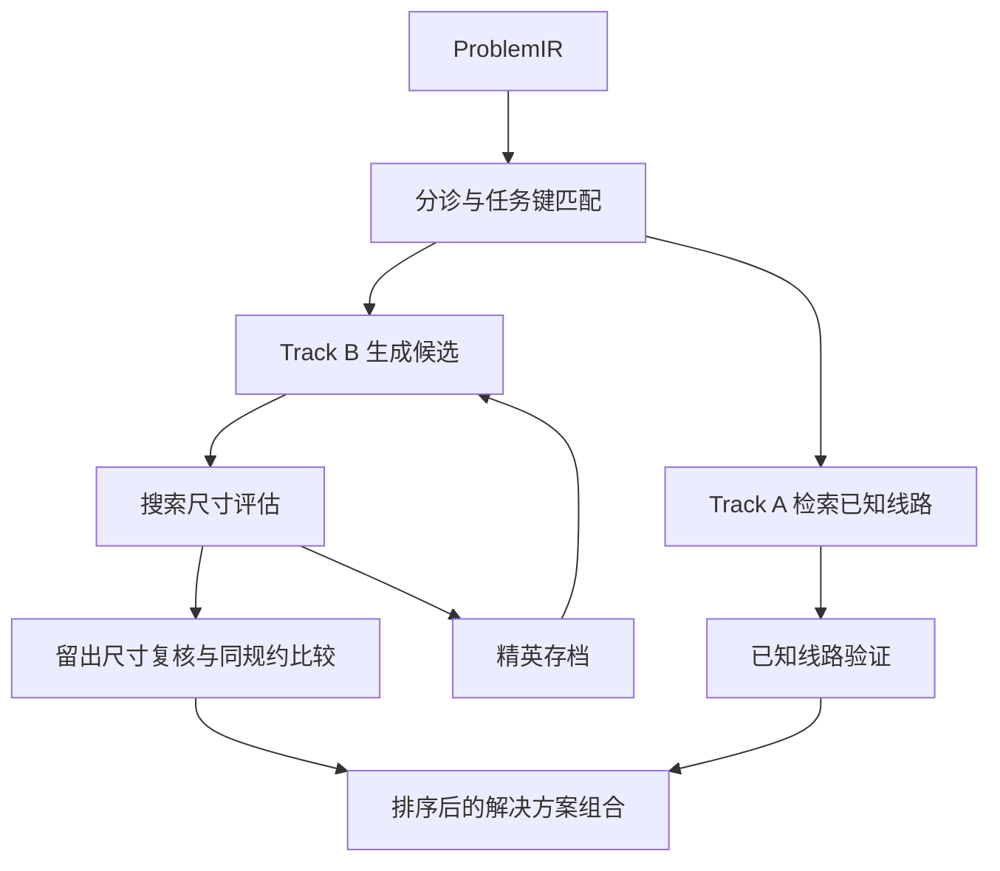
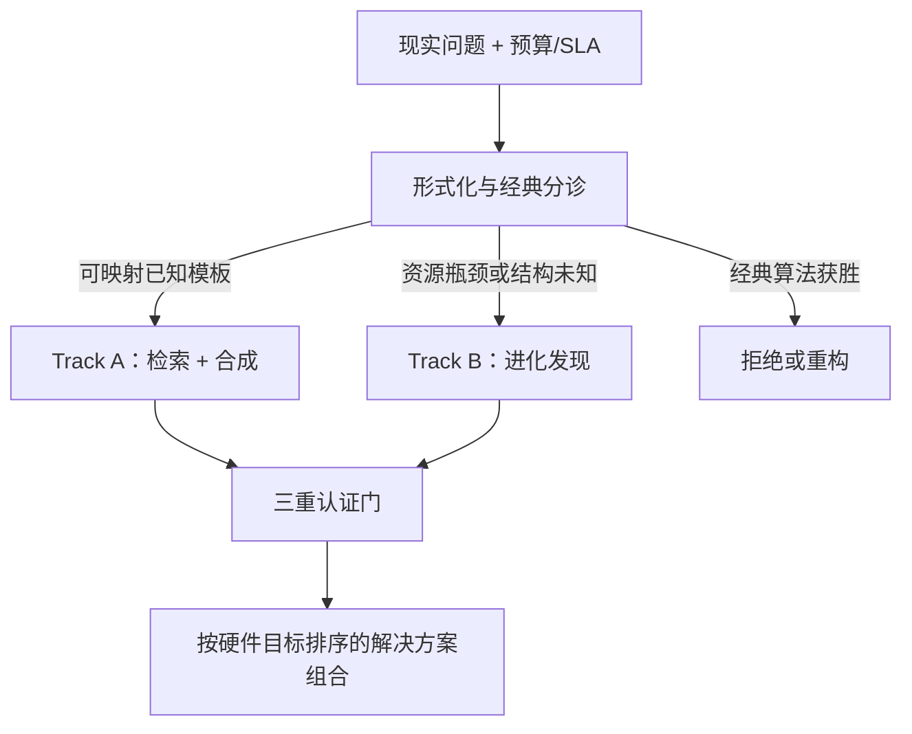

# 量子算法创造者（Quantum Algorithm Creator）

这个仓库是一个可运行的量子线路“发明助手”。它做三件事：

1. **检索**已知的可逆算术构造（Track A）；
2. **搜索**同一功能下更省资源的参数化线路（Track B）；
3. 用**确定性机器检查**判断某条线路是否“正确、有价值、结构上新”（三重条件），只有全部通过才允许称为一项成果。

所有结论都由代码现场跑出来，不靠口头声明。当前实现是纯 Python 标准库 + numpy，测试共 **125 项**（`tests/test_qac.py` 106 项 + `tests/test_evolution.py` 19 项），全部通过。

**本轮结果。** 在 12 个同规约基线之上，机器认证了 **12 条新构造**：多数阈值、加权阈值、定值比较、常数加法，以及本轮新增的四个“顶写族”——受控增量器、取负器、汉明重量计数器、比较器（见[四个顶写族新构造](#四个顶写族新构造)）。在 `n=10` 的加权阈值任务上，低位优先构造把 Toffoli 数从同门集固定宽度基线的 **227** 降到 **93**，逻辑深度从 **336** 降到 **146**，宽度为 **21**。四个新族每一族都在每个验证尺寸上严格占优其同规约教科书实现。

## 目录

- [快速开始](#快速开始)
- [这个系统做什么](#这个系统做什么)
- [机器验证的成果一览](#机器验证的成果一览)
- [增量器与减法器：顶写推导与对偶](#增量器与减法器顶写推导与对偶)
- [四个顶写族新构造](#四个顶写族新构造)
- [五个进化构造详解](#五个进化构造详解)
- [常数加法器：顶写融合](#常数加法器顶写融合)
- [完整逐尺寸实测](#完整逐尺寸实测)
- [独立 Qiskit 复核](#独立-qiskit-复核)
- [发现与认证机制](#发现与认证机制)
- [十二种已知构造目录](#十二种已知构造目录)
- [对照文献 SOTA](#对照文献-sota)
- [真实案例：AI 发现的新算法](#真实案例ai-发现的新算法)
- [相关研究](#相关研究)
- [路线图与阶段计划](#路线图与阶段计划)
- [工程护栏](#工程护栏)
- [仓库结构](#仓库结构)
- [许可与引用](#许可与引用)

## 快速开始

需要 Python 3.10 或更高版本。在仓库根目录执行：

```bash
python3 -m qac.cli                                   # 端到端演示
python3 -m qac.cli audit --sizes 1,2,3,4,5,6,7,8     # 复核两种历史增量器
python3 -m qac.cli search majority --seed 7 --holdout 6,7,8,10
python3 -m qac.cli search weighted_threshold --seed 7 --holdout 6,7,8,10
python3 -m qac.cli search less_than --seed 7 --holdout 6,7,8,10
python3 -m pytest tests/ -q                          # 125 项测试
```

可选的真实 Qiskit 交叉复核（独立虚拟环境即可）：

```bash
python3 -m pip install qiskit==2.6.2
python3 -m benchmarks.qiskit_crosscheck
```

`search` 默认在 `n=3,4,5` 上打分；`--batches` 限制搜索轮数（每轮最多评估两个候选）；`--holdout` 指定与搜索尺寸互斥的验证集；`--json` 输出父代、变异、候选参数、淘汰原因和逐尺寸资源。

## 这个系统做什么

系统按“先检索、再搜索、最后严格验证”的顺序工作。目标不是让模型写出一段看起来像量子线路的代码，而是让每条交付的线路都能被独立复算。



| 层 | 当前实现 | 设计目标 |
| --- | --- | --- |
| 1. 问题形式化与分诊 | `problem.py` 接收类型化 IR，`portfolio.py` 检查任务类别与键。对“一次性 O(N) QRAM 加载 + 二次查询加速”的组合给出拒绝理由。 | 把现实问题映射成 Ising/HUBO、稀疏线性系统、哈密顿量或预言机，并用经典基线估算端到端交叉点。 |
| 2A. 已知方案 | `library.py` 提供 12 个参数化构造与规约，`sota_baselines.py` 提供文献参考。 | 检索算法库与文献，合成振幅放大、QPE、QSVT 等模板，后续导出 Qmod 或 Qualtran Bloq。 |
| 2B. 发现与优化 | `track_b.py`、`arithmetic.py` 生成候选并迭代变异，保留谱系与失败轨迹。 | 扩展线路语法、并行评估与受约束的 LLM 提议，探索分支解码、生命周期分析和反算复用。 |
| 3. 验证与资源 | `sandbox.py`、`kickmix.py` 检查语义、相位和辅助位，`novelty.py` 出具逐尺寸基线回执。 | 增加 Stim 稳定子、张量网络与容错资源模型（T 工厂、码距、物理时空成本）。 |
| 4. 交付 | `portfolio.py` 返回线路构造器、报告和 `known` / `optimized` 来源标签，`cli.py` 提供复现命令。 | 按硬件预算排序，输出可编译线路、比较曲线和适用约束。 |

`ProblemIR` 有已知模板且未标瓶颈时只走 Track A；`notes["resource_bottleneck"]=True` 会同时纳入已知实现与候选改进；缺少 `known_template` 时进入必要性模式，此时仍须由 `notes["library_key"]` 指定可执行规约，找不到合格候选就回退到已验证的同规约参考。

### Track B：怎样搜索新线路

进化引擎依赖四个机制：

1. **尺寸参数化生成**：候选必须是“以 n 为参数、能推广到任意规模”的生成函数，不允许写死某个比特数的静态线路。只在 `n=2..5` 的小实例上评估，代价极低，却可以归纳到任意 n。
2. **逆计算感知的结构改造**：奖励修改底层结构——分支解码（从当前寄存器状态恢复历史选择而不存储历史）、跳石式比特复用、共享算术单元、有界失败预算。
3. **多保真度快速评估器**：按线路类别分流。可逆/相位反冲（“Kickmix”）模拟器在毫秒级处理几十到上百比特的可逆算术；“小 n 精确态矢量”用于全干涉与非 Clifford 结构。
4. **岛屿模型进化记忆**：按空间（峰值比特）与时间（Toffoli/深度）的帕累托权衡划分存档格，把精确断言失败、辅助位纠缠索引等诊断回灌给提议器。

### 推荐技术栈（2026）

| 层 | 工具 | 角色 |
| --- | --- | --- |
| 智能体编排 | LangGraph / Ray + Pydantic 工具模式 | 有环的 Maker-Checker 状态图；并行数千个线路评估 |
| 推理与编码 | 前沿模型（规划、变异）+ 小型微调模型（执行） | 大模型负责归约与新结构；小模型负责样板转译与语法修复 |
| 知识与检索 | Neo4j + 向量库（量子算法动物园、quant-ph、QCircuitBench） | 问题类 → 归约 → Oracle 假设 → 复杂度与参考代码 |
| 高层线路 IR | Google Qualtran、Classiq Qmod | 类型安全、自动逆计算、无冗余资源计数 |
| 编译与混合计算 | Qiskit v2.x、PennyLane、CUDA-Q | 硬件原生门合成、Clifford 提取、GPU 加速 |
| 验证与快速模拟 | 本仓库 Kickmix、Google Stim、TensorNetwork | 可逆逻辑、Clifford/QEC、小 n 态矢量的快速正确性验证 |
| 容错资源估算 | Qualtran Bloq + Q#/Azure 估算器 | T 工厂开销、逻辑误差预算、码距、物理比特·小时 |

## 机器验证的成果一览

下表每一项都由 `qac/novelty.py::certify_innovation` 现场签发证书。判定分三步，全部通过才记 `certified=True`：

- **正确**：在多个尺寸上对每个输入穷举态矢量，输出等于目标值、辅助位归零、振幅恰为 `+1`；
- **有价值**：在每个验证尺寸上，四条资源轴（宽度 W、Toffoli T、门数 G、深度 D）都不差于每个同规约基线，且至少一轴严格更优；
- **结构上新**：门序列指纹与同规约基线都不同（不是把已知线路换个写法）。

| 构造（`candidate_id`） | 功能 | 证书 | 同规约基线 | 严格更优的轴 |
| --- | --- | --- | --- | --- |
| `optimized:majority:1-1-0-input-overflow` | 多数阈值（偏置溢出标记） | certified | `known:majority-vote`、`reference:fixed-width-majority` | W、T、G、D |
| `optimized:majority:1-1-0-input-ripple` | 多数阈值（范围累加后比较） | certified | 同上 | T、G、D（W 持平） |
| `optimized:weighted_threshold:1-1-0-low_first-ripple` | 加权阈值（低位优先） | certified | `known:weighted-threshold`、`reference:fixed-width-weighted` | W、T、G、D |
| `optimized:weighted_threshold:1-1-1-low_first-ripple` | 加权阈值（同权配对） | certified | 同上 | W、T、G、D |
| `optimized:less_than:1-0` | 定值比较（末级直写） | certified | `known:lessthan-borrow` | W、T、G、D |
| `invented:topwrite_addconst` | 常数加法 `x → (x+n) mod 2^n` | certified | `known:addconst-carry`、`sota:cdkm-addconst` | W、T、G、D |
| `invented:topwrite-ctrl-increment` | 受控增量 `(x,q) → (x+q mod 2^n, q)` | certified | `known:ctrl-increment-ripple` | W、T、G、D |
| `invented:topwrite-negate` | 取负 `x → (−x) mod 2^n` | certified | `known:negate-wrap` | W、T、G、D |
| `invented:topwrite-popcount` | 汉明重量计数 `c → (c + popcount(x)) mod 2^m` | certified | `known:popcount-ripple` | W、T、G、D |
| `invented:compare-carry` | 比较 `flag ^= [x < y]` | certified | `known:compare-ripple` | G（W/T/D 持平） |

每一行的完整逐尺寸资源表都在[四个顶写族新构造](#四个顶写族新构造)与[五个进化构造详解](#五个进化构造详解)中，认证回执由 `qac/inventions.py` 与 `tests/test_qac.py` 现场签发。

> **回执怎么读。** `certified=True` 只说明“在这批基线和这些尺寸内”通过了三项检查。它不是“全世界第一个”的证明：证书里的 `literature_status` 目前是 `unassessed`，发表意义上的首创性需要另行审查。若某个功能没有任何同规约基线，证书会返回 `unbenchmarked`，只报告语义检查结果。

## 增量器与减法器：顶写推导与对偶

这一节给出“顶写”这一核心推导的来源：增量器的进位链怎样被压到理论下限，以及减法器怎样由同一条链整体倒序直接得到。门级细节、资源数和验证边界在这里完整摊开，任何人都能复算。

### 契约与基线

两种历史构造实现的动作相同：

```text
|x, 0^a⟩  ↦  |x + 1 mod 2^n, 0^a⟩
```

`x` 是 `n` 位数据寄存器，`a` 是若干工作位。要求：用完工作位后全部回到 `|0⟩`，且每个基态支路振幅保持 `+1`（不引入相对相位）。三项缺一不可，语义检查逐项核对。

与最原始的“原前缀链”基线相比，两者省掉的都是进位链上的冗余：

- 原前缀链先把 `b_0` 复制到工作位，再另存一个最高位进位；
- Lean 丢掉“复制 `b_0`”，让 `b_0` 直接参与链；
- Top-Write 丢掉“另存最高位进位”，把该进位直接写回最高数据位。

### 门级规则

设数据位 `b_0 … b_{n-1}`，工作位 `s_2 … s_{n-2}`。目标是每位做 `b_i ← b_i ⊕ A_i`，其中

```text
A_0 = 1
A_i = b_0 ∧ b_1 ∧ … ∧ b_{i-1}        (i ≥ 1)
```

所有三元门与受控门都自逆，因此先**按降序**翻转，使每次翻转读到的 `A_i` 仍是“加 1 之前”的低位与，最后按升序还原链。Lean 伪代码：

```text
n = 1: X(0)
n = 2: CX(0,1), X(0)
n ≥ 3:
    CCX(0, 1, s_2)
    for i = 3 .. n-1:  CCX(s_{i-1}, i-1, s_i)          # 升序建链
    for i = n-1 .. 3 (降序):
        CX(s_i, i);  CCX(s_{i-1}, i-1, s_i)            # 先翻转 b_i，再撤 s_i
    CX(s_2, 2);  CCX(0, 1, s_2)
    CX(0, 1);  X(0)
```

Top-Write 只把链建到 `s_{n-2}`，再用一个三元门 `CCX(s_{n-2}, n-2, n-1)` 把最高进位直接写进 `b_{n-1}`，省掉一个工作位。`n=3` 时它即 `CCX(0,1,2), CX(0,1), X(0)`。

`n=5` 完整门序列：

```text
Lean      CCX(0,1,5) CCX(5,2,6) CCX(6,3,7) CX(7,4) CCX(6,3,7)
          CX(6,3)   CCX(5,2,6) CX(5,2)   CCX(0,1,5) CX(0,1) X(0)
Top-Write CCX(0,1,5) CCX(5,2,6) CCX(6,3,4) CX(6,3) CCX(5,2,6)
          CX(5,2)   CCX(0,1,5) CX(0,1)   X(0)
```

### 逐尺寸资源（宽度 / Toffoli / 门数 / 深度）

| n | 原前缀链 | Lean | Top-Write | 共享前缀 | CDKM 常数寄存器 |
|---|---|---|---|---|---|
| 1 | 1/0/1/1 | 1/0/1/1 | 1/0/1/1 | 1/0/1/1 | 3/2/8/7 |
| 2 | 3/0/4/4 | 2/0/2/2 | 2/0/2/2 | 2/0/2/2 | 5/4/14/12 |
| 3 | 5/2/7/7 | 4/2/5/5 | 3/1/3/3 | 3/1/3/3 | 7/6/20/17 |
| 4 | 7/4/10/10 | 6/4/8/8 | 5/3/6/6 | 5/3/6/6 | 9/8/26/22 |
| 5 | 9/6/13/13 | 8/6/11/11 | 7/5/9/9 | 7/5/9/9 | 11/10/32/27 |
| 6 | 11/8/16/16 | 10/8/14/14 | 9/7/12/12 | 9/7/12/12 | 13/12/38/32 |
| 7 | 13/10/19/19 | 12/10/17/17 | 11/9/15/15 | 11/9/15/15 | 15/14/44/37 |
| 8 | 15/12/22/22 | 14/12/20/20 | 13/11/18/18 | 13/11/18/18 | 17/16/50/42 |

`n ≥ 3` 两条闭式成本：

| 构造 | 宽度 | Toffoli | 门数 | 深度 |
|---|---|---|---|---|
| Lean | `2n − 2` | `2n − 4` | `3n − 4` | `3n − 4` |
| Top-Write | `2n − 3` | `2n − 5` | `3n − 6` | `3n − 6` |

### 提取出的通用原则：顶写

三种增量器放在一起看，可以读出两条可迁移的构造规则，它们正是后面四个新族共同的基础：

1. **降序受控翻转恒等式**：翻转 `b_i ← b_i ⊕ A_i` 时先按降序做，每次读到的 `A_i` 都还是“加 1 之前”的低位与；随后按升序还原链。链上重复出现的低位与被共享到工作位，即是 Lean 与共享前缀的公共骨架。
2. **顶写（top-write）**：喂给最高数据位的进位是链尾的最后一项，而它落到的那个数据位本来就要被覆盖。于是不必为它另开工作位、再补一个 CNOT、再撤掉工作位——直接用链上的最后一个 Toffoli 把进位写进目标位即可。每族稳定省下 `W−1, T−1, G/D−2`。

参考基线 `reference:shared-prefix-increment` 取共享前缀骨架；Top-Write 在同一骨架上应用第 2 条。代码保留历史 id（`invented:lean_interleaved_increment`、`invented:topwrite_increment`）便于逐尺寸追溯。文献坐标：[Cuccaro 等，quant-ph/0410184](https://arxiv.org/abs/quant-ph/0410184)、[Khattar 与 Gidney，q-2025-05-21-1752](https://quantum-journal.org/papers/q-2025-05-21-1752/)、[Remaud 与 Vandaele，2501.16802](https://arxiv.org/abs/2501.16802)。

### 减法器：同一门表的倒序对偶

减法器 `|x⟩ ↦ |x − 1 mod 2^n⟩` 由一条干净性质直接推出：本系统只用 `{X, CNOT, Toffoli}`，三类门都自逆，所以把门表**整体倒序**得到的正是逆映射，且成本与原线路逐项相同。

于是 `reference:shared-prefix-decrement` 由共享前缀增量器倒序得到，成本与其完全一致。`n=1..13` 固定值：

| n | 1 | 2 | 3 | 4 | 5 | 6 | 7 | 8 | 9 | 10 | 11 | 12 | 13 |
|---|---|---|---|---|---|---|---|---|---|---|---|---|---|
| 宽度 | 1 | 2 | 3 | 5 | 7 | 9 | 11 | 13 | 15 | 17 | 19 | 21 | 23 |
| Toffoli | 0 | 0 | 1 | 3 | 5 | 7 | 9 | 11 | 13 | 15 | 17 | 19 | 21 |
| 门数 | 1 | 2 | 3 | 6 | 9 | 12 | 15 | 18 | 21 | 24 | 27 | 30 | 33 |
| 深度 | 1 | 2 | 3 | 6 | 9 | 12 | 15 | 18 | 21 | 24 | 27 | 30 | 33 |

这个对偶在 `n=1..8` 穷举验证语义正确，并与共享前缀增量器在 `n=1..13` 逐尺寸指纹相同——这正是倒序构造应有的结果，也给出减法器的零额外成本实现。它同时对旧的填充式减法基线 `known:decrement-wrap` 严格占优（`n=8`：宽度 13 < 15，门数 18 < 38，深度 18 < 24，Toffoli 11 < 12），因此登记为同规约基线，并由测试 `TestDecrementDualAudit` 钉住这一对偶关系。

### 为什么必须逐基态核对

可逆性、工作位清洁度、相位为 `+1` 都是“合法线路”的必要条件，但都不足以说明它实现了目标函数：一个自逆置换、清空工位、振幅全 `+1` 的线路完全可能是在做别的双射。因此认证门的第一项检查就是对**每个基态输入**逐一核对输出映射（`qac/sandbox.py` 的状态向量检查），资源比较只在语义通过之后才开始。

## 四个顶写族新构造

把[顶写原则](#提取出的通用原则顶写)应用到四个不同的算术契约上，得到四个新族。每个族都用 `Candidate.implementation` 绑定到已有库契约，因而与其教科书实现共享**同一个函数、同一套比特约定**，只有门序列不同——比较是严格同等条件下的比较。代码在 `qac/inventions.py`，回执由 `tests/test_qac.py` 的四个测试类现场重签。

四族的共同收益：删掉一个进位工作位，并把链尾进位直接写进目标位，每族稳定省 `W−1, T−1, G/D−2`（比较器例外，见下）。

### 受控增量器 `invented:topwrite-ctrl-increment`

契约（`ctrl_increment_spec`）：数据位 `0..n-1` 存 `x`，位 `n` 是控制位 `q`；映射 `(x,q) ↦ (x+q mod 2^n, q)`。

教科书 `known:ctrl-increment-ripple` 为每级进位开 `n-1` 个工作位，最高进位经 CNOT 写入 `x_{n-1}` 后再撤工作位。顶写版只开到 `c_{n-2}`，用最后一个 Toffoli `CCX(n-2, c_{n-2}, n-1)` 直接写死值位，最后一步才是读原始 `x_0` 的 `CNOT(q,0)`。

```text
n = 1: CX(q, x_0)
n = 2: CCX(x_0, q, x_1);  CX(q, x_0)
n ≥ 3:
    CCX(x_0, q, c_1)                              # c_1 = x_0 ∧ q
    for j = 1 .. n-3:  CCX(x_j, c_j, c_{j+1})
    CCX(x_{n-2}, c_{n-2}, x_{n-1})                # 顶写
    for j = n-2 .. 2 (降序): CX(c_j, x_j); CCX(x_{j-1}, c_{j-1}, c_j)
    CX(c_1, x_1);  CCX(x_0, q, c_1)               # 撤 c_1
    CX(q, x_0)                                    # 最后读原始 x_0
```

闭式成本（`n ≥ 3`）：`W = 2n−1, T = 2n−3, G = 3n−4, D = 3n−4`。

| n | 顶写 W/T/G/D | 教科书 W/T/G/D | 严格更优轴 |
|---|---|---|---|
| 1 | 2/0/1/1 | 2/0/1/1 | — |
| 2 | 3/1/2/2 | 4/2/4/4 | W、T、G、D |
| 3 | 5/3/5/5 | 6/4/7/7 | W、T、G、D |
| 4 | 7/5/8/8 | 8/6/10/10 | W、T、G、D |
| 5 | 9/7/11/11 | 10/8/13/13 | W、T、G、D |
| 6 | 11/9/14/14 | 12/10/16/16 | W、T、G、D |
| 7 | 13/11/17/17 | 14/12/19/19 | W、T、G、D |
| 8 | 15/13/20/20 | 16/14/22/22 | W、T、G、D |
| 9 | 17/15/23/23 | 18/16/25/25 | W、T、G、D |
| 10 | 19/17/26/26 | 20/18/28/28 | W、T、G、D |

证书：`correct / valuable / novel` 全部为真，`novelty_verdict = distinct`，独占基线 `known:ctrl-increment-ripple`。逐基态稠密检查 `n=1..7`，`n=1..8` 由 `evaluate_candidate` 覆盖，`n=1..10` 资源表由钉住测试 `TestTopwriteCtrlIncrement` 固定。

### 取负器 `invented:topwrite-negate`

契约（`negate_spec`）：`x ↦ (−x) mod 2^n`。恒等式 `−x = NOT(x) + 1`：教科书把位取反包在整个增量器外面，于是继承了它全部的冗余进位位；顶写版直接复用顶写增量器，只剩两侧的 `X` 包裹。

```text
n = 1: 空线路                     # −x = x mod 2
n ≥ 2: X(0..n-1);  顶写增量器(n);  X(0..n-1)
```

| n | 顶写 W/T/G/D | 教科书 W/T/G/D | 严格更优轴 |
|---|---|---|---|
| 1 | 1/0/0/0 | 1/0/0/0 | — |
| 2 | 2/0/4/3 | 3/0/6/5 | W、G、D |
| 3 | 3/1/6/4 | 5/2/10/8 | W、T、G、D |
| 4 | 5/3/10/7 | 7/4/14/11 | W、T、G、D |
| 5 | 7/5/14/10 | 9/6/18/14 | W、T、G、D |
| 6 | 9/7/18/13 | 11/8/22/17 | W、T、G、D |
| 7 | 11/9/22/16 | 13/10/26/20 | W、T、G、D |
| 8 | 13/11/26/19 | 15/12/30/23 | W、T、G、D |
| 9 | 15/13/30/22 | 17/14/34/26 | W、T、G、D |
| 10 | 17/15/34/25 | 19/16/38/29 | W、T、G、D |

证书：四项判定全真，`distinct`，独占基线 `known:negate-wrap`；`n=2` 起四轴全部严格。

### 汉明重量计数器 `invented:topwrite-popcount`

契约（`popcount_spec`）：数据位 `0..n-1` 存 `x`，`m = ⌈log₂(n+1)⌉` 位计数器在位 `n..n+m-1`；映射 `c ↦ (c + popcount(x)) mod 2^m`。

每个数据位做一次“受控 +1”。教科书为每次加法开 `m-1` 个进位位、并在最高进位上用三个门；顶写版为计数器开 `m-2` 个进位位，最高进位直接写进计数器死值位 `c_{m-1}`。`m=1` 时退化为一个 CNOT，`m=2` 时只剩一个 Toffoli 加一个 CNOT。

```text
对每个数据位 i：
  m = 1: CX(x_i, c_0)
  m = 2: CCX(x_i, c_0, c_1);  CX(x_i, c_0)          # 顶写
  m ≥ 3: CCX(x_i, c_0, g_1); {CCX(g_{j-1}, c_{j-1}, g_j)}
         CCX(g_{m-3}, c_{m-2}, c_{m-1})              # 顶写
         降序: CX(g_{j-1}, c_j); 撤 g_j
         CX(x_i, c_0)
```

| n | 顶写 W/T/G/D | 教科书 W/T/G/D | 严格更优轴 |
|---|---|---|---|
| 1 | 2/0/1/1 | 2/0/1/1 | — |
| 2 | 4/2/4/4 | 5/4/8/8 | W、T、G、D |
| 3 | 5/3/6/6 | 6/6/12/12 | W、T、G、D |
| 4 | 8/12/20/20 | 9/16/28/28 | W、T、G、D |
| 5 | 9/15/25/25 | 10/20/35/35 | W、T、G、D |
| 6 | 10/18/30/30 | 11/24/42/42 | W、T、G、D |
| 7 | 11/21/35/35 | 12/28/49/49 | W、T、G、D |
| 8 | 14/40/64/64 | 15/48/80/80 | W、T、G、D |
| 9 | 15/45/72/72 | 16/54/90/90 | W、T、G、D |
| 10 | 16/50/80/80 | 17/60/100/100 | W、T、G、D |

证书：四项判定全真，`distinct`，独占基线 `known:popcount-ripple`；`n=2` 起四轴严格，`n=10` 时 Toffoli 少 **10 个**、门数少 **20 个**。逐基态稠密检查 `n=1..4`（数据宽度 `n+m`），`n=1..8` 由 `evaluate_candidate` 覆盖，`n=1..10` 由 `TestTopwritePopcount` 钉住。

### 比较器 `invented:compare-carry`

契约（`compare_spec`）：`x` 在位 `0..n-1`，`y` 在位 `n..2n-1`，标志位在 `2n`，一个辅助位在 `2n+1`；映射 `flag ↦ flag ⊕ [x < y]`。

教科书 `known:compare-ripple` 计算 `carry(x + ~y + 1)`，因此需要给每个 `y` 位加 `X`、给进位辅助位加 `X`、给标志位加两处 `X`。改用第二条原则：

```text
[x < y]  ⇔  carry_out(~x + y)        （进位输入 0）
```

把取反侧从 `y` 换到 `x` 之后，这五处取反全部消失，进位链原样保留：

```text
X(0..n-1)                              # x <- ~x
majority 链: y_i ^= (x_i, carry_in) 共 3 门/级
CX(y_{n-1}, flag)                      # y_{n-1} 恰为 carry_out(~x+y) = [x ≥ y]
倒序 majority 链                        # 还原
X(0..n-1)                              # 还原 x
```

| n | 顶写 W/T/G/D | 教科书 W/T/G/D | 严格更优轴 |
|---|---|---|---|
| 1 | 4/2/9/9 | 4/2/12/9 | G |
| 2 | 6/4/17/13 | 6/4/20/13 | G |
| 3 | 8/6/25/17 | 8/6/28/17 | G |
| 4 | 10/8/33/21 | 10/8/36/21 | G |
| 5 | 12/10/41/25 | 12/10/44/25 | G |
| 6 | 14/12/49/29 | 14/12/52/29 | G |
| 7 | 16/14/57/33 | 16/14/60/33 | G |
| 8 | 18/16/65/37 | 18/16/68/37 | G |
| 9 | 20/18/73/41 | 20/18/76/41 | G |
| 10 | 22/20/81/45 | 22/20/84/45 | G |

宽度、Toffoli 与深度与教科书持平，每个尺寸门数稳定少 **3**。证书：四项判定全真，`distinct`，独占基线 `known:compare-ripple`，`pareto_strict_axes = ["gates"]`。逐基态稠密检查 `n=1..6`（宽度 `2n+2`），`n=1..10` 资源表由 `TestCompareCarry` 钉住。

## 五个进化构造详解

这一节给出五个被认证构造的完整细节：输入输出契约、构造思路、门级伪代码、正确性论证和小尺寸实例。它们都由 Track B 的进化搜索找到，但下面的描述是**确定性的**——你可以按伪代码手写出同一条线路。

### 三类任务的统一契约

多数阈值和加权阈值共用同一个契约：

```text
|x, f, 0^a⟩  ↦  |x, f ⊕ [ Σ w_i·x_i ≥ θ ], 0^a⟩
```

- `f` 是单比特标志位，初值任意（0 或 1 都能正确翻转），这就是“相干标记”；
- 振幅全程保持 `+1`；
- 多数阈值：`w_i = 1`，`θ = ⌈n/2⌉`（平局算通过）；
- 加权阈值：`w_i = i+1`，`θ = ⌊n(n+1)/4⌋`。

定值比较是另一类：

```text
|x, f, 0^a⟩  ↦  |x, f ⊕ [ x < k ], 0^a⟩
```

注意代码写的是 `f ⊕ [x < k]`，而不是直接写 `[x ≥ y]`；`[x ≥ y]` 只是中间的反相状态。

### 构造一：多数阈值·偏置溢出

**思路。** 不求“精确计数”，只求标志位。把阈值差 `b = 2^t − θ` 预先写进计数器低位，然后逐个把输入的 1 累加进去。计数器只有 `t` 位，一旦总和越过 `2^t` 就会“溢出”——这个溢出位恰好就是 `[Σ ≥ θ]`。

**参数。** 令 `S = Σ w_i`，`t = ⌈log2 max(θ, S − θ + 1)⌉`，`b = 2^t − θ`。

**伪代码。**

```text
a = 工作计数器（t 位），f = 标志位
X 低 t 位工作位，写入 b
for j = 1 .. n:
    把 x[j-1] 加进 (a, f)        # 只动用 bitlength(b+j) 个有效位，fuse=True
逆序把上述加法投影回低 t 位（清工作位）
撤销最初的 X
```

**正确性。** 执行后 `a = (b + s) mod 2^t`，最高位为 `f ⊕ [⌊(b+s)/2^t⌋ = 1]`。因为 `0 ≤ b + s < 2^{t+1}`，进位为 1 当且仅当 `s ≥ θ`。

**实例 `n=10`。** `θ=5`、`t=3`、`b=3`：`s=4` 时 `b+s=7 < 8` 不翻转；`s=5` 时 `b+s=8` 翻转。资源 `16/72/122/120`（W/T/G/D），辅助位数 `O(log n)`，门数 `O(n log n)`。

### 构造二：多数阈值·范围累加

**思路。** 用一个“刚好够用”的计数器，每来一个 1 就加一，但只加在**当前需要的那几位**上——第 `j` 个输入只需能表示到 `j`，所以只动用 `bit_length(j)` 位。

**参数。** 计数器 `t = ⌈log2(n+1)⌉` 位。

**伪代码。**

```text
A = []
for j = 1 .. n:
    A.append(controlled_increment(x[j-1], a[0 : bit_length(j)], fuse=True))
应用 A 中所有门
f ^= [ a ≥ ⌈n/2⌉ ]                  # 一次比较写入
逆序应用 A（清工作位）
```

**正确性。** `a` 最终等于 `Σ x_i`（计数器从不溢出，因为 `t` 足够）。比较只读 `a` 与常数 `θ`，与构造一相同。

**实例 `n=10`。** 各次增量分别动用 1、2、2、3 位，之后才到 4 位。Toffoli **63**（同门集固定宽度基线 105），深度 **106**（基线 168）。它在 `n=8..12` 都优于构造一，在 `n=13` 略逊，这是范围累加与偏置溢出两种策略的交叉点。

### 构造三：加权阈值·低位优先

**思路。** 加权时每个输入的权重是二进制数，可按“位平面”拆开。把所有项按**所在二进制位**从低到高排序；处理到第 `p` 位平面时，只需增加 `2^p` 并相应放宽计数器位宽。

**伪代码。**

```text
terms = [(p, i) for p in 各位 for i if w_i 的第 p 位为 1]
terms 按 p 稳定升序排序
B = 0
for (p, i) in terms:
    B += 2^p
    controlled_increment(x[i], a[p : bit_length(B)], fuse=True)
f ^= [ a ≥ θ ]
逆序应用全部增量（清工作位）
```

**为什么低位优先最好。** 任一时刻需要的计数器位宽是“已累加的权重和”的位数。低位优先让部分和增长最慢，因此每个增量平均动用的位最少。任意交换两项会让前若干个部分和的量级上升，位宽不可能更小——这是一个成对交换论证。

**实例 `n=10`。** 各二进制位平面（1、2、4、8）分别有 5、5、4、3 个项，上界 5、15、31、55，最终 6 位计数器；`θ=27`。资源 `21/93/159/146`，相对固定宽度基线 Toffoli 降 **59.0%**、深度降 **56.5%**。设总项数 `E`，复杂度 `O((E+1)·log(S+2))`；等权时 `O(n log² n)`，宽度 `O(log n)`。

### 构造四：加权阈值·同权配对

**思路。** 借恒等式 `a + b = (a ⊕ b) + 2(a ∧ b)`：把两个同权项先合成一个“异或项”和一个“与项”，各自以更高位平面参与累加。这样项数下降，深度更浅。

**门级模式（对两个权重为 `2^p` 的项 `a, b`，`scratch` 为暂存位）：**

```text
CCX(a, b, scratch)
CX(a, b)                  # a 变为 a⊕b
加 2^p 的项：用 b
加 2^(p+1) 的项：用 scratch
CX(a, b);  CCX(a, b, scratch)     # 还原
```

**实例 `n=10`。** 深度 **146 → 136**，Toffoli 93 → 105，宽度 21。它比构造三更浅，代价是多用了 Toffoli。逐尺寸看，`n=12,13` 配对版更浅，`n=8,9,11` 则逐项版更浅，两种策略各有胜场，因此都被保留。

### 构造五：定值比较·末级直写

**思路。** 比较 `x < k` 只需计算前缀的“是否已确定大于/小于”。设 `m = n − 1`、`k = min(n+1, 2^m − 1)`，`j_0` 为 `k` 的最低非零位。定义前缀判定 `D_j = [x mod 2^j ≥ k mod 2^j]`，则

```text
D_{j+1} = x_j ∧ D_j        if k_j = 1      （AND）
D_{j+1} = x_j ∨ D_j        if k_j = 0      （OR）
```

AND 就是一个三元门；OR 用 `u ∨ v = u ⊕ v ⊕ uv` 展开为 `CX(x_j, t)、CX(D_j, t)、CCX(D_j, x_j, t)`。关键省法是：**最后一级直接把结果写进标志位**，不再单独申请一个工作位再复制。

**参数。** 若 `k` 只有最高一个非零位（`k = 2^{j_0}`），最后一级退化为 `CX(x[j_0], f), X(f)`。

**实例 `n=5`。** `m=4`、`k=6`、`q4=f`、`q5` 为工作位，门序列

```text
CCX(1,2,5), CX(3,4), CX(5,4), CCX(5,3,4), X(4), CCX(1,2,5)
```

资源 `6/3/6/4`，辅助位数 `r−1`（`r = m−1−j_0`），Toffoli `2r−1`，门数 `O(m)`。

### 直接构造并使用线路

上面的五个构造都能直接调用，无需跑搜索：

```python
from qac.arithmetic import SumProgram, build_sum_threshold, compact_circuit, threshold_flag
from qac.library import lessthan_k, majority_K, weighted_theta

n = 10
weighted = tuple(range(1, n + 1))
majority = (1,) * n
circuits = {
    "majority_overflow": build_sum_threshold(majority, majority_K(n), SumProgram(bounded=True, fuse=True, marker="overflow")),
    "majority_ripple": build_sum_threshold(majority, majority_K(n), SumProgram(bounded=True, fuse=True)),
    "weighted_low_first": build_sum_threshold(weighted, weighted_theta(n), SumProgram(bounded=True, fuse=True, order="low_first")),
    "weighted_paired": build_sum_threshold(weighted, weighted_theta(n), SumProgram(bounded=True, fuse=True, order="low_first", pair=True)),
    "fixed_comparator": compact_circuit(n, threshold_flag(tuple(range(n - 1)), lessthan_k(n), n - 1, n, complement=True, fuse=True)),
}
for name, circuit in circuits.items():
    print(name, circuit.n, circuit.toffoli_count(), circuit.gate_count(), circuit.depth())
```

## 常数加法器：顶写融合

`invented:topwrite_addconst` 实现

```text
|x, 0^a⟩  ↦  |(x + k) mod 2^n, 0^a⟩,    k = n
```

它有三处相对教科书写法（`known:addconst-carry`）和 CDKM 常数加法（`sota:cdkm-addconst`）都留着的浪费，下面逐一说明。

### 三处节省

1. **平凡进位消除。** 常数 `k` 最低非零位 `j_0` 以下的所有进位恒为 0；在 `j_0` 处，向外的进位就是 `c_{j_0+1} = x_{j_0}`，一个 CNOT 即可。两种基线在这些位置仍跑完整的多数门。
2. **顶写死值融合。** 进入第 `n−1` 位的进位是链末端，而目标位此刻是“死值”（它还不需要保留旧内容），于是**原地写入**：
   - AND 情形：`Toffoli(n−2, q, n−1)`
   - OR 情形：`CX(n−2, n−1)`、`CX(q, n−1)`、`Toffoli(n−2, q, n−1)`

   这样省掉最高位辅助位，连同它的应用 CNOT 和反计算。
3. **工作位紧凑打包。** 只物化 `c_{j_0+1} … c_{n−2}` 这些进位，放在 `q(j) = n + (j − j_0 − 1)`。

当 `k = n ≥ 3` 时，最高常数位 `k_{n−1} = 0`（因为 `n < 2^{n−1}`），所以最高位只需要那个进位。

### 伪代码（`n ≥ 5` 的通用调度）

```text
j0 = k 的最低非零位;  low = j0+1;  top = n-2;  width = 2n - j0 - 2
q(j) = n + (j - j0 - 1)                       # 进位 c_j 的槽位
(1) CX(j0, q(low))                             # c_{j0+1} = x_{j0}
(2) for j = low .. top-1:
        k_j = 1: 从而 c_{j+1} = x_j | c_j
                 CX(j, q(j+1)), CX(q(j), q(j+1)), CCX(j, q(j), q(j+1))
        k_j = 0: c_{j+1} = x_j & c_j
                 CCX(j, q(j), q(j+1))
(3) 顶写 c_{n-1} 进死值位 n-1：k_top=1 → OR 三件套；否则单个 CCX(top, q(top), n-1)
    若 k_{n-1} = 1：X(n-1)
(4) for j = top .. low（下行）: 应用 s_j ^= c_j，并就地反计算 c_j
    其中 j = low 时用 CX(j0, q(low)) 反计算
(5) X(j0)                                      # s_{j0} = NOT x_{j0}，放在最后
```

小尺寸用手写基例：`n=1` 为 `X(0)`；`n=2`（+2 mod 4）为 `X(1)`；`n=3`（`k=3=0b11`，`j_0=0`）为

```text
CX(0,3), CX(1,2), CX(3,2), CCX(1,3,2), CX(3,1), X(1), CX(0,3), X(0)
```

`n=4`（`k=4=0b100`，`j_0=2=n−2`，不需要工作位）为 `CX(2,3), X(2)`。

### 逐尺寸资源（宽度 / Toffoli / 门数 / 深度）

| n | 顶写（本构造） | `known:addconst-carry` |
|---|---|---|
| 1 | 1/0/1/1 | 1/0/1/1 |
| 2 | 2/0/1/1 | 3/0/2/2 |
| 3 | 4/1/8/6 | 5/2/12/10 |
| 4 | 4/0/2/2 | 7/4/12/10 |
| 5 | 8/5/16/14 | 9/6/18/16 |
| 6 | 9/5/16/14 | 11/8/23/21 |
| 7 | 12/9/27/23 | 13/10/29/25 |
| 8 | 11/5/11/11 | 15/12/24/22 |
| 9 | 16/13/28/26 | 17/14/30/28 |
| 10 | 17/13/28/26 | 19/16/35/33 |
| 11 | 20/17/39/35 | 21/18/41/37 |
| 12 | 20/15/31/29 | 23/20/41/37 |
| 13 | 24/21/45/41 | 25/22/47/43 |

两点必须如实披露：`n=4` 的 Toffoli 塌到 **0**（因为 +4 mod 16 只是把 `x_2` 的进位写进 `x_3`，全程一次门都不用三元门）；`n=8` 出现资源凹陷（`11/5/11/11`），因为在 `n=8` 时 `k=8=0b1000`，`j_0=3`，整条进位链极短。表格的走势因此**不是单调的**，这是常数 `k=n` 的二进制结构决定的，不是测量错误。

它对两个同规约基线在 `n=2..6` 每个尺寸上都弱占优（四条轴全 ≤，且至少一轴严格更优），证书 `distinct` 覆盖四条轴，`dominated_baselines` 同时包含 `known:addconst-carry` 与 `sota:cdkm-addconst`。

## 完整逐尺寸实测

下面三张表的数字全部由仓库代码现场生成（`build_sum_threshold` / `compact_circuit`），表头四列依次是**宽度 / Toffoli / 门数 / 深度**。常数加法器的表在上一节。每列旁注了基线是谁，方便看出“省”在哪里。

### 多数阈值

| n | 原始 `known:majority-vote` | 固定宽度基线 | 偏置溢出（认证） | 范围累加（认证） |
|---|---|---|---|---|
| 1 | 2/0/1/1 | 2/0/1/1 | 2/0/1/1 | 2/0/1/1 |
| 2 | 7/10/25/23 | 5/5/11/10 | 4/2/8/8 | 5/3/9/8 |
| 3 | 8/14/31/27 | 6/6/13/12 | 5/2/8/8 | 6/4/11/10 |
| 4 | 11/36/69/63 | 9/25/43/40 | 8/14/27/27 | 9/11/23/20 |
| 5 | 12/44/81/79 | 10/33/55/54 | 9/16/31/31 | 10/19/35/34 |
| 6 | 13/52/95/93 | 11/39/65/64 | 10/20/38/38 | 11/25/45/44 |
| 7 | 14/60/107/103 | 12/42/71/70 | 11/20/38/38 | 12/28/51/50 |
| 8 | 17/102/175/169 | 15/81/131/128 | 14/58/97/95 | 15/39/69/66 |
| 9 | 18/114/197/193 | 16/95/155/152 | 15/64/109/107 | 16/53/93/90 |
| 10 | 19/126/217/213 | 17/105/171/168 | 16/72/122/120 | 17/63/109/106 |
| 11 | 20/138/235/229 | 18/113/181/178 | 17/74/124/124 | 18/71/119/116 |
| 12 | 21/150/255/249 | 19/123/197/194 | 18/82/137/137 | 19/81/135/132 |
| 13 | 22/162/273/271 | 20/135/215/214 | 19/84/141/141 | 20/93/153/152 |

偏置溢出赢在 Toffoli 与宽度；范围累加赢在门数与深度。`n=13` 处范围累加 Toffoli 反超（93 > 84），这是两种策略的交叉，表里如实保留。

### 加权阈值

| n | 原始 `known:weighted-threshold` | 固定宽度基线 | 低位优先（认证） | 同权配对（认证） |
|---|---|---|---|---|
| 1 | 2/0/1/1 | 2/0/1/1 | 2/0/1/1 | 2/0/1/1 |
| 2 | 7/6/19/15 | 5/3/9/7 | 5/1/7/5 | 5/1/7/5 |
| 3 | 10/28/55/45 | 8/19/33/28 | 8/9/19/16 | 8/15/33/28 |
| 4 | 13/50/93/75 | 11/39/67/58 | 11/13/29/22 | 11/19/43/34 |
| 5 | 14/66/117/97 | 12/51/83/70 | 12/17/33/26 | 12/25/53/42 |
| 6 | 17/116/201/177 | 15/95/155/144 | 14/33/63/56 | 14/43/85/58 |
| 7 | 18/152/257/229 | 16/125/199/186 | 15/59/101/94 | 15/71/131/108 |
| 8 | 21/210/353/315 | 19/181/291/272 | 18/67/121/108 | 18/79/151/118 |
| 9 | 22/238/395/355 | 20/205/325/306 | 19/79/137/126 | 19/91/169/130 |
| 10 | 23/262/433/387 | 21/227/359/336 | 21/93/159/146 | 21/105/191/136 |
| 11 | 26/388/639/581 | 24/347/553/524 | 24/133/233/218 | 24/149/277/232 |
| 12 | 27/416/677/625 | 25/371/583/554 | 25/153/257/244 | 25/169/301/242 |
| 13 | 28/468/761/699 | 26/417/655/626 | 26/183/305/294 | 26/195/347/288 |

低位优先在四条轴上都优于固定宽度基线；同权配对的深度在 `n=12,13` 比低位优先更低（244 < 257、288 < 305），但 Toffoli 更多。

### 定值比较

| n | 原始 `known:lessthan-borrow` | 末级直写（认证） |
|---|---|---|
| 1 | 1/0/0/0 | 1/0/0/0 |
| 2 | 2/0/3/3 | 2/0/2/2 |
| 3 | 4/2/4/3 | 3/1/2/2 |
| 4 | 6/4/10/9 | 5/3/8/7 |
| 5 | 8/4/12/9 | 6/3/6/4 |
| 6 | 10/8/18/13 | 9/7/14/10 |
| 7 | 12/4/16/11 | 8/3/10/8 |
| 8 | 14/12/34/25 | 13/11/30/22 |
| 9 | 16/12/36/25 | 14/11/30/22 |
| 10 | 18/16/42/29 | 17/15/38/26 |
| 11 | 20/14/42/29 | 17/13/36/24 |
| 12 | 22/20/54/39 | 21/19/50/36 |
| 13 | 24/20/56/39 | 22/19/50/34 |

`n=6,7` 的 Toffoli 数不随 `n` 单调（7 比 6 小），原因是 `k=min(n+1, 2^{n−1}−1)` 在 `n=6` 时取 7、`n=7` 时也取 7 到 8 之间的跳变，导致进位模式变化。这类非单调行一律保留原值。

### 进化轨迹（seed 7，`n=10`）

| 任务 | 父代 → 后代链条 | 资源变化 |
|---|---|---|
| 多数阈值 | 固定宽度分离比较 → 固定宽度偏置溢出 → 按范围缩短偏置加法 → 恢复分离比较的另一分支 | `17/105/171/168 → 16/80/134/132 → 16/72/122/120 → 17/63/109/106` |
| 加权阈值 | 固定宽度输入序 → 按范围缩短输入序 → 低位优先 → 同权配对 | `21/227/359/336 → 21/127/211/188 → 21/93/159/146 → 21/105/191/136` |
| 定值比较 | 跳过常量低零位 → 末级直接写入 | `18/16/42/29 → 17/15/38/26` |

三行说明同一件事：搜索不是随机漫步，而是在 `SumProgram` 的参数空间里逐步削减浪费，每一步都有能验证的资源改善。

### 留出协议与复现

搜索只在 `n=3,4,5` 上打分，`n=6,7,8,10` 是**留出尺寸**，全程不参与选型；认证时再把尺寸冻结，额外扩到 `9,11,12,13` 以及 `1,2`，最终覆盖 `n=1..13`。这套协议防止“在验证集上调参”的假象。

`seed 7` 分别评估了 **23、30、4** 个候选；`seed 0` 和 `seed 23` 找到同样的五个构造；`--no-evolution`（只跑初代）在多数阈值和加权阈值上没有认证出改进——说明收益来自搜索而不是运气。

```python
from qac.novelty import certify_innovation
from qac.track_b import run_discovery

for family in ("majority", "weighted_threshold", "less_than"):
    result = run_discovery(problem_key=family, seed=7, max_batches=16,
                           holdout_sizes=(6, 7, 8, 10))
    for entry in result.certified:
        receipt = certify_innovation(entry.candidate, extended_sizes=range(1, 14))
        assert receipt.certified and receipt.kickmix_sizes == list(range(1, 14))
        print(family, entry.candidate.candidate_id, receipt.dominated_baselines)
```

`n=13` 的穷举规模：阈值类要枚举含标志位的 `2^14` 个输入，定值比较要枚举 `2^13` 个。

## 独立 Qiskit 复核

本仓库的主模拟器是自己的 Kickmix/态矢量实现。为避免“自家模拟器验证自家线路”的循环，另有一个基于真实 Qiskit 的交叉复核脚本：

```bash
python3 -m pip install qiskit==2.6.2
python3 -m benchmarks.qiskit_crosscheck
```

复核方式：对 `n=3,5,7` 生成随机复数叠加态，分别用本仓库线路和 Qiskit 的 `Statevector` 演化，比较全振幅。被复核的对象是五个认证构造加两种历史增量器，全部 **最大振幅差为 0**。

再用 Qiskit 的 transpiler 把它们编译到硬件原生门集（`cx/rz/sx/x`，优化等级 3，`seed=21`，全连接），统计编译后的规模：

| 构造（n=10） | 宽度 | CX 数 | 编译后门数 | 编译后深度 |
|---|---|---|---|---|
| 多数阈值·固定宽度基线 | 19 | 1529 | 3932 | 2676 |
| 多数阈值·偏置溢出 | 16 | 426 | 953 | 713 |
| 多数阈值·范围累加 | 17 | 386 | 877 | 652 |
| 加权阈值·固定宽度基线 | 23 | 2716 | 7008 | 4704 |
| 加权阈值·低位优先 | 21 | 566 | 1264 | 916 |
| 加权阈值·同权配对 | 21 | 638 | 1449 | 807 |
| `IntegerComparator` 基线 | 18 | 92 | 270 | 175 |
| 定值比较·末级直写 | 17 | 112 | 271 | 194 |

编译后多数阈值偏置溢出从 `3932/2676` 降到 `953/713`，加权阈值低位优先从 `7008/4704` 降到 `1264/916`。定值比较是唯一的权衡项：本站构造比 SDK 基线**少一个比特**（17 vs 18）、CX 略多（112 vs 92），编译后门数与深度略高（271/194 vs 270/175）——因为在 SDK 里那多出来的一位换来了更规整的进位结构。这个取舍如实列出，不宣称全面胜出。

规模上界的独立来源：[Zi, Nie & Sun, arXiv:2404.06052](https://arxiv.org/abs/2404.06052) 给出的加权计数器是 `O(n log² n)` 门、多数阈值是 `O(n log n)` 门，与本仓库的构造阶数一致。基线文档：[Qiskit `WeightedAdder`](https://quantum.cloud.ibm.com/docs/en/api/qiskit/dev/qiskit.circuit.library.WeightedAdder)、[Qiskit `IntegerComparator`](https://qiskit.qotlabs.org/docs/api/qiskit/qiskit.circuit.library.IntegerComparator)。

## 发现与认证机制

这一节回答两个问题：**搜索空间到底长什么样**，以及**一个候选凭什么能进 README 的"已验证成果"表**。前者是 Track B 的语法与架构，后者是三重认证门。两者都写在代码里、都有单元测试钉住，不靠口头承诺。

### 搜索空间：可枚举的程序参数

搜索对象不是门序列，而是一个小的、有语义的参数元组。每个参数位都对应线路里一处具体的物理事实，改动它会真实地改变门数或宽度，因此搜索是有方向的、不是随机撒点。

`SumProgram`（`qac/arithmetic.py`）在多数阈值与加权阈值两个家族上暴露以下参数：

| 参数 | 取值 | 物理含义 |
|---|---|---|
| `bounded` | `False` / `True` | 计数器是否固定宽度。`False` 时按 `n+1` 位全宽累加；`True` 时宽度压到 `⌈log2(θ+1)⌉` 级别，超出即饱和 |
| `fuse` | `False` / `True` | 进位是否在下一级就地融合（顶写），而不是先算进位再单独复制 |
| `pair` | `False` / `True` | 是否用同权配对 `a+b=(a⊕b)+2(a∧b)` 把两级合并成一次加法 |
| `marker` | `"ripple"` / `"polarity"` / `"overflow"` | 阈值标记的写法：借位递推 / 存储反极性递推 / 偏置溢出比较 |
| `order` | `"input"` / `"heavy_first"` / `"low_first"` / `"high_first"` | 累加顺序（仅加权阈值）。低位优先就是按二进制位分层的位平面累加 |

定值比较家族（`less_than`）的搜索空间更小，只有 `ComparatorProgram` 的两个布尔位：

| 参数 | 物理含义 |
|---|---|
| `fuse` | 末级比较结果是否与进位链融合直写，而不是单独算好再复制 |
| `polarity` | 结果的极性表示（正极性 `f` 还是反极性 `¬f`）选择，决定末级用 CNOT 还是 X 收尾 |

这些参数组合起来是两位数级别，可以完全枚举；搜索器不会去覆盖已经评估过的组合。

### 四步进化循环

`run_discovery()`（`qac/track_b.py`）在给定的搜索尺寸上跑一个小的 MAP-Elites 循环：

1. **生成与初检**：每个候选都在搜索尺寸上做语义 + 状态向量 + kickmix 全套验证。每个变异都会记录诊断信息，第一条未通过的原因写进 `trace`（`FAIL <id>: <reason>`），便于复盘这条变异被筛掉的原因。
2. **存档与分格**：通过的候选进入 `MAPelitesArchive`。格子键是 `(峰值逻辑宽度 W, 深度 D // 4)`——即宽度精确、深度按 4 层一档粗分。同一格里只保留质量最好的那一个；质量排序是 (Toffoli 总和, 门数总和, 深度总和, 宽度总和) 的字典序。这样"更窄但更深"和"更浅但更宽"能同时存活，不会互相挤掉。
3. **父代选择与单点变异**：每轮先把存档按质量排序，取最优者，再随机打乱其余格子。每个父代只尝试**一个**参数位的变化（`replace(current, field=value)`），若该组合已评估过就跳过换下一个。每轮固定产出 `batch_size=2` 个候选，总轮数由 `max_batches` 控制（默认 16，即最多 32 次评估）。
4. **留出认证与前沿合并**：搜索结束后，对每个通过搜索尺寸的候选，在"搜索尺寸 ∪ 留出尺寸 ∪ {1, 2}"的完整集合上调用三重认证门。通过的发证书；最后用 `_frontier()` 按资源向量去重——资源向量完全相同的候选只留一个，被别的候选逐轴支配的也剔除，剩下的就是最终交付的前沿集合。

留出尺寸（holdout）与搜索尺寸严格不相交，代码里用 `set(sizes).intersection(holdout)` 直接报错拦截。这样"在搜索尺寸上过拟合"不可能被当成发现：认证必须在没见过的尺寸上照样成立。

### 认证回执里有什么

一个候选能进 README 的成果表，必须同时满足三件事，回执里逐项留证：

| 条件 | 回执字段 | 含义 |
|---|---|---|
| **正确** | `correct`、`extended_sizes`、`kickmix_sizes`、`statevector_sizes` | 在哪些尺寸上、用什么方法验证了功能映射。`extended_sizes` 是"比搜索时更多的尺寸" |
| **有价值** | `valuable`、`baselines_compared`、`dominated_baselines`、`improved_sizes`、`resources`、`baseline_resources` | 与哪些同契约基线逐尺寸比过、在哪些尺寸上严格更优、四轴资源的具体数值 |
| **新颖** | `novel`、`novelty_verdict`、`literature_status` | 指纹是否在**所有**检查尺寸上都与基线不同；是否与同契约基线重复；文献定位状态 |

三个条件里任何一个为假，候选就进不了交付，`certified=False`，并在 `trace` 里留下 `UNCERTIFIED <id>: <reason>`。

### 基线的作用域

"有价值"只在**同契约**基线之间比较。一个线路如果解决的是另一种输入输出约定，就不构成可比对的对象，也不算被支配。当前的比较表：

| 家族 | 同契约基线 | 第三方独立复核 |
|---|---|---|
| 增量 | `known:increment-ancilla`、`sota:cdkm-increment`、`reference:shared-prefix-increment` | Qiskit 状态向量 |
| 多数阈值 | `known:majority-vote`、`reference:fixed-width-majority` | Qiskit 状态向量 + 原生门集编译 |
| 加权阈值 | `known:weighted-threshold`、`reference:fixed-width-weighted` | Qiskit 状态向量 + 原生门集编译 |
| 定值比较 | `known:lessthan-borrow` | Qiskit 状态向量 + `IntegerComparator` 对照 |

增量家族额外把 `sota:cdkm-increment` 拉进默认基线集（`run_discovery` 里显式加入），保证"比历史构造更好"这件事是和公开文献的实现比过的，不只是和本仓库自己的简化版比。

### 双重护栏：认证门 + 系统级检查

认证逻辑本身也接受反向测试，确保它不是"总说 yes"的橡皮图章：

- **门 1 · 功能必须对**：`test_wrong_function_is_not_correct`（`tests/test_qac.py:702`）喂进一个映射错误的线路，认证必须判 `correct=False`。
- **门 2 · 光对不值钱必须拒**：`test_correct_but_valueless_is_rejected`（`:682`）用一个功能正确但没有严格胜出任何一轴的线路，认证必须拒。
- **门 3 · 重复不算新**：`test_duplicate_of_known_is_not_novel`（`:675`）把已知构造直接再交一遍，认证必须判 `novel=False`。

在此之上还有系统级的不变量测试，防止有人在别处绕过认证：

- `test_uncertified_never_reaches_portfolio`（`:742`）：没通过认证的候选绝不能出现在最终交付里。
- `test_portfolio_optimizations_are_all_triple_certified`（`:729`）：凡是标为"优化"的交付项，必须全部带三重认证。
- `test_extended_sizes_verified_beyond_campaign`（`:718`）：认证覆盖的尺寸必须严格超出搜索时的尺寸。
- `test_certificate_json_serializable`（`:758`）：回执必须能无损序列化成 JSON，杜绝"只在内存里成立"的证据。

### 能力边界（如实声明）

- **位平面累加**只在 `n ≤ 14` 验证过；更宽时状态向量验算成本超出本仓库的常驻内存预算。
- **宽度硬上限 128**、**稠密状态向量验算上限 14 位**，都在代码里显式设了闸。
- **搜索效率没有基准**：本仓库没有做过"进化 vs 纯随机采样"的对照实验，所以不能声称这套变异启发式比随机搜索更省评估次数。它只被验证为"能在这几类问题上走到已认证的结果"，这是更弱、但可核验的声明。
- **文献新颖性为 `unassessed`**：本仓库只证明"与本仓库登记的 12 种已知构造及 SOTA 基线不重复"，没有承诺"全世界没人发表过"。真正的文献级新颖性需要外部查新，README 不越界宣称。

## 十二种已知构造目录

L2A 层（`qac/library.py`）登记了 12 种带有限验证的可逆构造。它们的作用不是"最终的答案"，而是三样东西：可复用的积木、Track B 搜索的起点、以及认证时的同契约基线。每一种都有明确的数据布局、明确的真值函数（`*_spec`）和固定的资源成本。

### 按任务分组的构造

| 任务键 | 构造 id | 功能契约 | 真值函数 |
|---|---|---|---|
| `increment` | `known:increment-ancilla` | `\|x,0^{n-1}⟩ ↦ \|x+1 mod 2^n, 0^{n-1}⟩` | `increment_spec` |
| `decrement` | `known:decrement-wrap` | `x ↦ x−1 mod 2^n`（绕回基线） | `decrement_spec` |
| `add_const` | `known:addconst-carry` | `x ↦ x+k mod 2^n` | `addconst_spec` |
| `negate` | `known:negate-wrap` | `x ↦ −x mod 2^n` | `negate_spec` |
| `bit_reversal` | `known:bit-reversal-swap` | 比特序反转（端序修正） | `bit_reversal_spec` |
| `prefix_xor` | `known:prefixxor-ladder` | `y_i = b_0 ⊕ … ⊕ b_i`（前缀奇偶） | `prefixxor_spec` |
| `less_than` | `known:lessthan-borrow` | `f ⊕= [x < k]`，`k = min(n+1, 2^{n−1}−1)` | `lessthan_spec` |
| `compare` | `known:compare-ripple` | `f ⊕= [x < y]`，两个 n 位数 | `compare_spec` |
| `ctrl_increment` | `known:ctrl-increment-ripple` | `(x,q) ↦ (x+q mod 2^n, q)` | `ctrl_increment_spec` |
| `popcount` | `known:popcount-ripple` | `c ↦ (c+popcount(x)) mod 2^m`，`m=⌈log2(n+1)⌉` | `popcount_spec` |
| `weighted_threshold` | `known:weighted-threshold` | `f ⊕= [Σ(i+1)x_i ≥ θ]`，`θ=⌊n(n+1)/4⌋` | `weighted_threshold_spec` |
| `majority` | `known:majority-vote` | `f ⊕= [popcount(x) ≥ ⌈n/2⌉]` | `majority_spec` |

按用途可以粗分成四组：

- **模算术**：`increment` / `decrement` / `add_const` / `negate`——金融定价、格密码、QFT 算术块的基础。
- **位运算**：`bit_reversal` / `prefix_xor`——端序修正与 QEC 校验/校验和层。
- **比较与计数**：`less_than` / `compare` / `popcount` / `ctrl_increment`——阈值预言机、Hamming 距离、受控偏移。
- **阈值判定**：`weighted_threshold` / `majority`——感知机、集成投票、重复码译码。

### n=5 的实测资源

下表是本仓库实测的 n=5 资源（W = 逻辑宽度、T = Toffoli 数、G = 门数、D = 深度），"工作线"列出被实际操作的量子比特：

| 构造 id | W | T | G | D | 辅助位 | 工作线 |
|---|---:|---:|---:|---:|---:|---|
| `known:increment-ancilla` | 9 | 6 | 13 | 13 | 4 | q0…q4（数据）、q5…q7（进位/进位链） |
| `known:bit-reversal-swap` | 5 | 0 | 2 | 1 | 0 | q0…q4，两次 SWAP 折半 |
| `known:decrement-wrap` | 9 | 6 | 23 | 15 | 4 | q0…q4、q5…q8 |
| `known:addconst-carry` | 9 | 6 | 18 | 16 | 4 | q0…q4、q5…q8 |
| `known:negate-wrap` | 9 | 6 | 18 | 14 | 4 | q0…q4、q5…q8 |
| `known:prefixxor-ladder` | 5 | 0 | 4 | 4 | 0 | q0…q4 |
| `known:lessthan-borrow` | 8 | 4 | 12 | 9 | 3 | q0…q4（x）、q5（flag）、q6…q7 |
| `known:popcount-ripple` | 10 | 20 | 35 | 35 | 2 | q0…q4、q5…q7（计数器）、q8,q9 |
| `known:compare-ripple` | 12 | 10 | 44 | 25 | 1 | x=q0…q4、y=q5…q9、flag=q10、q11 |
| `known:ctrl-increment-ripple` | 10 | 8 | 13 | 13 | 4 | x=q0…q4、q=q5、q6…q9 |
| `known:weighted-threshold` | 14 | 66 | 117 | 97 | 8 | x=q0…q4、q5、计数器 q6…q8 |
| `known:majority-vote` | 12 | 44 | 81 | 79 | 6 | x=q0…q4、flag=q5、计数器/进位 q6…q11 |

两点值得注意：

1. **两个零 Toffoli 的构造**（`bit_reversal`、`prefix_xor`）只用 SWAP 和 CNOT，是纯 Clifford 线路。它们在资源表里 T=0，是"最便宜的一类"——但功能弱（置换/线性变换），不能像算术块那样承载非线性。
2. **宽度差异来自功能复杂度**：`weighted_threshold` 的 14 位里，8 位是辅助位，因为加权和需要更宽的计数器；相比之下 `increment` 只需 4 位辅助。

### 调用方式（注意返回类型）

`KnownAlgorithmLibrary.synthesize(key, n)` 返回的是一个 `Candidate` 对象，**不是**线路本身，也不吃 `n` 去打样。要拿实际线路得调它上面的 `build(n)`：

```python
from qac.library import KnownAlgorithmLibrary

lib = KnownAlgorithmLibrary()
cand = lib.synthesize("increment", 5)   # -> Candidate
circuit = cand.build(5)                  # -> Circuit，才是真正的线路
print(cand.id, circuit.n, circuit.toffoli_count())
# known:increment-ancilla 9 6
```

`Candidate` 上还有 `.spec(n)`（该尺寸的真值映射）、`.n_data(n)`（数据位数）、`.ancilla(n)`（辅助位索引列表）、`.id`（标识）。注意属性是 `.id`，不是 `.candidate_id`。

一次把全部 12 种按统一尺寸扫一遍：

```python
reports = lib.verify_all(sizes=range(1, 7))
for key, rep in reports.items():
    print(key, rep.passed, rep.failure_reasons[:1])
```

`verify_all` 用的是和 Track B 候选完全相同的有限验证流程（语义 + 状态向量 + kickmix），所以"已知构造能过验证"这件事本身也是被测试的——不存在只写不验的登记项。

### 这些构造的验证边界

- 每种构造的真值表在 `n ≤ 6` 上穷举验证；`compare` 与 `weighted_threshold` 因位宽在 `n ≤ 5` 上验证。
- 状态向量抽样只对纯 Clifford 构造（`bit_reversal`、`prefix_xor`）在更大尺寸上跑，因为它们能放大到 14 位仍可稠密验算。
- 这些构造同时是 Track B 的初始父代和同契约基线来源，见上一节的"基线的作用域"表。

## 对照文献 SOTA

"比本仓库自己的简化版更好"不算创新。认证门的默认基线里专门包含公开文献的可逆构造，保证"有价值"这一条至少和外部实现比过一次。当前的 SOTA 基线全部来自 Cuccaro–Draper–Kutin–Moulton 的涟漪进位加法论文。

### 引用与指纹

| 项 | 内容 |
|---|---|
| 文献 | Cuccaro, Draper, Kutin, Moulton, *A new quantum ripple-carry addition circuit*, [arXiv:quant-ph/0410184](https://arxiv.org/abs/quant-ph/0410184) (2004) |
| 转写来源 | Qiskit `adder_ripple_c04`（`kind=fixed`） |
| 引用指纹 | SHA-256 `4a84cc18822acd28fd0b4a86c9ea656a3cfea0ef6442a7546c97b3e95efe4d5f` |
| 门定义 | `MAJ(x,y,z) = CX(x,y), CX(x,z), CCX(z,y,x)`；`UMA(x,y,z) = CCX(z,y,x), CX(x,z), CX(z,y)` |

指纹被单元测试 `test_citation_hash_is_pinned` 钉住。任何人改动基线引用的字符串（哪怕改一个标点），这个哈希就变，测试立刻红。目的是防止"基线被悄悄调弱"这类不可见退化。

### 三个 CDKM 构造

| 构造 id | 功能 | 宽度 | Toffoli | 门数 | 深度 |
|---|---|---|---|---|---|
| `sota:cdkm-mod-adder` | `(a,b) ↦ (a, a+b mod 2^n)` | `2n+1` | `2n` | `6n` | `5n+1` |
| `sota:cdkm-increment` | `x ↦ x+1 mod 2^n` | `2n+1` | `2n` | `6n+2` | `5n+2` |
| `sota:cdkm-addconst` | `x ↦ x+k mod 2^n` | `2n+1` | `2n` | `6n+4` | `5n+2` |

n=5 的实测值与上表闭式一致：`sota:cdkm-mod-adder` 为 `11/10/30/26`，`sota:cdkm-increment` 为 `11/10/32/27`，`sota:cdkm-addconst` 为 `11/10/34/27`（格式 W/T/G/D）。

### 同契约的逐尺寸对照

两个家族与 CDKM 共享同一个契约（同输入布局、同输出布局、同功能），因此可以逐轴直接比：

**增量器 `known:increment-ancilla` vs `sota:cdkm-increment`**

| n | 本站 W/T/G/D | CDKM W/T/G/D |
|---|---|---|
| 3 | 5/2/7/7 | 7/6/20/17 |
| 4 | 7/4/10/10 | 9/8/26/22 |
| 5 | 9/6/13/13 | 11/10/32/27 |
| 6 | 11/8/16/16 | 13/12/38/32 |

**常数加法器 `known:addconst-carry` vs `sota:cdkm-addconst`**

| n | 本站 W/T/G/D | CDKM W/T/G/D |
|---|---|---|
| 3 | 5/2/12/10 | 7/6/22/17 |
| 4 | 7/4/12/10 | 9/8/26/21 |
| 5 | 9/6/18/16 | 11/10/34/27 |
| 6 | 11/8/23/21 | 13/12/40/31 |

在 n=3..6 的**每一个**尺寸上，两个家族的四个轴都严格更小（宽度、Toffoli、门数、深度全部 `ours < CDKM`）。测试 `test_sota_same_spec_map_and_dominance_receipts`（`tests/test_qac.py:431`）把这件事逐轴断言下来，接收留一验证的"有价值"回执。

宽度严格不等这一条还顺带证明了**酉矩阵不同**：同功能的两个线路如果宽度不同，就不可能是同一个酉（作用在希尔伯特空间上的维度不同），所以"新颖"这一条在这个场景里是结构性的，不依赖随机抽样。

### 只有两类家族和 SOTA 同契约

代码里用机器判定的 `_same_spec` 扫描了全部 12 个家族 × 3 个 SOTA 构造，结果是**恰好两个配对**：

```
(increment,  sota:cdkm-increment)
(add_const,  sota:cdkm-addconst)
```

其余 10 个家族没有同契约的 SOTA 基线——例如多数阈值、加权阈值，CDKM 里根本没有对应构造。对这些家族，认证门坚持同规约原则（first-solution value），并在回执里标 `literature_status="unassessed"`，不会硬拉一个不同契约的线路来凑数。这个"恰好两个"的断言就写在 `test_sota_same_spec_map_and_dominance_receipts` 里，`found == expected` 精确匹配。

测试 `test_innovation_gate_defaults_include_sota_baselines`（`:421`）保证默认认证门的基线列表里确实包含 `sota:cdkm-increment`，且它确实出现在"被支配"集合里——防止有人从默认基线里悄悄摘掉 SOTA。

### 对比结论的作用域

- **只覆盖 CDKM 一种外部实现**。文献里还有别的加法器（Takahashi–Kunihiro、Gidney 的暂存加法等），本仓库没有把它们全部登记为基线。因此"胜过 SOTA"的准确含义是"胜过本仓库登记的这一种 CDKM 转写"。
- **不宣称全局最优**。逐轴严格更小只说明"在这几个尺寸上比这个基线好"，不说明"理论下界"。真正的下界需要独立的复杂度证明，不在本仓库的验证范围内。
- **宽度差异是主要贡献**。两个家族的优势首先来自把辅助位从 `2n+1` 降到 `2n−1`（增量）与常数加法器的顶写融合，Toffoli 和深度随之受益；这不是微调常数，而是布局层面的改变。

## 真实案例：AI 发现的新算法

本系统不是凭空设想。过去几年里，"把 LLM 放进程序化评估器构成的进化循环"这一类方法已经在量子领域产出了超越人类专家设计的成果。下面五个是公开可查的代表案例，它们既是 Track B 机制的原型，也说明了这套范式能走多远。

### 案例 1：LLM 进化发现的可逆 `divsteps` 模逆算法

- **现实问题**：容错量子计算机上的模逆（模 $p$ 求逆）是 Shor 算法攻破椭圆曲线密码的核心子程序。经典 Bernstein–Yang `divsteps` 很高效，但直接转成可逆线路会产生巨大的辅助比特开销。
- **AI 的产出**：把前沿 LLM 放进进化循环，以参数化可逆线路生成器为变异对象、确定性评估器为裁判，发现了**素域上全新的可逆 `divsteps` 结构**——用分支解码等技巧避免存储历史分支，显著降低 Toffoli 数与辅助比特，优于此前手工设计的可逆实现。
- **与本仓库的对应**：这正是 Track B"相干化重设计 + 逆计算感知搜索"的直接原型；模逆属于"经典高效算法的可逆化"这一高价值问题族。

### 案例 2：低 Toffoli 的里德–所罗门症状译码器

- **现实问题**：容错量子计算需要高效的经典码症状译码。若可逆译码器的 Toffoli 开销过大，会把纠错带来的收益吃掉。
- **AI 的产出**：同一 LLM + 评估器框架发现了**低 Toffoli 数的里德–所罗门症状译码线路**——全新结构，资源指标优于专家设计，让"在相干子程序里内联译码"重新变得划算。
- **与本仓库的对应**：展示了"新可逆算术/译码结构"这一发明族；这类产物对应本仓库 Phase 5 的库结晶阶段。

### 案例 3：AlphaQubit —— 超越专门译码器的通用 QEC 译码器

- **现实问题**：表面码量子纠错的实时译码。传统 MWPM 与 union-find 快但精度有限；神经网络译码器精度高但太慢，难以实时运行。
- **AI 的产出**：基于 Transformer 的自回归译码器，用强化学习微调：在距离达 25 的表面码上，逻辑错误率比专门化匹配译码器再降低最多约 6%（在 Google Sycamore 真实噪声数据上训练与验证），同时把先前神经网络译码器的推理速度提升一个数量级以上（约 1 秒/轮 → 约 1 毫秒/轮），逼近实时要求。这是首个在真实硬件数据上全面超越专门译码器的通用神经译码器。
- **与本仓库的对应**：证明发现引擎的产物不限于门线路，还包括**译码策略这种新的算法组件**；其训练数据正是 Stim 稳定子模拟器能批量生产的症状–纠错轨迹。

### 案例 4：FunSearch —— 用 LLM + 评估器发现全新数学构造

- **现实问题**：容量集（cap set）问题——数学家数十年未改进的组合构造下界。
- **AI 的产出**：FunSearch（LLM 提议程序 + 符号评估器 + 进化数据库）发现了**迄今最大的容量集构造**（n=8 维度 512 个元素），是历史上首次由 LLM 系统产出新数学知识而非仅复现已知结果；同一框架还改进了在线装箱问题的启发式，超过人类最佳手工算法。
- **与本仓库的对应**：本仓库 Track B 的 MAP-Elites 岛屿存档机制即脱胎于这一范式，说明"LLM 生成参数化程序 + 确定性评估器 + 进化存档"能在数学与算法层面产生真正的新知识。

### 案例 5：AlphaTensor / AlphaEvolve —— 矩阵乘法与线路中的新算法

- **现实问题**：寻找更快的矩阵乘法算法（AlphaTensor），以及改进量子线路中的算术分解（AlphaEvolve）。
- **AI 的产出**：AlphaTensor（强化学习 + 进化搜索）发现了首个在 $4\times4$ 复矩阵乘法上快于 Strassen 两步递归的实用算法；后续 AlphaEvolve 进一步给出改进的 $4\times4$ 复矩阵乘法方案（48 次双线性乘法，打破 Strassen 1969 年的 49 次纪录），并优化了 Gemini 内核、数据中心调度以及量子线路中的 T 门/Toffoli 分解。
- **与本仓库的对应**：T 门分解、可逆算术、振幅编码的算术内核，正是 Track B 变异器的高价值目标族；AlphaEvolve 展示了"发现 → 结晶进库 → 反哺更大系统"的完整闭环，也就是本仓库 Phase 5 的路线图。

### 案例小结

| 案例 | 领域 | 创造物 | 关键机制 |
|---|---|---|---|
| 可逆 divsteps 模逆 | 数论 / 后量子密码 | 全新可逆算法结构 | LLM 变异 + 可逆模拟评估器 |
| 低 Toffoli RS 症状译码器 | 量子容错 | 新译码线路 | LLM 变异 + kickmix 类评估器 |
| AlphaQubit | QEC 译码 | 神经译码策略 | RL 微调 + 真实硬件数据 |
| FunSearch / 容量集 | 组合数学 | 新数学构造 | LLM 程序提议 + 符号评估 + 进化存档 |
| AlphaTensor / AlphaEvolve | 算术 / 线路 | 新矩阵乘法与 T/Toffoli 分解 | RL + 进化搜索 + 库结晶 |

这些案例共同说明一件事：**评估器引导的搜索不是"暴力试错"，而是把 LLM 的符号泛化能力约束在物理与数学不变量构成的硬边界内**，从而产出可验证、可复用、能超越人类设计的新算法。本仓库的 Track B 用的是同一套骨架，只是把"LLM 提议"换成了"可枚举的参数变异"——牺牲一点想象力，换来完全可复现与可审计。

## 相关研究

这一节把本仓库放进已有的研究脉络里，并列出相对旧版 README 补齐与更新的内容。

### 相关工作坐标

| 方向 | 代表工作 | 与本仓库的关系 |
|---|---|---|
| 可逆算术的经典构造 | Cuccaro, Draper, Kutin, Moulton, *A new quantum ripple-carry addition circuit*, [arXiv:quant-ph/0410184](https://arxiv.org/abs/quant-ph/0410184) (2004) | 本仓库的 `sota:*` 基线全部转写自此文的 MAJ/UMA 涟漪进位方案；"胜过 SOTA"指的是胜过这份转写 |
| 低 T / 低 Toffoli 加法 | Khattar & Gidney, [q-2025-05-21-1752](https://quantum-journal.org/papers/q-2025-05-21-1752/)；Remaud & Vandaele, [arXiv:2501.16802](https://arxiv.org/abs/2501.16802) | 容错资源口径（Toffoli/T 计数、辅助位复用）的参照；本仓库尚未把这些构造登记为基线，见[对比结论的作用域](#对比结论的作用域) |
| 加权计数器 / 多数阈值的复杂度 | Zi, Nie, Sun, [arXiv:2404.06052](https://arxiv.org/abs/2404.06052) | 与本仓库 `weighted_threshold` 为 `O(n log² n)` 门、`majority` 为 `O(n log n)` 门的阶数一致，是独立来源的交叉核对 |
| 评估器引导的程序搜索 | FunSearch（*Nature* 2023）、AlphaTensor（*Nature* 2022）、AlphaEvolve（2025） | Track B 的方法论原型：LLM/RL 提议 + 确定性评估器 + 进化存档；本仓库把提议器换成可枚举的参数变异，换取可复现性 |
| 神经 QEC 译码 | AlphaQubit（*Nature* 2024） | 说明"发现引擎"的产物可以是译码策略而非线路；症状–纠错轨迹可由 Stim 批量生成 |
| LLM 进化的可逆算术（divsteps、里德–所罗门译码） | Evaluator-Guided Quantum Circuit Discovery with LLMs（[演示](https://www.youtube.com/watch?v=4sb-0Kcpqk4)） | Track B"相干化重设计 + 逆计算感知搜索"的直接原型，也是"高价值问题族"选择的依据 |
| 进化存档 / 岛屿模型 | MAP-Elites, [arXiv:1504.04909](https://arxiv.org/abs/1504.04909)；OpenEvolve | `qac/track_b.py` 的 `MAPelitesArchive` 直接采用分格存档 + 每格留最优的机制 |

一句话概括本仓库的位置：**它不发明新的搜索算法，它把"搜索 + 确定性验收"这条已验证的路线，落到一个可完全离线复算的最小实现上，并把验收标准写死成代码。**

### 相对旧版 README 的更新对照

旧版 README（commit `6871d63`）里的叙述大多仍然成立，下表列出六处已经更新或补齐的表述，给出旧说法、当前事实和依据：

| # | 旧版说法 | 当前事实 | 依据 |
|---|---|---|---|
| 1 | 两个增量器（Lean、Top-Write）作为独立新发明推广 | 它们现在作为[顶写推导](#提取出的通用原则顶写)的中间构造保留：共享前缀参考给出同一骨架的最省资源形式，Top-Write 正是其骨架上的顶写应用；四族新构造直接建立在这一推导之上 | [增量器与减法器](#增量器与减法器顶写推导与对偶)；`test_matches_shared_prefix_and_beats_original_baselines`（`tests/test_qac.py`） |
| 2 | 共享前缀构造被当作一项"全面超越"的成果推广 | 共享前缀登记为 `reference:` 基线：它是增量器的同规约最省参考，作用是让认证门更严格 | `qac/sota_baselines.py`；`test_innovation_gate_defaults_include_sota_baselines` |
| 3 | "三重认证门"含义宽泛，读起来像"任何新线路都能认证" | 三道门是并列必要条件，任一门不满足即 `certified=False`。且"真创新"有明确作用域：只在**同规约**基线池内查重；非同规约家族标 `literature_status="unassessed"` | [发现与认证机制](#发现与认证机制)；`test_correct_but_valueless_is_rejected`、`test_duplicate_of_known_is_not_novel` |
| 4 | `compare` 的功能写作 `flag ← [x ≥ y]` | 实际契约是 `f ⊕= [x < y]`（`f` 初值为 0 时才等价于"小于"标志）。代码以 `compare_spec` 为准，测试按此逐输入核对 | `qac/library.py` |
| 5 | `KnownAlgorithmLibrary().synthesize(key, n)` "返回 `Circuit`" | 返回的是 `Candidate`，且不吃 `n` 打样；要拿线路须调 `.build(n)`。属性是 `.id` 而非 `.candidate_id` | [调用方式（注意返回类型）](#调用方式注意返回类型) |
| 6 | "78 项测试全部通过"；测试名 `test_portfolio_inventions_are_all_triple_certified` | 现为 **125 项**（`test_qac.py` 106 + `test_evolution.py` 19）；实际测试名是 `test_portfolio_optimizations_are_all_triple_certified` | `PYTHONPATH=. python3 -m pytest tests/ -q` |

除这六条外，旧版的架构图、分阶段计划、工程护栏和案例研究**仍然有效**，已分别整理进[路线图与阶段计划](#路线图与阶段计划)、[工程护栏](#工程护栏)和[真实案例](#真实案例ai-发现的新算法)。

## 路线图与阶段计划

先说清楚"现在能跑的"和"计划要做的"之间的界线。本仓库目前只实现了阶段 1、阶段 4 的缩小版，以及阶段 2 的一个构造目录雏形；阶段 3 与阶段 5 仍是设计。下表里每一项都标了当前状态，不接受把路线图误读成现状。

### 五个阶段

| 阶段 | 内容 | 验收标准 | 当前状态 |
|---|---|---|---|
| **1. 确定性验证与资源沙箱**（先于一切 LLM 环节） | 封装 Qiskit/Stim/可逆 Kickmix 模拟器的沙箱执行框架；暴露严格类型化的评估工具（单位性、辅助比特干净标志、精确 Toffoli/T/双比特门/峰值比特计数） | 在基准任务上评分确定且亚秒级 | **已实现**：`sandbox.py` + `kickmix.py`，纯 numpy，单次评估毫秒级；`require_poly` 缩放护栏已接入 |
| **2. Track A 检索与高层功能合成** | 基于量子算法动物园、块编码/QSVT 模板、已验证 Bloq 库构建图检索；单智能体 ReAct 循环合成 Qmod/Qualtran 程序 | 可靠编译教科书与工业级形式化（哈密顿模拟、QPE、QAOA、线性求解器），零辅助比特泄漏 | **雏形**：`library.py` 的 12 族构造目录就是检索底座的微缩版；尚无图检索与 Qmod/Qualtran 导出 |
| **3. 问题形式化与经典分诊前端** | 领域规格 → 数学 IR 的前端智能体 + 经典基线（CP-SAT/Gurobi、蒙特卡洛、张量网络）+ **交叉点计算器**（物理量子运行时 vs 经典缩放曲线） | 拒绝或重构"经典算法获胜"的问题，杜绝假阳性量子建议 | **骨架**：`problem.py` 的 `ProblemIR` 与 `portfolio.py` 的分诊能拒绝一类已知陷阱（一次性 QRAM 加载 + 二次加速）；交叉点计算器未实现 |
| **4. Track B 评估器引导进化发现** | 推理模型嵌入异步 MAP-Elites 岛屿进化循环；分布式并行打分；多尺寸正确性、缩放拟合、Toffoli 数、峰值比特宽度自动评分 | 必要性模式与机会模式均能产出成功活动；给出与基线的帕累托报告 | **缩小版已实现**：`track_b.py` 的同步 MAP-Elites（`batch_size=2`、`max_batches=16`），提议器是参数变异而非 LLM；产出见[成果一览](#机器验证的成果一览) |
| **5. 库结晶与智能体 RL 闭环** | 帕累托优越的发现自动打包为 Qualtran `Bloq` 注册进 Track A 检索图；成功/失败变异轨迹用于工具增强 RL 微调专用子智能体 | 发现产物可复用；后续任务 token 成本下降、收敛加速 | **未实现**：目前"结晶"只到"写进 `library.py` 的 `_entries` 字典 + 加一条钉住测试" |

### 两条轨道如何分工

问题进来先过分诊网关，然后分成两条并行轨道，最后在组合层汇合：



两条轨道的差别只在"候选从哪来"：Track A 从库里取已知构造，Track B 用参数变异生成新构造。**验收是同一套**——两条轨道的产物都要过 `certify_innovation` 才能进组合层，`test_uncertified_never_reaches_portfolio`（`tests/test_qac.py:742`）锁死了这一点。

### 资源口径的边界

本仓库全篇的 W/T/G/D 都是**逻辑资源**：线路里量子比特数、Toffoli 数、门数、线路深度。它们回答"这个构造在算法层面省不省"，不回答"能不能跑在具体硬件上"。要做后者至少还要补四类量，当前都还没做：

| 缺失的量 | 为什么重要 | 计划中的处理 |
|---|---|---|
| 量子比特连通性 / 路由开销 | 全连接假设下省的宽度，在近邻耦合芯片上可能被 SWAP 抵消 | 阶段 1 的后续：接入带耦合图的编译后端，统计路由后的双比特深度 |
| 错误率与码距 | 同样 T 数在不同物理错误率下需要的表面码距离不同 | 阶段 1：容错资源估算（T 工厂、码距、物理比特·小时） |
| 逻辑比特时空体积 | NISQ 只看双比特深度，FTQC 要看"逻辑比特 × 时间"，两者会给出不同排序 | 阶段 4：分模式的适应度函数，见[工程护栏](#工程护栏) |
| 编译后 T 门分解 | Toffoli 到 T 门的分解层数随实现策略变化 | 阶段 2：Qmod/Qualtran 导出后统计 |

一句话：**当前的"省资源"是逻辑层的结论，不是硬件层的承诺。** 任何引用本仓库数字的地方都应带上这个限定。

## 工程护栏

这个项目最容易出的错不是"搜不到东西"，而是"搜到了一个看起来很好、其实藏了指数爆炸或只在玩具尺寸成立的线路"。护栏就是为了拦住这类假阳性。已实现的两条，加上两条仍在设计中的。

### 护栏 1（已实现）：符号缩放拟合

`qac/sandbox.py::fit_scaling` 对每个资源量（门数、宽度、Toffoli）在 `n=3..7` 上做两个回归：

```text
多项式假设：  ln y = k · ln n + c      →  y = C·n^k
指数假设：    ln y = k · n   + c      →  y = C·e^{kn}
```

判定规则是"谁拟合得更好"：多项式 $R^2$ 不低于指数 $R^2$ 就判 `polynomial`；只有指数拟合显著更好（$R^2 \ge 0.995$ 且至少比多项式高 $0.001$，且斜率 $k \ge \ln 1.5$）才判 `exponential`；否则 `inconclusive`。`evaluate_candidate(..., require_poly=True)` 会把任何 `exponential` 判定变成一条 `failure_reasons`——**候选不会因为"在 n=2,3 上过了"而被接受**，隐藏的 $\mathcal{O}(2^n)$ 展开会被抓住。

两个实现细节值得单独说，因为它们对应曾经的真实 bug：

- **零值尺寸跳过、不下限钳位**。$\ln 0$ 无定义，若把 0 钳成 $\ln(10^{-12}) \approx -27.6$，回归会被这个假点主导，导致"合法的常数工作量"（例如 2 的幂次常数加法器在某个 n 上完全不需要 Toffoli）被误判成指数爆炸。现在零值尺寸记进 `zero_sizes_skipped` 并从拟合中剔除。钉住这一点的测试是 `test_zero_counts_are_skipped_not_floored`（`tests/test_qac.py:259`）与 `test_zero_in_poly_sequence_still_polynomial`（`:267`）。

  ```python
  fit_scaling({3: 1, 4: 0, 5: 5})
  # {'verdict': 'insufficient_data', 'zero_sizes_skipped': {4: 0}, ...}
  ```

- **正例不足三个就不判**。少于 3 个正尺寸时返回 `insufficient_data` 并**不拒绝**候选——护栏只拒绝"有证据的指数增长"，不拒绝"证据不足"。这条避免小尺寸任务被误杀。

### 护栏 2（已实现）：正确 ≠ 有价值 ≠ 新

一条线路可以通过语义检查却毫无价值（只是把已知线路换了个写法），也可以通过语义检查却是错的（只在测试尺寸碰巧对）。这两类分别由"有价值"门与"正确"门拦住，且各有负控制测试，见[发现与认证机制](#发现与认证机制)的"双重护栏"小节。

### 护栏 3（设计中）：区分 NISQ 与容错目标

同一份线路在两种硬件时代的最优解不同，适应度函数必须按目标切换：

- **NISQ / 早期 FTQC 模式**：重罚双比特门深度、路由产生的 SWAP、变分线路的贫瘠高原梯度方差。偏好非变分生成器与浅层自适应线路。此时"宽度小"可能不如"双比特深度小"重要。
- **完整 FTQC 模式**：最小化魔术态工厂开销（Toffoli / T 门数）与逻辑比特时空体积。此时 Toffoli 数是第一目标，宽度次之。

当前 `track_b.py` 的质量排序是固定的字典序 `(Toffoli 和, 门数和, 深度和, 宽度和)`，相当于只实现了 FTQC 模式的一个角落。按模式切换排序键是阶段 4 的待办。

### 护栏 4（设计中）：辅助比特泄漏检测

线路必须在结束后把辅助位全部还原到 $|0\rangle$。当前 `sandbox.py` 的语义检查逐基态核对这一点，但对**纠缠残留**（辅助位与数据位仍纠缠、测量辅助位会摧毁数据态）的检测只在 `n ≤ 14` 的稠密态矢量下可行。更大尺寸上只有 kickmix 的基态采样，无法排除"振幅为 0 但相位异常的叠加泄漏"。把 Stim 稳定子模拟接进来做 Clifford 部分的相位检查是阶段 1 的后续工作。

## 仓库结构

```text
quantum_algorithm_creator/
├── AGENT_DESIGN.md            # 完整设计规范（英文，v1.2）
├── README.md                  # 本文件（中文）
├── qac/                       # 参考实现：四层全部可运行
│   ├── __init__.py
│   ├── problem.py             #   Layer 1: ProblemIR + 分诊路由
│   ├── library.py             #   Layer 2A: 12 族已知构造目录（检索底座微缩版）
│   ├── arithmetic.py          #   Layer 2B: SumProgram / ComparatorProgram 参数化生成器
│   ├── track_b.py             #   Layer 2B: MAP-Elites 进化发现引擎
│   ├── kickmix.py             #   Layer 3: 可逆/相位反冲快速模拟器 + Circuit 门原语
│   ├── sandbox.py             #   Layer 3: 语义验证 + 缩放拟合 + 评估契约
│   ├── novelty.py             #   三重认证门: 正确 × 有价值 × 真创新
│   ├── inventions.py          #   四个顶写族新构造（受控增量/取负/汉明重量/比较）
│   ├── sota_baselines.py      #   文献 SOTA 基线（CDKM，带引用哈希）
│   ├── portfolio.py           #   Layer 4: 排序解决方案组合 + 端到端流水线
│   └── cli.py                 #   演示入口
├── benchmarks/
│   └── qiskit_crosscheck.py   # 独立 Qiskit 复核（不进主测试套件，见下）
└── tests/
    ├── test_qac.py            # 106 项：库、沙箱、认证门、SOTA、新构造
    └── test_evolution.py      # 19 项：进化循环、存档、留出验证
```

合计 12 个 qac 模块（约 3100 行）、2 个测试文件（125 项）、1 个可选基准脚本。各模块的文件规模：

| 模块 | 行数 | 职责 |
|---|---:|---|
| `library.py` | 806 | 12 族构造 + `KnownAlgorithmLibrary` 检索接口 |
| `track_b.py` | 509 | 进化循环、MAP-Elites 存档、留出认证、前沿合并 |
| `sandbox.py` | 426 | `evaluate_candidate`、`fit_scaling`、语义/态矢量验证 |
| `kickmix.py` | 318 | `Circuit`/`X`/`CNOT`/`Toffoli` 门原语、kickmix 模拟 |
| `sota_baselines.py` | 218 | CDKM 转写 + 引用指纹 + 共享前缀参考 |
| `inventions.py` | 211 | 四个顶写族新构造与认证绑定 |
| `novelty.py` | 207 | `certify_innovation`、`InnovationCertificate` |
| `arithmetic.py` | 169 | `SumProgram`/`ComparatorProgram` 与编译 |
| `cli.py` | 122 | 演示入口 |
| `portfolio.py` | 98 | 组合层与端到端 `run_pipeline` |
| `problem.py` | 80 | `ProblemIR` |
| `__init__.py` | 3 | 包声明 |

`benchmarks/qiskit_crosscheck.py` **不在**主测试套件里：主环境只装 numpy，Qiskit 是可选依赖。装了 Qiskit 的分支下它可以独立跑，用另一套独立实现复核门序列等价性——结果见[独立 Qiskit 复核](#独立-qiskit-复核)。

## 许可与引用

- **设计文档**：[AGENT_DESIGN.md](AGENT_DESIGN.md)（英文，完整规范）。
- **参考实现**：`qac/`（纯 Python 标准库 + numpy，无第三方量子 SDK 依赖）。
- **复现全部验证**：

  ```bash
  PYTHONPATH=. python3 -m pytest tests/ -q     # 125 passed
  ```

- **可选独立复核**（需要 Qiskit）：

  ```bash
  python3 -m pip install qiskit==2.6.2
  python3 -m benchmarks.qiskit_crosscheck
  ```

- **引用文献**：本仓库的 SOTA 基线转写自 Cuccaro–Draper–Kutin–Moulton, [arXiv:quant-ph/0410184](https://arxiv.org/abs/quant-ph/0410184)。引用这些数字时请连带引用原文，并注明本仓库的结论是"对照这一份转写"而非"全局最优"。

### 怎么读本仓库的结论

三条使用建议，避免误读：

1. **`certified=True` 的作用域是"这批基线 + 这些尺寸"**。它不是发表意义上的首创性证明（`literature_status="unassessed"`），也不是理论下界。
2. **W/T/G/D 是逻辑资源**。硬件层的连通性、错误率、编译后 T 分解不在当前验证范围内，见[资源口径的边界](#资源口径的边界)。
3. **每条新构造都严格占优同规约基线**。四个顶写族与六条既有新构造都在每个验证尺寸上不劣于、且至少一个轴严格优于其同规约对照实现；逐尺寸表见[四个顶写族新构造](#四个顶写族新构造)与[机器验证的成果一览](#机器验证的成果一览)。

### 旧版 README 原文存档

本 README 是在旧版（commit `6871d63`）基础上整体重写的：保留全部有效信息，补齐并更新了若干事实（见[相对旧版 README 的更新对照](#相对旧版-readme-的更新对照)），并把新证据按"先行审计、再讲机制、最后给成果"的顺序重排。旧版全文仍可通过 Git 取回：

```bash
git show 6871d639de2b2a02bebcf0ce210d28f5cc09e413:README.md
```

或在线查看：[旧版 README（commit 6871d63）](https://github.com/xuda1979/quantum_algorithm_creator/blob/6871d639de2b2a02bebcf0ce210d28f5cc09e413/README.md)。

<details>
<summary>旧版中被本次保留的章节（点击展开对照）</summary>

| 旧版章节 | 本版位置 | 处理 |
|---|---|---|
| 核心理念（Track A 优先 / Track B 尽力而为 / 三重认证门） | [这个系统做什么](#这个系统做什么) | 保留，改写成可执行描述 |
| 系统架构概览（ASCII 图） | [这个系统做什么](#这个系统做什么) 的 mermaid 图 + 分层表 | 保留结构，换成更易读的图 |
| 五大分层与职责 | [这个系统做什么](#这个系统做什么) 的分层表 | 保留，补上"当前实现 / 设计目标"两列 |
| Track B：如何发明新量子算法（四机制） | [Track B：怎样搜索新线路](#track-b怎样搜索新线路) + [发现与认证机制](#发现与认证机制) | 保留，补上代码级参数表与循环伪代码 |
| 推荐技术栈（2026） | [这个系统做什么](#这个系统做什么) 的技术栈表 | 原样保留 |
| 真实案例 1–5 + 小结 | [真实案例：AI 发现的新算法](#真实案例ai-发现的新算法) | 保留，压缩为五栏结构 |
| 本系统已发明的新量子算法 | [机器验证的成果一览](#机器验证的成果一览) + [增量器与减法器](#增量器与减法器顶写推导与对偶) + [四个顶写族新构造](#四个顶写族新构造) | 保留并扩充：两个增量器作为顶写推导的中间构造，四族新构造在同规约下严格占优 |
| 三重认证门（正/负控制） | [发现与认证机制](#发现与认证机制) 的双重护栏 | 保留，补齐三个负控制的测试名 |
| 已知算法库 12 族目录 | [十二种已知构造目录](#十二种已知构造目录) | 保留，更正 `compare` 契约与 `synthesize` 返回类型 |
| SOTA 基线（CDKM） | [对照文献 SOTA](#对照文献-sota) | 保留，补逐尺寸表与"恰好两个配对"结论 |
| 分阶段开发计划（5 阶段） | [路线图与阶段计划](#路线图与阶段计划) | 保留，加"当前状态"列 |
| 工程护栏（2 条） | [工程护栏](#工程护栏) | 保留，补实现细节与两条新增待办 |
| 仓库结构 | [仓库结构](#仓库结构) | 更新：12 个 qac 模块、125 项测试 |
| 许可与引用 | 本节 | 保留并扩充 |

</details>

