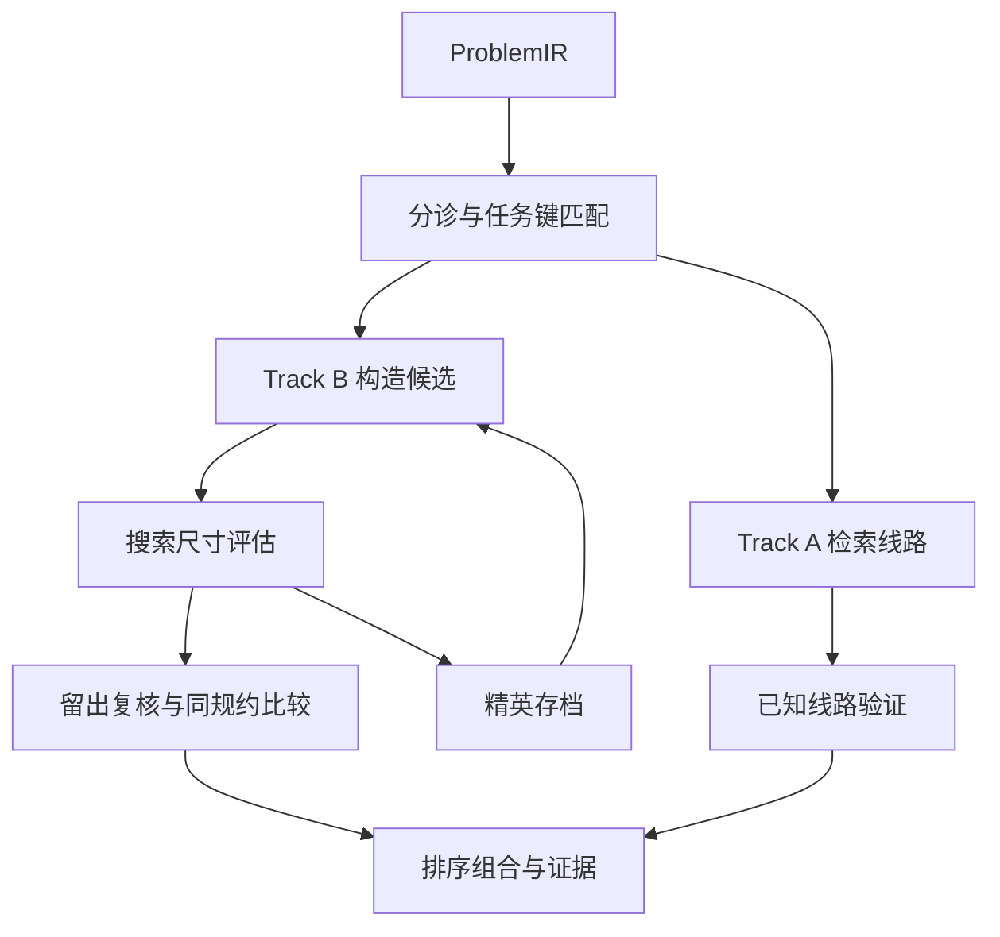

# 量子算法创造者（Quantum Algorithm Creator）

从形式化的可逆算术任务生成量子子程序，逐一核验输入输出、相位和辅助比特，再比较线路资源。Track A 提供已知构造。Track B 通过进化搜索改进同一功能的参数化线路。当前版本用 Python 标准库运行。

**本轮结果。** 复核了原有两种增量器，并在多数阈值、加权阈值和定值比较三类任务上找到五种经过验证的线路。在 `n=10` 的加权阈值任务上，低位优先构造相对同门集的固定宽度基线，将 Toffoli 数从 **227 降至 93**，逻辑深度从 **336 降至 146**，逻辑宽度为 **21**。原有 Top-Write 增量器与共享前缀构造相同，按已知构造交付。

## 阅读导航

- [运行与复现](#运行与复现) · [系统架构和路线图](#系统架构和路线图)
- [两种历史增量器的门级构造](#两种历史增量器的门级构造) · [三个失败候选](#三个失败候选)
- [五个新构造详解](#五个新构造详解) · [完整逐尺寸实测](#完整逐尺寸实测) · [独立 Qiskit 复核](#独立-qiskit-复核)
- [发现与认证机制](#发现与认证机制) · [十二种已知构造的详细目录](#十二种已知构造的详细目录)
- [相关研究和历史更正](#相关研究和历史更正) · [旧版 README 原文](#旧版-readme-原文)

## 运行与复现

需要 Python 3.10 或更高版本。在仓库根目录运行以下命令。

```bash
python -m qac.cli
python -m qac.cli audit --sizes 1,2,3,4,5,6,7,8 --json
python -m qac.cli search majority --seed 7 --holdout 6,7,8,10
python -m qac.cli search weighted_threshold --seed 7 --holdout 6,7,8,10 --json
python -m qac.cli search less_than --seed 7 --holdout 6,7,8,10
python -m qac.cli search weighted_threshold --no-evolution --seed 7
python -m pip install pytest
python -m pytest -q
```

`search` 默认在 `n=3,4,5` 上打分。`--batches` 限制搜索轮数，每轮最多评估两个候选。`--holdout` 指定与搜索尺寸互斥的验证集。JSON 记录父代、变异、候选参数、淘汰原因及逐尺寸资源。Python 接口 `run_agent()` 接收 `ProblemIR`，其中 `known_template` 或 `notes["library_key"]` 必须指定同一个受支持的任务。返回条目的 `candidate.build(n)` 可构造对应规模的 `Circuit`。

## 原有增量器的审计

两种旧实现均在 `n=1…8` 对所有输入实现 $|x,0^a\rangle\mapsto|x+1\bmod 2^n,0^a\rangle$，振幅为 $+1$。原基线把低位 $b_0$ 复制到辅助比特，并单独存储最高位需要的进位。Lean 去掉前一项，Top-Write 将后一项直接写到最高数据位。新对照 `reference:shared-prefix-increment` 从降序受控翻转恒等式出发，为重复出现的低位 AND 共享辅助位。最高位的 AND 可以直接作为翻转条件，后续按降序应用并清理其余前缀。

| `n=8` 构造 | 宽度 W | Toffoli 数 T | 门数 G | 深度 D | 审计结果 |
| --- | ---: | ---: | ---: | ---: | ---: | --- |
| 原前缀链 | 15 | 12 | 22 | 22 | 参考 |
| Lean Interleaved | 14 | 12 | 20 | 20 | 优于原前缀链，落后于共享前缀 |
| Top-Write | 13 | 11 | 18 | 18 | 与共享前缀线路一致 |
| 共享前缀 | 13 | 11 | 18 | 18 | 同规约专用参考 |
| CDKM 准备常数寄存器 | 17 | 16 | 50 | 42 | 通用模加法实例 |

从 `n≥3` 起，Lean 的 `W/T/G/D` 为 $2n-2,\ 2n-4,\ 3n-4,\ 3n-4$，Top-Write 为 $2n-3,\ 2n-5,\ 3n-6,\ 3n-6$。降序翻转时，各位读取的低位仍为原值，随后反算将辅助位清零。旧筛选池中的锯齿、循环进位、原地前瞻三个反例仍用于检验错误线路会被拒绝。文献中还有采用条件干净辅助位的增量器，以及不同宽度和深度取舍的常数加法构造。[Cuccaro 等](https://arxiv.org/abs/quant-ph/0410184) · [Khattar 与 Gidney](https://quantum-journal.org/papers/q-2025-05-21-1752/) · [Remaud 与 Vandaele](https://arxiv.org/abs/2501.16802)

### 两种历史增量器的门级构造

两种实现的输入都是小端序寄存器 $x=\sum_{i=0}^{n-1}2^i b_i$ 和初始为零的辅助位。增量的逐位规则为 $b_i\gets b_i\oplus A_i$，其中 $A_0=1$，$A_i=b_0\land\cdots\land b_{i-1}$。从最高位往最低位执行翻转，能够在每一步继续读取尚未修改的低位。以下 `CX(c,t)` 和 `CCX(c1,c2,t)` 分别表示 CNOT 和 Toffoli。

**精简交错增量器（Lean Interleaved）** 使用 $a=\max(0,n-2)$ 个辅助位。$A_1=b_0$ 直接读取，其余前缀放在 $s_i=q_{n+i-2}$。先升链，后降链逐位写入并清理。在处理 $i$ 时，计算 $A_i$ 用到的低位和短前缀仍保持原值，故可重放同一 Toffoli 将 $s_i$ 清零。

```text
n = 1: X(0)
n = 2: CX(0,1), X(0)
n ≥ 3:
    CCX(0,1,s₂)
    for i = 3 .. n−1: CCX(sᵢ₋₁,i−1,sᵢ)
    for i = n−1 .. 3 descending:
        CX(sᵢ,i), CCX(sᵢ₋₁,i−1,sᵢ)
    CX(s₂,2), CCX(0,1,s₂), CX(0,1), X(0)
```

**顶写增量器（Top-Write）** 使用 $a=\max(0,n-3)$ 个辅助位。最高前缀只用于翻转最高位，可由一门 Toffoli 直接写到目标位。这样同时省掉最高辅助槽、一次 CNOT 和一次反算 Toffoli。`n=1,2` 沿用上面的边界构造。`n=3` 的线路是 `CCX(0,1,2), CX(0,1), X(0)`。`n≥4` 时只计算到 $s_{n-2}$，其余步骤如下。

```text
CCX(0,1,s₂)
for i = 3 .. n−2: CCX(sᵢ₋₁,i−1,sᵢ)
CCX(sₙ₋₂,n−2,n−1)
for i = n−2 .. 3 descending:
    CX(sᵢ,i), CCX(sᵢ₋₁,i−1,sᵢ)
CX(s₂,2), CCX(0,1,s₂), CX(0,1), X(0)
```

以 `n=5` 为例，两种线路的完整门序列可直接核对。

```text
Lean      CCX(0,1,5) CCX(5,2,6) CCX(6,3,7) CX(7,4) CCX(6,3,7)
          CX(6,3)   CCX(5,2,6) CX(5,2)   CCX(0,1,5) CX(0,1) X(0)
Top-Write CCX(0,1,5) CCX(5,2,6) CCX(6,3,4) CX(6,3) CCX(5,2,6)
          CX(5,2)   CCX(0,1,5) CX(0,1)   X(0)
```

| n | 原前缀链 W/T/G/D | Lean W/T/G/D | Top-Write 与共享前缀 W/T/G/D | CDKM 常数寄存器 W/T/G/D |
| ---: | --- | --- | --- | --- |
| 1 | 1/0/1/1 | 1/0/1/1 | 1/0/1/1 | 3/2/8/7 |
| 2 | 3/0/4/4 | 2/0/2/2 | 2/0/2/2 | 5/4/14/12 |
| 3 | 5/2/7/7 | 4/2/5/5 | 3/1/3/3 | 7/6/20/17 |
| 4 | 7/4/10/10 | 6/4/8/8 | 5/3/6/6 | 9/8/26/22 |
| 5 | 9/6/13/13 | 8/6/11/11 | 7/5/9/9 | 11/10/32/27 |
| 6 | 11/8/16/16 | 10/8/14/14 | 9/7/12/12 | 13/12/38/32 |
| 7 | 13/10/19/19 | 12/10/17/17 | 11/9/15/15 | 15/14/44/37 |
| 8 | 15/12/22/22 | 14/12/20/20 | 13/11/18/18 | 17/16/50/42 |

归一化后，Top-Write 与 `reference:shared-prefix-increment` 在 `n=1…8` 的门序列一致。Lean 和 Top-Write 对原前缀链及 CDKM 常数寄存器实现的资源改进可以复现。加入同规约共享前缀参考后，Lean 的资源差异转为劣势，Top-Write 返回 `duplicate_of:reference:shared-prefix-increment`。两份证书记为 `correct=True`、`certified=False`，保留原生成器和 `invented:` 历史标识符用于重跑。

### 三个失败候选

下表按输入 `x=0,1,…,7` 列出 `n=3` 的完整输出。正确结果应为 `[1,2,3,4,5,6,7,0]`。三个候选都是可逆门线路，八个输入均违反增量规约。

| 历史候选 | 实际输出 | 验证发现 |
| --- | --- | --- |
| `_zigzag_increment` | `[0,1,2,3,4,5,6,7]` | 前后两段互为逆变换，输出是原输入。 |
| `_cyclic_increment` | `[7,4,1,2,3,0,5,6]` | 得到另一种置换，低位预先翻转后无法按原低位判定进位。 |
| `_inplace_lookahead_increment` | `[3,6,5,0,7,2,1,4]` | 把进位异或写入后续仍要使用的数据位，破坏计算所需的前缀条件。 |

Toffoli 将前缀异或到目标位，仍然是可逆门。第三个反例的问题出在中间值的使用和反算顺序。仅检查辅助位、相位和可逆性会让这三个错误构造都通过，逐输入对照规约才能区分它们。

## 进化搜索得到的线路

阈值线路实现 $|x,f,0^a\rangle\mapsto|x,f\oplus[\sum_i w_i x_i\ge\theta],0^a\rangle$。其中 $f$ 可以取任意输入值，各个基态的振幅均保持为 $+1$。因此该变换可用于叠加态中的相干条件标记。多数阈值取 $w_i=1$ 和 $\theta=\lceil n/2\rceil$，偶数个输入的平票满足阈值。加权阈值使用 $w_i=i+1$ 和 $\theta=\lfloor n(n+1)/4\rfloor$。

### 1. 多数阈值的偏置溢出标记

设总权重为 $S$，选最小的 $t$ 使 $2^t\ge\max(\theta,S-\theta+1)$。令低 $t$ 位累加器初值为 $2^t-\theta$，把标志位 $f$ 接在累加器高位。加入总和 $s$ 后，偏置和落在 $[0,2^{t+1})$，恰在 $s\ge\theta$ 时跨过 $2^t$，因此高位被异或翻转一次。清理阶段只对低位执行逆向模加法，再消除初始偏置，保留标志位上的结果。搜索还保留了一个直接比较的版本。它在 `n=10` 使用 63 个 Toffoli，宽度比偏置版多一个比特。

### 2. 加权阈值的低位优先累加

把常量权重拆成 $2^p$ 项，按位权从低到高累加。对每一步计算所有已处理项的最大可能和 $B$，然后把受控加法限制在能表示 $B$ 的位数内。高位一直为零，因此缩短的加法与整寄存器加法有相同作用。比较器写入标志后按逆序消去全部累加门。对相同位权的两个输入，还可以用 $a+b=(a\oplus b)+2ab$ 重新编码。`n=10` 的配对变体用更多 Toffoli 换取逻辑深度从 146 降至 136。

对采用末级直写、逐项累加的未配对构造，低位优先在此构造空间内最小化 Toffoli 数和门数。设相邻两项位权为 $2^p\le 2^q$，交换前的上界为 $B_0$。先加低位时，首步的寄存器位数 $m_p=\operatorname{bitlength}(B_0+2^p)$ 不大于先加高位时的 $m_q$。两项加完的位数 $m$ 与顺序无关。若将低位项提前，它的受控增量区间由 $m-p$ 缩短为 $m_p-p$，而高位项由 $m_q-q$ 扩大为 $m-q$。增量器的每位边际门成本随区间长度非递减。低位项缩短的位数至少与高位项扩大的位数相同，且在共同缩短或扩大的位数区间中边际成本更高或相同，因此总成本不会升高。逐对交换即可得到低位优先序。配对与逻辑深度仍由实测比较。

### 3. 定值比较的末级进位直写

有效数据为 $m=n-1$ 位无符号数，最高位是标志。任务为 $f\mathrel{\oplus}=[x<k]$，其中 $k=\min(n+1,2^{m}-1)$。比较链从 $k$ 的最低置位开始。对低 $j$ 位的比较结果 $D_j=[x\bmod 2^j\ge k\bmod 2^j]$，加入下一位时，按常量位选择 AND 或 OR。末级进位直接异或写入标志，随后反算前缀。该构造节省了最后一级的进位槽和一次反算。以下比较包含 IBM 的 `IntegerComparator`。[IBM Quantum 文档](https://qiskit.qotlabs.org/docs/api/qiskit/qiskit.circuit.library.IntegerComparator)

### 资源与复核范围

W 是逻辑比特数，T 是 Toffoli 数，G 是逻辑门数，D 是按依赖关系排程的全连接深度。表中各行均为 `n=10`。加权和多数任务的固定宽度对照已合并末级进位，并用同一门集实现比较和反算。

| 任务 | 原库 W/T/G/D | 固定宽度对照 W/T/G/D | 进化结果 W/T/G/D |
| --- | --- | --- | --- |
| 多数阈值，偏置溢出 | 19/126/217/213 | 17/105/171/168 | **16/72/122/120** |
| 多数阈值，按范围累加后比较 | 19/126/217/213 | 17/105/171/168 | **17/63/109/106** |
| 加权阈值，低位优先 | 23/262/433/387 | 21/227/359/336 | **21/93/159/146** |
| 加权阈值，低位优先配对 | 23/262/433/387 | 21/227/359/336 | **21/105/191/136** |
| 定值比较，末级直写 | 18/16/42/29 | — | **17/15/38/26** |

种子 7 在上述三类任务上分别评估了 **23、30、4** 个候选。种子 0 和 23 找到了相同的五种线路。多数与加权任务仅评估初始程序时均未获得认证的资源改进。搜索结束后，五个入选构造使用位平面模拟与独立 Kickmix 交叉核验，每个尺寸穷举所有数据输入和标志取值。搜索尺寸为 `3,4,5`，筛选留出尺寸为 `6,7,8,10`。冻结构造后又验证 `9,11,12,13`，连同最小尺寸 `1,2`，覆盖 `n=1…13`。

可通过以下 Python 代码复核冻结构造。

```python
from qac.novelty import certify_innovation
from qac.track_b import run_discovery

result = run_discovery(problem_key="weighted_threshold", seed=7,
                       holdout_sizes=(6, 7, 8, 10))
for entry in result.certified:
    receipt = certify_innovation(entry.candidate, extended_sizes=(9, 11, 12, 13))
    print(entry.candidate.id, receipt.correct, receipt.certified, receipt.extended_sizes)
```

### 独立 Qiskit 复核

Qiskit 2.6.2 在 `n=3,5,7` 上模拟随机复振幅叠加态。本轮五个构造与两个原增量器的最大振幅差均为 0。另一组实验将 `n=10` 电路统一编译为 `cx/rz/sx/x`，优化级别 3、种子 21、全连接。多数和加权的 SDK 基线由 `WeightedAdder`、`IntegerComparator` 与逆加法组成，复用已清零的工作位。定值比较的 SDK 基线直接使用 `IntegerComparator`。[IBM WeightedAdder 文档](https://quantum.cloud.ibm.com/docs/en/api/qiskit/dev/qiskit.circuit.library.WeightedAdder)

| 任务及候选 | Qiskit 基线宽度 / CX / 深度 | 候选宽度 / CX / 深度 |
| --- | --- | --- |
| 多数阈值，偏置溢出 | 19/1529/2676 | **16/426/713** |
| 加权阈值，低位优先 | 23/2716/4704 | **21/566/916** |
| 定值比较，末级直写 | 18/92/175 | **17/112/194** |

定值比较体现的是宽度取舍。SDK 基线多用一个比特，但 CX 更少、编译后的深度也更低。以上指标取自逻辑模拟和全连接编译，实际硬件的耦合、噪声与容错开销尚待测量。已有工作提出多对数深度、对数辅助比特的对称函数线路，本仓库的多数阈值结果是对指定基线的资源改进。加权线路对 `1…n` 权重的门数上界为 $O(n\log^2 n)$，多数阈值为 $O(n\log n)$。这两类构造的文献首创性仍需审查。[Zi、Nie 与 Sun](https://arxiv.org/abs/2404.06052)

```bash
python -m pip install qiskit==2.6.2
python -m benchmarks.qiskit_crosscheck
```

## 五个新构造详解

下表中的标识符与 CLI 的 `candidate_id` 一致。四个阈值变体共用 [`build_sum_threshold`](qac/arithmetic.py)，定值比较共用 `threshold_flag`。对于阈值家族，`n` 是输入位数，另有一个可取 `0` 或 `1` 的标志位。对于 `less_than`，`n` 包含标志位。辅助位均按初态 $|0\rangle$ 接入，输出要求恢复 $|0\rangle$，并保持每个计算基态的振幅为 $+1$。由线性性，该规约适用于任意数据叠加态。将标志初始化为 $|{-}\rangle$ 时，还可通过相位反冲对满足条件的分量施加负号。

| 构造 | `candidate_id` | 主要用途 |
| --- | --- | --- |
| [多数阈值偏置溢出](#多数阈值偏置溢出) | `optimized:majority:1-1-0-input-overflow` | 用较少逻辑比特实现 Hamming 重量阈值标记 |
| [多数阈值范围累加](#多数阈值范围累加) | `optimized:majority:1-1-0-input-ripple` | 在同一任务上减少门数与深度 |
| [加权阈值低位优先](#加权阈值低位优先) | `optimized:weighted_threshold:1-1-0-low_first-ripple` | 标记加权和达到阈值的输入，用作约束预言机的子程序 |
| [加权阈值同权配对](#加权阈值同权配对) | `optimized:weighted_threshold:1-1-1-low_first-ripple` | 在特定尺寸进一步压低逻辑深度 |
| [定值比较末级直写](#定值比较末级直写) | `optimized:less_than:1-0` | 保持输入寄存器的相干区间标记 |

### 多数阈值偏置溢出

**输入输出。** 设 $s=\sum_i x_i$ 和 $\theta=\lceil n/2\rceil$，输出为 $(x,f\oplus[s\ge\theta])$。计算使用一个低位工作寄存器 $a$，标志位 $f$ 作为逻辑最高位。选 $t=\lceil\log_2\max(\theta,n-\theta+1)\rceil$，置 $a\gets 2^t-\theta$。受控增量的 `fuse=True` 将末级进位直接加到相应目标位。

```text
b = 2^t − theta
X-set the low t work bits to b
for j = 1 .. n:
    add x[j−1] into (a, f), using at most bitlength(b + j) active bits
apply the inverse of those additions projected onto the low t bits a
undo the X initialization on a
```

**正确性。** 用 $f$ 的输入值对整数字进行编码，则前向模加得到 $a=(b+s)\bmod 2^t$，最高位为 $f\oplus[\lfloor(b+s)/2^t\rfloor=1]$。由 $0\le b+s<2^{t+1}$，这个进位等价于 $s\ge\theta$。低位模加法的结果独立于最高位，因而只反算低 $t$ 位即可清理工作寄存器。当前缀上界 $b+j<2^t$ 时，前向加法也可以只触及低位。每个受控增量自身负责清零借用的进位槽。

**例子。** `n=10` 时，$\theta=5$、$t=3$、$b=3$。若 $s=4$，偏置和为 7，标志保持原值。若 $s=5$，偏置和为 8，低三位变为 0，标志翻转。两种情况下，低位反算后都恢复到 3，最后恢复为 0。逻辑资源为 `16/72/122/120`，其中初始的 11 个数据和标志位之外分配 5 个工作位。该构造使用 $O(\log n)$ 个工作比特和 $O(n\log n)$ 个门。

### 多数阈值范围累加

**输入输出。** 多数阈值及标志契约与偏置溢出相同。这里用可表示 `0…n` 的独立计数器，在累加结束后求 $[a\ge\theta]$。计数器宽度 $t=\lceil\log_2(n+1)\rceil$，第 $j$ 项之后的上界为 $j$，因而前 $j$ 项的当前受控增量只在低 `bit_length(j)` 位上构造。

```text
A = empty gate list
for j = 1 .. n:
    append controlled_increment(x[j−1], a[0 : bit_length(j)], fuse=True) to A
apply A
f ^= [a ≥ ceil(n/2)] using the fused constant comparator
apply reverse(A)
```

**正确性。** 累加第 $j$ 项后，$a=\sum_{i<j}x_i\le j$，所有非活动高位仍为 0。活动位宽覆盖新和值，缩短加法仍得到完整求和。常量比较保持 $a$，故反算从正确的和值开始，最终恢复工作寄存器。所有构造门在当前门集内均可自逆，反算可直接逆序放置门。

**例子。** `n=10` 的前四次受控增量依次使用 1、2、2、3 个计数器位，最后三次使用 4 位。相较固定 4 位累加的同门集基线，Toffoli 为 **63 对 105**，逻辑深度为 **106 对 168**。该版本在 `n=8…12` 的 Toffoli 数低于偏置溢出版本，`n=13` 则由偏置版使用更少 Toffoli。两者在不同尺寸和资源目标下均有价值，逐尺寸数据见后表。

### 加权阈值低位优先

**输入输出。** 仓库任务取 $w_i=i+1$、$S=\sum_{i=0}^{n-1}w_i=n(n+1)/2$ 和 $\theta=\lfloor S/2\rfloor$。输出为 $(x,f\oplus[\sum_iw_ix_i\ge\theta])$。底层构造也接收任意非负整数权重和整数阈值。$\theta\le0$ 时仅对标志施加 $X$，$\theta>S$ 时保持标志与数据。

```text
terms = all (p, i) such that bit p of w[i] is 1
stable-sort terms by p in ascending order
A = empty gate list
B = 0
for each (p, i):
    B += 2^p
    append controlled_increment(x[i], a[p : bit_length(B)], fuse=True) to A
apply A
f ^= [a ≥ theta] using the fused constant comparator
apply reverse(A)
```

**正确性。** 每个二进制项向和值加 $2^p x_i$，等价于对累加器从第 $p$ 位起的后缀做受控增量。$B$ 是所有已处理项权重的和，因此覆盖每个基态的最大可能部分和。同一数据位即使在多个位权中出现，$B$ 也不会遗漏任何部分和。前缀界限与量子输入无关，生成线路时即可确定。完整求和后比较和清理的证明与范围累加多数版本相同。

**例子。** `n=10` 时，按位权 `1,2,4,8` 分组，组内项数分别为 **5、5、4、3**，各组结束的上界为 **5、15、31、55**。因此 6 位计数器直到最后一组才完整启用。阈值是 27，令权重 8、9、10 对应的三个输入位为 1 且其余为 0，和值恰好等于阈值，标志翻转。`n=10` 的逻辑资源为 `21/93/159/146`。与同门集固定宽度参考相比，Toffoli 门数减少 **59.0%**，逻辑深度减少 **56.5%**。如果权重二进制展开共有 $E$ 项，门数上界为 $O((E+1)\log(S+2))$。对 `1…n` 的权重，该界为 $O(n\log^2 n)$，工作宽度为 $O(\log n)$。

### 加权阈值同权配对

**输入输出。** 保持低位优先构造的阈值和相干规约。每个位权组中，把相邻两项配成对。将两个控制位的和重编码为一个同位权的奇偶项和一个双倍位权的进位项。组内剩余单项沿用受控增量。

```text
for each equal-place pair (p, a, b):
    CCX(a, b, scratch)              # scratch = a AND b
    CX(a, b)                        # b = old_a XOR old_b
    add 2^p using b as the control
    add 2^(p+1) using scratch as the control
    CX(a, b), CCX(a, b, scratch)     # restore both input wires and clear scratch
```

**正确性。** $a+b=(a\oplus b)+2(a\land b)$ 保持两个控制位的加权贡献。因此加法对子序列之前的上界只增加 $2\cdot2^p$。两个和项同时取 1 的情况不可达，实际的配对贡献上限仍为 $2\cdot2^p$。随后恢复原来的控制位并清理配对工作位，再处理下一项。阈值翻转和整个累加网络的反算与上一版本相同。

**例子。** `n=10` 时，位权 `1` 组的前两个控制来自权重 `1` 和 `3`。如果二者都选中，则这一对的奇偶为 0、进位为 1，向累加器贡献 2。权重 `3` 的位权 `2` 项仍会在后续组单独处理。全部同权配对使 `n=10` 的逻辑深度从 **146 降至 136**，Toffoli 从 93 增至 105，宽度仍为 21。`n=12,13` 也测到较浅深度，`n=8,9,11` 则逐项版本更浅，适合按目标尺寸选择。

### 定值比较末级直写

**输入输出。** `n` 个数据位包含 $m=n-1$ 位数值 $x$ 和标志 $f$。目标为 $(x,f\oplus[x<k])$，其中 $k=\min(n+1,2^m-1)$。对 $k>0$，设 $j_0$ 是其最低置位。$j_0$ 以下 $k$ 的各位为 0，低位比较在这一段保持为真。首次遇到 $k_{j_0}=1$ 时，低 $j_0+1$ 位的比较结果恰为 $x_{j_0}$，可直接读取数据位。

$$
D_j=[x\bmod 2^j\ge k\bmod 2^j],\qquad
D_{j+1}=\begin{cases}
 x_j\land D_j & k_j=1,\\
 x_j\lor D_j & k_j=0.
\end{cases}
$$

**门级实现。** AND 用一门 `CCX` 异或到目标位。OR 以 `CX(x_j,target), CX(D_j,target), CCX(D_j,x_j,target)` 实现，利用 $u\lor v=u\oplus v\oplus uv$，可直接写入任意初值标志。最后一级计算 $[x\ge k]$ 时直接把其值异或到标志，再用 `X(f)` 得到所需的 $[x<k]$，最后逆序清理前缀。若 $k$ 的唯一最高置位已经给出完整比较，则末级是 `CX(x[j₀],f), X(f)`。`k=0` 是恒不触发的边界情况。设 $r=m-1-j_0$，则 $r\ge1$ 时该实现使用 $r-1$ 个辅助位与 $2r-1$ 个 Toffoli。该比较依赖最低置位后的有效位数，门数为 $O(m)$。

**例子。** `n=5` 时，$m=4$、$k=6$，`q4=f`，`q5` 为唯一辅助位。先计算 $q_5=x_1\land x_2$，再把 $x_3\lor q_5$ 写入标志。整个门序列为 `CCX(1,2,5), CX(3,4), CX(5,4), CCX(5,3,4), X(4), CCX(1,2,5)`，逻辑资源 `6/3/6/4`。`n=10` 的全连接 Qiskit 对照节比较了节省一个逻辑比特所带来的额外 CX 与深度。

### 直接构造并使用线路

从仓库根目录运行以下 Python 代码可以构造五个已入选的实现。构造参数和自动搜索结果一致。下例只生成线路，运行与硬件编译可使用现有 Qiskit 复核模块提供的 `to_qiskit` 转换。

```python
from qac.arithmetic import SumProgram, build_sum_threshold, compact_circuit, threshold_flag
from qac.library import lessthan_k, majority_K, weighted_theta

n = 10
weighted = tuple(range(1, n + 1))
majority = (1,) * n
circuits = {
    "majority_overflow": build_sum_threshold(
        majority, majority_K(n), SumProgram(bounded=True, fuse=True, marker="overflow")
    ),
    "majority_ripple": build_sum_threshold(
        majority, majority_K(n), SumProgram(bounded=True, fuse=True)
    ),
    "weighted_low_first": build_sum_threshold(
        weighted, weighted_theta(n), SumProgram(bounded=True, fuse=True, order="low_first")
    ),
    "weighted_paired": build_sum_threshold(
        weighted, weighted_theta(n), SumProgram(bounded=True, fuse=True, order="low_first", pair=True)
    ),
    "fixed_comparator": compact_circuit(n, threshold_flag(
        tuple(range(n - 1)), lessthan_k(n), n - 1, n, complement=True, fuse=True
    )),
}
for name, circuit in circuits.items():
    print(name, circuit.n, circuit.toffoli_count(), circuit.gate_count(), circuit.depth())
```

## 完整逐尺寸实测

每个单元格依次为 **W/T/G/D**。W 为分配的逻辑比特总数，T 为此门集中的 Toffoli 类门数（当前这些线路均为 CCX），G 为逻辑门总数，D 为按共享线路依赖排程的逻辑深度。`T` 在这里是列名，Clifford+T 电路中的 T 门数需要另行分解测量。`n=1,2` 检查最小输入，`n=3,4,5` 用于提出和筛选变异，`n=6,7,8,10` 用于留出认证。冻结候选后，再核验 `n=9,11,12,13`。以下表格汇总所有尺寸，五个候选均以同一程序通过全尺寸复核。

### 多数阈值逐尺寸资源

| n | 原始多数基线 | 固定宽度参考 | 偏置溢出 | 范围累加 |
| ---: | --- | --- | --- | --- |
| 1 | 2/0/1/1 | 2/0/1/1 | 2/0/1/1 | 2/0/1/1 |
| 2 | 7/10/25/23 | 5/5/11/10 | 4/2/8/8 | 5/3/9/8 |
| 3 | 8/14/31/27 | 6/6/13/12 | 5/2/8/8 | 6/4/11/10 |
| 4 | 11/36/69/63 | 9/25/43/40 | 8/14/27/27 | 9/11/23/20 |
| 5 | 12/44/81/79 | 10/33/55/54 | 9/16/31/31 | 10/19/35/34 |
| 6 | 13/52/95/93 | 11/39/65/64 | 10/20/38/38 | 11/25/45/44 |
| 7 | 14/60/107/103 | 12/42/71/70 | 11/20/38/38 | 12/28/51/50 |
| 8 | 17/102/175/169 | 15/81/131/128 | 14/58/97/95 | 15/39/69/66 |
| 9 | 18/114/197/193 | 16/95/155/152 | 15/64/109/107 | 16/53/93/90 |
| 10 | 19/126/217/213 | 17/105/171/168 | 16/72/122/120 | 17/63/109/106 |
| 11 | 20/138/235/229 | 18/113/181/178 | 17/74/124/124 | 18/71/119/116 |
| 12 | 21/150/255/249 | 19/123/197/194 | 18/82/137/137 | 19/81/135/132 |
| 13 | 22/162/273/271 | 20/135/215/214 | 19/84/141/141 | 20/93/153/152 |

### 加权阈值逐尺寸资源

| n | 原始加权基线 | 固定宽度参考 | 低位优先 | 同权配对 |
| ---: | --- | --- | --- | --- |
| 1 | 2/0/1/1 | 2/0/1/1 | 2/0/1/1 | 2/0/1/1 |
| 2 | 7/6/19/15 | 5/3/9/7 | 5/1/7/5 | 5/1/7/5 |
| 3 | 10/28/55/45 | 8/19/33/28 | 8/9/19/16 | 8/15/33/28 |
| 4 | 13/50/93/75 | 11/39/67/58 | 11/13/29/22 | 11/19/43/34 |
| 5 | 14/66/117/97 | 12/51/83/70 | 12/17/33/26 | 12/25/53/42 |
| 6 | 17/116/201/177 | 15/95/155/144 | 14/33/63/56 | 14/43/85/58 |
| 7 | 18/152/257/229 | 16/125/199/186 | 15/59/101/94 | 15/71/131/108 |
| 8 | 21/210/353/315 | 19/181/291/272 | 18/67/121/108 | 18/79/151/118 |
| 9 | 22/238/395/355 | 20/205/325/306 | 19/79/137/126 | 19/91/169/130 |
| 10 | 23/262/433/387 | 21/227/359/336 | 21/93/159/146 | 21/105/191/136 |
| 11 | 26/388/639/581 | 24/347/553/524 | 24/133/233/218 | 24/149/277/232 |
| 12 | 27/416/677/625 | 25/371/583/554 | 25/153/257/244 | 25/169/301/242 |
| 13 | 28/468/761/699 | 26/417/655/626 | 26/183/305/294 | 26/195/347/288 |

### 定值比较逐尺寸资源

| n | 原始借位参考 | 末级直写 |
| ---: | --- | --- |
| 1 | 1/0/0/0 | 1/0/0/0 |
| 2 | 2/0/3/3 | 2/0/2/2 |
| 3 | 4/2/4/3 | 3/1/2/2 |
| 4 | 6/4/10/9 | 5/3/8/7 |
| 5 | 8/4/12/9 | 6/3/6/4 |
| 6 | 10/8/18/13 | 9/7/14/10 |
| 7 | 12/4/16/11 | 8/3/10/8 |
| 8 | 14/12/34/25 | 13/11/30/22 |
| 9 | 16/12/36/25 | 14/11/30/22 |
| 10 | 18/16/42/29 | 17/15/38/26 |
| 11 | 20/14/42/29 | 17/13/36/24 |
| 12 | 22/20/54/39 | 21/19/50/36 |
| 13 | 24/20/56/39 | 22/19/50/34 |

### 候选谱系与初始基线对照

下表对应种子 7 的实际父代记录，度量为 `n=10` 的 `W/T/G/D`。多数与加权任务的 `--no-evolution` 对照只评估一个固定宽度初始程序，均未获得通过认证的资源改进。定值比较从已压缩常量前缀的版本出发，在末级融合后进一步变窄。其余两次种子复跑得到同一组最终变体。

| 家族 | 实际谱系 | 资源变化 |
| --- | --- | --- |
| 多数 | 固定宽度分离比较 → 固定宽度偏置溢出 → 按范围缩短偏置加法 → 恢复分离比较的另一分支 | `17/105/171/168` → `16/80/134/132` → `16/72/122/120` → `17/63/109/106` |
| 加权 | 固定宽度输入序 → 按范围缩短输入序 → 低位优先 → 同权配对 | `21/227/359/336` → `21/127/211/188` → `21/93/159/146` → `21/105/191/136` |
| 定值比较 | 跳过常量低零位 → 末级直接写入 | 相对原库实现 `18/16/42/29`，末级写入为 `17/15/38/26` |

冻结后可用同一段代码生成所有三张表中的证书数据。`n=13` 时阈值线路分别遍历 `2^14` 个含标志的输入，定值比较遍历 `2^13` 个含标志的输入。

```python
from qac.novelty import certify_innovation
from qac.track_b import run_discovery

for family in ("majority", "weighted_threshold", "less_than"):
    search = run_discovery(problem_key=family, seed=7, max_batches=16,
                           holdout_sizes=(6, 7, 8, 10))
    for entry in search.certified:
        receipt = certify_innovation(entry.candidate, extended_sizes=range(1, 14))
        assert receipt.certified and receipt.kickmix_sizes == list(range(1, 14))
        print(entry.candidate.id, receipt.resources, receipt.baseline_resources)
```

### Qiskit 编译的全部候选

这些结果在 Qiskit 2.6.2 中以相同门集、级别和随机种子得到。G 和 D 为编译后的门数和深度。实验脚本还用独立态矢量计算复核相位、输出和辅助位。

| `n=10` 实现 | W | CX | 编译后 G | 编译后 D |
| --- | ---: | ---: | ---: | ---: |
| Qiskit 多数参考 | 19 | 1529 | 3932 | 2676 |
| 多数偏置溢出 | 16 | 426 | 953 | 713 |
| 多数范围累加 | 17 | 386 | 877 | 652 |
| Qiskit 加权参考 | 23 | 2716 | 7008 | 4704 |
| 加权低位优先 | 21 | 566 | 1264 | 916 |
| 加权同权配对 | 21 | 638 | 1449 | 807 |
| Qiskit `IntegerComparator` | 18 | 92 | 270 | 175 |
| 定值比较末级直写 | 17 | 112 | 271 | 194 |

## 智能体怎样继续改进候选

1. **构造空间。** 从同规约初始程序出发，变异活动位宽、进位融合、项顺序、同权配对和阈值标记方式。每个候选是一套随 `n` 生成线路的规则。
2. **选择父代。** 精确评估器拒绝不满足功能、相位或辅助位契约的线路。MAP-Elites 存档按逻辑宽度和深度区间保留代表，后续候选由这些通过验证的父代变异而来。搜索使用种子控制提议顺序。
3. **交付。** 停止变异后才检查留出尺寸，随后按逐尺寸资源保留帕累托前沿。结构查重时对称控制位与互不依赖门的顺序按统一规则归一化。若在指定基线上找不到改进，返回同规约的已验证构造。

这一实现采用 OpenEvolve 的评估器反馈、精英存档和迭代变异思想。当前变异器使用可逆运算语法，搜索和评估使用本地 Python。[OpenEvolve](https://github.com/algorithmicsuperintelligence/openevolve)

`InnovationCertificate` 记录有限尺寸证据。候选在全部验证尺寸上各轴不劣于每条指定基线，并对每条基线至少取得一次严格改善，才能通过资源门槛。`novel` 字段表示相对比较池的线路结构差异，`literature_status` 单独记录文献审查状态。缺少同规约基线时可报告正确性。规模拟合用于警示显著增长，渐近界限来自构造分析。

## 发现与认证机制

### 有限预算进化

`SumProgram` 搜索活动位宽、进位融合、同位权配对、累加顺序和标记策略。多数任务的权重相同，顺序固定为输入序。加权任务还尝试重权优先、低位优先与高位优先。标记策略包括借位递推、存储反极性的递推及偏置溢出。定值比较改变两个布尔选项，分别控制末级融合和极性表示。

1. 在搜索尺寸上生成线路并检查规约。功能错误、未清零工作位、相位错误和跳过的尺寸均会留下失败记录。
2. 用最大搜索尺寸的 `(W, D // 4)` 划分 MAP-Elites 存档。格内用各搜索尺寸 Toffoli 数之和、门数之和、深度之和及宽度之和依次排序。通过验证的精英可以作为变异父代。
3. 保留当前排名最高的父代，并从其他存档格抽取候选父代。每次只改变一个程序参数，跳过已提出的参数组合。候选在搜索尺寸上被评估并更新存档，直到预算耗尽或没有可提出的变异。
4. 搜索停止后，对通过搜索尺寸语义检查的候选做留出认证。留出成绩用于认证、资源比较与最终选择。最终组合保留跨尺寸资源的帕累托前沿，资源向量相同的候选合并。

`--batches` 默认 16。每轮最多两项评估，第一次只有初始程序。`less_than` 的变异空间可在四个候选内覆盖。`increment` 的 `search` 分支则重跑历史生成器池，便于复现原成果与反例。`search` 的 JSON 保留 `attempts`、`search_sizes`、`holdout_sizes`、`lineage` 与 `trace`。`candidate_id` 指向参数组合，`parent` 和 `mutation` 记录真实来源。与同预算随机搜索的效率差异仍待基准实验。

### 正确性、价值和结构差异

| 证据项 | 当前核验规则 | 如何读取结果 |
| --- | --- | --- |
| 正确性 | 按 Little-endian 数据规约穷举输入。对内置可逆及符号相位门先用位平面求值，再以逐态 Kickmix 独立核验。默认也对 `W≤8` 的内置候选做稠密态矢量交叉复核。 | `correct`、`extended_sizes`、`kickmix_sizes`、`statevector_sizes` |
| 价值 | 先检查基线具有同一输入输出规约并通过语义验证。候选在每个尺寸的 W/T/G/D 各轴均不劣于每条基线，对每条基线至少有一个尺寸的一轴严格改善。退化边界可以并列。 | `valuable`、`baselines_compared`、`dominated_baselines`、`improved_sizes`、`resources` 与 `baseline_resources` |
| 结构差异 | 按依赖层对门序列归一化，对称控制位顺序不影响结果。逐尺寸比较同规约线路的结构指纹。 | `novel`、`novelty_verdict`、`literature_status` |

所有正确的同规约线路在辅助位为零的输入子空间上实现相同的逻辑作用。门数、宽度和中间态可以不同，所以旧版使用全酉相等判断发明的说法已由结构查重与独立文献审查取代。`certified=True` 表明在选定的尺寸和基线内通过三项核验，`literature_status="unassessed"` 表示尚未建立发表意义上的首创性。若缺少同规约基线，证书返回 `unbenchmarked` 并保留语义检查结果。

边界值与资源限制也会进入验证。位平面模式支持至多 14 个数据位，评估器默认总宽上限为 128。稠密态矢量路径的总宽上限为 14。规模拟合比较总门数、逻辑宽度和 Toffoli 数的增长，用于发现明显的资源异常。五个构造的多项式门数上界来自其生成规则与循环结构。

### 基线的选择和范围

| 合同 | 本仓库认证基线 | 独立比较 |
| --- | --- | --- |
| 增量 | `known:increment-ancilla`、`sota:cdkm-increment`、`reference:shared-prefix-increment` | Qiskit 叠加态复核旧候选。文献中的条件干净辅助位与低深度构造用于讨论适用范围。 |
| 多数阈值 | `known:majority-vote`、`reference:fixed-width-majority` | Qiskit `WeightedAdder`、`IntegerComparator` 与逆加法组合。 |
| 加权阈值 | `known:weighted-threshold`、`reference:fixed-width-weighted` | 相同的 Qiskit SDK 组合，采用与任务匹配的权重和阈值。 |
| 定值小于 | `known:lessthan-borrow` | Qiskit `IntegerComparator(geq=False)` 提供不同的宽度和深度取舍。 |

CDKM 的增量和常数加法参考以通用模加法器为主体，把常数准备到第二个量子寄存器。`n=5` 时 CDKM 模加、增量和常数加法资源分别是 `11/10/30/26`、`11/10/32/27`、`11/10/34/27`。`sota:` 前缀沿用历史标识符。专用算术参考对应相同功能，能够检验是否只是节省了通用加法器准备常数所付出的开销。SDK 比较使用另一门基并另行列出。上述比较的范围由基线表限定。[CDKM 论文](https://arxiv.org/abs/quant-ph/0410184)

## 已知构造与代码

| Track A 任务键 | 功能 |
| --- | --- |
| `increment`、`decrement`、`add_const`、`negate` | 模 $2^n$ 增量、减量、加常数和取负 |
| `bit_reversal`、`prefix_xor` | 比特反转和前缀奇偶变换 |
| `less_than`、`compare` | 定值比较和双寄存器比较 |
| `ctrl_increment`、`popcount` | 受控增量和相干位计数累加 |
| `weighted_threshold`、`majority` | 加权阈值和多数阈值 |

可运行模块包括 `qac/library.py`（已知构造）、`qac/arithmetic.py`（线路构造空间）、`qac/track_b.py`（搜索）、`qac/sandbox.py` 与 `qac/kickmix.py`（语义验证）、`qac/novelty.py`（基线证据）和 `qac/portfolio.py`（任务路由与结果）。通用问题形式化、LLM 变异器、Qualtran 导出与容错资源评估的长期设计见 [AGENT_DESIGN.md](AGENT_DESIGN.md)。

## 十二种已知构造的详细目录

`KnownAlgorithmLibrary.synthesize(key, n)` 返回可在多个尺寸调用的 `Candidate`。其 `build(n)` 生成电路，`spec(n)` 给出基态映射，`n_data(n)` 包含所有具有任意输入值的数据、目标或控制位，`ancilla(n)` 列出要求以零态进入并退出的高位工作线。下表资源取 `n=5`，十二条参考线路另在 `n=1…6` 通过了穷举语义复核。

| 任务键 | 计算规约与用途 | `n=5` W/T/G/D | 工作线 |
| --- | --- | --- | --- |
| `increment` | $x\gets x+1\bmod 2^n$，原始前缀 AND 链。可用于相干计数和索引更新。 | 9/6/13/13 | `q5…q8` |
| `bit_reversal` | 首尾成对交换，对应比特序转换与 QFT 的反转输出。 | 5/0/2/1 | 无 |
| `decrement` | $x\gets x-1\bmod 2^n$，用全位取反包裹一次增量。 | 9/6/23/15 | `q5…q8` |
| `add_const` | $x\gets x+k\bmod 2^n$，常量加法进位链，库规约采用 $k=n$。 | 9/6/18/16 | `q5…q8` |
| `negate` | $x\gets -x\bmod 2^n$，二补数取负。 | 9/6/18/14 | `q5…q8` |
| `prefix_xor` | $y_i=\bigoplus_{j=0}^{i}x_j$，CNOT 前缀链。逆变换用相邻前缀值求原比特。 | 5/0/4/4 | 无 |
| `less_than` | $f\gets f\oplus[x<k]$，原始常量借位链，$x$ 占 $n-1$ 位。 | 8/4/12/9 | `q5…q7` |
| `popcount` | 受控增量实现 $c\gets c+\operatorname{popcount}(x)\bmod 2^m$，$m=\lceil\log_2(n+1)\rceil$。计数器可有任意初值。 | 10/20/35/35 | `q8,q9` |
| `compare` | $f\gets f\oplus[x<y]$，用一条工作线计算两个 $n$ 位寄存器的借位并反算。 | 12/10/44/25 | `q11` |
| `ctrl_increment` | $(x,q)\mapsto(x+q\bmod2^n,q)$，由量子控制位触发增量。 | 10/8/13/13 | `q6…q9` |
| `weighted_threshold` | $f\gets f\oplus[\sum_i(i+1)x_i\ge\lfloor n(n+1)/4\rfloor]$，固定宽度累加后比较。 | 14/66/117/97 | `q6…q13` |
| `majority` | $f\gets f\oplus[\operatorname{popcount}(x)\ge\lceil n/2\rceil]$，固定宽度逐位计数。 | 12/44/81/79 | `q6…q11` |

```python
from qac.library import KnownAlgorithmLibrary

library = KnownAlgorithmLibrary()
for key, report in library.verify_all(sizes=range(1, 7)).items():
    assert report.passed, (key, report.failure_reasons)
    print(key, report.peak_qubits[5], report.toffoli[5], report.gate_count[5], report.depth[5])
```

## 系统架构和路线图

项目采用双轨结构。Track A 交付已有同规约线路。Track B 针对已有结构搜索改进，并通过同一规约和可比较资源轴判断结果。当前实现以显式的 `ProblemIR` 和已注册的可逆算术任务为入口。



| 层 | 当前实现 | 对应设计目标 |
| --- | --- | --- |
| 1. 形式化与经典分诊 | `problem.py` 接收类型化 IR，`portfolio.py` 检查任务类别和键。对一次性 $O(N)$ QRAM 数据加载与二次查询加速的组合给出分诊理由。 | 把现实问题映射为 Ising/HUBO、稀疏线性系统、哈密顿量或预言机，并用经典求解器、张量网络或蒙特卡洛估计端到端交叉点。 |
| 2A. 已知方案 | `library.py` 提供参数化构造和规约，`sota_baselines.py` 提供专用及引用参考。 | 检索量子算法动物园和文献，合成振幅放大、QPE、QSVT 等模板，后续导出 Qmod 或 Qualtran Bloq。 |
| 2B. 发现与优化 | `track_b.py`、`arithmetic.py` 构造候选并迭代变异，保留谱系和失败轨迹。 | 扩展线路语法、分布式评估与受约束 LLM 提案，探索分支解码、生命周期分析和反算复用。 |
| 3. 验证与资源 | `sandbox.py`、`kickmix.py` 检验语义、相位和辅助位，`novelty.py` 提交逐尺寸基线回执。 | 增加 Stabilizer/Stim、适用的张量网络以及容错资源模型，覆盖 T 工厂、纠错码距与物理时空成本。 |
| 4. 交付 | `portfolio.py` 返回线路构造器、报告和 `known` 或 `optimized` 来源。`cli.py` 提供复现命令。 | 按硬件预算排序，输出可编译线路、比较曲线和适用约束。 |

`ProblemIR` 有已知模板且未设置瓶颈时只走 Track A。`notes["resource_bottleneck"]=True` 会同时纳入已知实现和有机会改善的候选。缺少 `known_template` 时路由进入必要性模式，仍需 `notes["library_key"]` 指定可执行规约。该模式找不到合格候选时回退到已验证的同规约参考。现有组合按最大搜索尺寸的 Toffoli、门数、深度和宽度依次排序。

| 阶段 | 已有工作与后续验收 |
| --- | --- |
| 确定性验证和资源沙箱 | 已实现符号相位与清工作位核验。扩展优先项为更多电路类别以及物理资源交叉核对。 |
| Track A 检索与高层合成 | 十二种已知构造可调用。高层 IR 与 SDK 导出需要对编译结果检查原规约。 |
| 问题形式化与经典分诊 | 已有显式任务路由。后续用经典算法和端到端交叉点实测评估通用问题。 |
| Track B 进化式发现 | 已有本地精英存档与冻结后验证。扩展 LLM 提议和并行搜索前，可以用固定预算下的候选质量检验增益。 |
| 可复用库与学习闭环 | 目前以 `Candidate` 构造函数复用。后续可将通过对照的线路封装为 Bloq，并用完整变异轨迹评估再次搜索的效率。 |

目前的 `W/T/G/D` 是统一逻辑门层的资源描述。真实设备比较还需指定连通性、双比特误差和布局，容错预算需指定允许的逻辑错误率、T 工厂和码距。详细的技术选型、研究路线和历史设计保留在本文旧版原文中，英文设计见 [AGENT_DESIGN.md](AGENT_DESIGN.md)。

## 相关研究和历史更正

| 研究案例 | 对本仓库的参考意义 |
| --- | --- |
| 可逆模逆与 Reed–Solomon 译码 | Gu 等人的预印本用评估器引导 LLM 搜索可逆量子线路，覆盖素域模逆及优化算法中的译码子程序。译码结果的用途应以该论文的任务定义为准。[arXiv:2610.22367](https://arxiv.org/abs/2610.22367) |
| AlphaQubit | 2024 年工作使用模拟训练并用 Sycamore 实验数据微调。官方报告的最大真实实验中，逻辑错误比张量网络译码低 6%，比相关匹配低 30%。更大规模结果来自模拟，最高码距 11。该案例研究的是纠错译码，与此处的可逆线路资源实验各有指标。[Nature 论文](https://www.nature.com/articles/s41586-024-08148-8) · [实验说明](https://blog.google/innovation-and-ai/models-and-research/google-deepmind/alphaqubit-quantum-error-correction/) |
| FunSearch | 预训练模型提出程序，确定性评估器筛选，进化数据库迭代。论文报告了容量集构造和在线装箱启发式的改进。[Nature 论文](https://www.nature.com/articles/s41586-023-06924-6) |
| AlphaTensor 与 AlphaEvolve | 需要按数域读取矩阵乘法结果。AlphaTensor 的 $4\times4$ 改进针对二元算术。AlphaEvolve 报告用 48 次标量乘法实现 $4\times4$ 复矩阵乘法。[AlphaEvolve 研究说明](https://deepmind.google/blog/alphaevolve-a-gemini-powered-coding-agent-for-designing-advanced-algorithms/) |
| MAP-Elites 与 OpenEvolve | MAP-Elites 给出按行为特征保留多种优良解的搜索模式。OpenEvolve 提供程序变异和评估循环的参考，本仓库使用参数化可逆算术语法实现这些思想。[MAP-Elites 论文](https://arxiv.org/abs/1504.04909) · [OpenEvolve](https://github.com/algorithmicsuperintelligence/openevolve) |

以下原文用于保留项目首次记录的线路、实验、负样本、架构和阶段计划。阅读时可用这张表定位后来发生的更正。

| 原文条目 | 当前结论 |
| --- | --- |
| 两种“发明”已通过当时的基线 | 原构造和逐输入正确性仍可复现。补入共享前缀参考后，Lean 在资源上落后，Top-Write 的归一化门序列与之相同。 |
| 三重认证保证文献首创性、无同规约参考即为首个解 | 当前证书记录有限尺寸和指定基线内的资源与结构证据。缺乏同规约参考时回报 `unbenchmarked`，首创性单独审查。 |
| 双寄存器 `compare` 的输出曾写作 $[x\ge y]$ | 代码写入 $f\oplus[x<y]$。$[x\ge y]$ 是翻转标志前的中间进位。 |
| 某些反例的历史讲解 | X/CNOT 生成仿射置换，仿射置换可以有大于二的阶。Toffoli 将控制条件异或到目标，保留可逆性。当前反例表给出失败的具体语义原因和逐输入结果。 |
| 技术栈与算法设计图 | 多智能体、GraphRAG、LLM、Stim、Qualtran 和物理 FTQC 预算属于设计路线。上方架构表给出运行模块及验收范围。 |
| 78 项测试与旧命令 | 78 项是原提交时的记录。此次复核执行当前根目录命令 `python -m pytest -q`，并用独立脚本重跑 Qiskit 对照。 |

## 旧版 README 原文

完整保留提交 `6871d63` 的 README，包括原有标题、伪代码、实验表格和参考资料。原文按当时的版本状态保留，以本文前面的复核和更正作为现行结果。[原始提交中的 README](https://github.com/xuda1979/quantum_algorithm_creator/blob/6871d639de2b2a02bebcf0ce210d28f5cc09e413/README.md)

<details>
<summary>展开旧版 README 全文</summary>

# 量子算法创造者（Quantum Algorithm Creator）

一个神经符号（neuro-symbolic）、评估器引导（evaluator-guided）的多智能体系统：接收一个**非结构化的现实世界问题**，返回一组**经机器验证的量子解决方案组合**——既包括检索并合成的**现有成熟量子算法**，也包括在必要时或条件允许时由智能体**自主发明的新量子算法**。

> **核心理念：已知算法优先，新算法尽力而为，常常两者兼得——一个问题，多个解。**
>
> - 如果问题能映射到已知 BQP 模板且满足资源预算，交付现有算法即为合格答案（Track A）。
> - 当没有已知算法能满足预算（**必要性模式**），或预算允许在已知解之外探索帕累托更优的新解（**机会模式**），则启动进化式发现引擎尝试发明新算法（Track B）。
> - 发明不是必须成功的任务：Track B 有时间与预算上限，失败时如实交付最优已知解并精确报告未突破的瓶颈；但**任何"新颖性"声明必须通过机器验证的三重认证门（缺一不可）**：
>   - **正确**——扩展尺寸区间上的穷举态矢量语义验证 + 独立 kickmix 交叉验证（两条代码路径、同一结论），辅助比特干净归零、无隐藏指数爆炸；
>   - **有价值**——在每个验证尺寸上严格帕累托支配所有同规约已知基线（所有资源轴 ≤、至少一轴严格更优），或是无任何基线可解问题时的第一个解；
>   - **真创新**——与所有同规约已知基线均不相同（门序列指纹 + 精确酉等价双重查重），对库的重新推导只能按"已知解"交付，绝不记作发明。
> - 每个经发明并验证的子程序都会沉淀为可复用的 Qualtran `Bloq`，永久扩展系统能力边界。

完整设计规范见 [AGENT_DESIGN.md](AGENT_DESIGN.md)。

---

## 目录

1. [系统架构概览](#系统架构概览)
2. [五大分层与职责](#五大分层与职责)
3. [Track B：如何发明新量子算法](#track-b如何发明新量子算法)
4. [推荐技术栈（2026）](#推荐技术栈2026)
5. [真实案例：AI 创造的新量子算法](#真实案例ai-创造的新量子算法)
6. [本系统已发明的新量子算法（机器验证）](#本系统已发明的新量子算法机器验证)
7. [三重认证门：正确 × 有价值 × 真创新（缺一不可）](#三重认证门正确--有价值--真创新缺一不可)
8. [已知算法库：12 个已验证的算法族目录](#已知算法库12-个已验证的算法族目录)
9. [分阶段开发计划](#分阶段开发计划)
10. [工程护栏](#工程护栏)
11. [仓库结构](#仓库结构)

---

## 系统架构概览

```text
+-------------------------------------------------------------------------+
|                    用户输入：现实世界问题                                  |
|   （领域规格、数据画像、目标规模 N、精度与 SLA）                            |
+------------------------------------+------------------------------------+
                                     |
                                     v
+-------------------------------------------------------------------------+
| 1. 形式化与经典分诊网关                                                  |
|  • 领域→数学智能体：业务/科学规格 -> 规范中间表示（IR）                   |
|    （Ising/HUBO 哈密顿量、稀疏矩阵 A、分子哈密顿量 H、Oracle f(x)）       |
|  • 经典基线运行器：CP-SAT/Gurobi、张量网络、蒙特卡洛；                     |
|    审计数据加载（QRAM）与读出瓶颈                                        |
+------------------------------------+------------------------------------+
                                     |
                      +--------------+--------------+
                      |  复杂度与新颖性路由器           |
                      +--------------+--------------+
                                     |
             +-----------------------+-----------------------+
             | 可映射到已知 BQP 模板            | 瓶颈或新颖结构
             v                                 | （并行运行，二者可同时进行）
+------------------------------------+   +------------------------------------+
| 2A. Track A：检索与合成             |   | 2B. Track B：进化式发现            |
|     （"交付成熟算法"）              |   |     （"创造新算法"）               |
|  • 基于量子算法动物园的 GraphRAG    |   |  • LLM 变异器/提议者               |
|  • 高层功能建模                     |   |    生成参数化 n 比特 DSL 模式      |
|    （Classiq Qmod / Qualtran Bloq）|   |  • MAP-Elites 岛屿种群             |
|  • 硬件与约束感知的自动逆计算        |   |  • 小 n 快速评估器 + Kickmix 循环  |
+-----------------+------------------+   +------------------+-----------------+
                  |                                         |
                  +--------------------+--------------------+
                                       |
                                       v
+-------------------------------------------------------------------------+
| 3. 多保真度验证与资源估算沙箱（Maker-Checker）                             |
|  • 正确性：酉等价/态矢量等价（n=2..6）、辅助比特解纠缠检查、               |
|    稳定子（Stim）与可逆模拟器                                            |
|  • 规模与成本：Toffoli/T 门数、逻辑峰值比特、线路深度、                     |
|    目标误差预算下的表面码物理比特与运行时间                                |
+------------------------------------+------------------------------------+
                                     |
                    通过？             |            失败/次优？
              +----------------------+----------------------+
              | 通过                                  | 否（反馈轨迹）
              v                                       +---> 回到 2A/2B
+------------------------------------+
| 4. 排序后的解决方案组合             |
|  • K 个经机器验证的解：已知（Track A）   |
|    与发明（Track B），按硬件目标        |
|    的资源指标排序                       |
|  • 每个解：可执行 Qmod/Qualtran/Qiskit、 |
|    FTQC 资源规格、量子 vs 经典交叉点    |
+------------------------------------+
```

## 五大分层与职责

| 层 | 名称 | 职责 |
| --- | --- | --- |
| 1 | 问题形式化与经典分诊智能体 | 将领域规格翻译为类型化数学 IR；**分诊批评者**在调用量子合成前检查数据加载复杂度（QRAM vs 紧凑程序化线路），评估量子渐近加速能否真实战胜经典求解器与纠错开销 |
| 2A | 检索与高层合成（"交付成熟算法"） | 经量子 GraphRAG 检索已验证算法框架（QSVT、QPE、哈密顿模拟、分布式 QAOA、振幅放大），产出 **Qmod / Qualtran Bloq** 高层建模代码而非裸门列表；编译器强制线性逻辑类型安全（防克隆）、自动辅助比特分配与逆计算 |
| 2B | 评估器引导的发现引擎（"创造新算法"） | 必要性模式 + 机会模式；前沿推理模型运行于进化搜索循环中，配合快速程序化评估器；活动有预算上限，失败可接受 |
| 3 | 确定性验证与资源估算沙箱 | 不可腐蚀的 Maker-Checker 批评者：验证数学精确性、辅助比特干净归零、拟合经验门数缩放曲线、计算容错物理比特与运行时间足迹 |
| 4 | 排序解决方案组合 | K 个机器验证解；每个解带**来源标签**（已知算法+引文 / 智能体发明+验证证据），按 NISQ 或 FTQC 目标模式排序 |

## Track B：如何发明新量子算法

进化式发现引擎依赖四个专门设计机制：

1. **尺寸参数化 DSL 生成（小 n → 任意 N 泛化）**：绝不允许发现智能体为固定比特数合成静态线路；强制输出以问题尺寸 n 为参数的 **Python 元程序或基于模板的 DSL**（Hierarqcal 模板、参数化 Qualtran `Bloq` 构建器）。在 $n \in \{2,3,4,5\}$ 的小实例上评估候选生成器，经典 CPU/GPU 代价极低，却足以让发现的算法归纳泛化到任意 n。
2. **相干化重设计与逆计算感知搜索**：奖励修改*底层算法表示*——分支解码器（从当前寄存器状态恢复历史选择而非存储历史）、跳石游戏式分步比特复用、共享算术单元、有界失败预算（当算法容忍有界小误差时省略处理指数罕见边界输入的逻辑）。
3. **多状态快速评估器**：全态矢量模拟在约 30 比特以上会卡死进化搜索，因此按线路类别路由：
   - **可逆与相位反冲（"Kickmix"）模拟器**：对由经典可逆门（X、CNOT、Toffoli、SWAP）、对角相位门（Z、CZ、CCZ）与合法的 X 基测量构成的相干算术/Oracle/数据加载线路，在随机输入样本上经典追踪比特串与相位——毫秒级验证 60+ 比特子程序；
   - **稳定子模拟器（Stim）**：千比特级纠错组件、Clifford 路由与症状提取，千赫兹采样率；
   - **小 n 酉/张量网络评估器**：对全量子干涉、块编码、非 Clifford 结构，在 $n \in \{2,\dots,7\}$ 检查精确保真度 $F = |\mathrm{Tr}(U_{\text{target}}^\dagger U_{\text{cand}})| / 2^n$，并验证全部 a 个辅助比特经 $V|x\rangle|0^a\rangle = (-1)^{g(x)}|\pi(x)\rangle|0^a\rangle$ 干净归零。
4. **岛屿模型进化记忆与智能体 RL**：MAP-Elites/FunSearch 风格的进化数据库，按空间（峰值逻辑比特）与时间（Toffoli/双比特门深度）的帕累托权衡划分平行岛屿；将丰富诊断轨迹（精确断言失败、纠缠的辅助比特索引、子程序门画像）回灌 LLM 上下文；长期通过工具增强强化学习（Agent-Q、QUASAR 范式）把获胜轨迹蒸馏进中等规模开源权重。

## 推荐技术栈（2026）

| 架构层 | 推荐框架与工具 | 角色 |
| --- | --- | --- |
| 智能体编排 | LangGraph / Ray + Pydantic 工具模式 | Maker-Checker 有环状态图；Ray 在 CPU/GPU 工作节点上并行数千个线路评估 |
| 推理与编码内核 | 前沿模型（规划/变异）+ RL 微调开源模型（执行） | 前沿模型负责数学归约与新算法变异；小模型负责样板转译与语法修复 |
| 知识与 GraphRAG | Neo4j + 向量库索引《量子算法动物园》、quant-ph、QCircuitBench | 问题类 → 归约 → Oracle 假设 → 渐近复杂度与已验证参考代码的图谱 |
| 高层量子 IR | Google Qualtran、Classiq Qmod | Track A 与 Track B 模块化组合的首要输出目标；类型安全、自动逆计算、无冗余资源计数 |
| 门编译与混合 ML | Qiskit v2.x（C++ 转译器）、PennyLane、NVIDIA CUDA-Q、QuCLEAR | 硬件原生门合成、Clifford 提取/优化、自动微分、GPU 加速混合 HPC-QC |
| 验证与快速模拟 | 自研 Kickmix 模拟器、Google Stim、TensorNetwork / cuQuantum | 可逆逻辑、Clifford/QEC 线路与小 n 态矢量的快速正确性验证 |
| 容错资源估算 | Qualtran Bloqs + Q# / Azure Quantum 资源估算器 | T 工厂开销、逻辑误差预算、表面码距离、物理比特·小时估计 |

## 真实案例：AI 创造的新量子算法

以下是已经发表的、与本系统 Track B 机制同构的真实案例——证明"LLM + 程序化评估器 + 进化搜索"确实能创造出超越人类专家设计的新量子算法与子程序。它们也是本系统发现引擎的参照基线与训练素材。

### 案例 1：LLM 进化发现的可逆 `divsteps` 模逆算法（数论 / 后量子密码）

- **现实问题**：容错量子计算机上的模逆（模 $p$ 求逆）是 Shor 算法攻破椭圆曲线密码（ECC）以及后量子密码分析的核心子程序。经典 Bernstein–Yang `divsteps` 算法效率很高，但直接可逆化会产生巨大的辅助比特开销。
- **AI 的创造**：研究者将前沿 LLM 置于进化循环中，以参数化可逆线路生成器为变异对象、以确定性评估器为裁判，发现了**素域上全新的可逆 `divsteps` 结构**——通过分支解码等技巧避免了历史分支的存储，显著降低 Toffoli 数与辅助比特，超越此前人类专家手工设计的可逆实现。
- **对本系统的意义**：Track B "相干化重设计 + 逆计算感知搜索"机制的直接原型；模逆属于"经典高效算法的可逆化"这一高价值问题族。
- **来源**：Evaluator-Guided Quantum Circuit Discovery with LLMs（见 [演示视频](https://www.youtube.com/watch?v=4sb-0Kcpqk4)）。

### 案例 2：低 Toffoli 里德–所罗门症状译码器（量子容错 / QEC）

- **现实问题**：容错量子计算需要高效的经典码症状译码（如量子 LDPC 码所配合的里德–所罗门码）。可逆译码器若 Toffoli 开销过大，会吞噬纠错带来的收益。
- **AI 的创造**：同一 LLM+评估器进化框架发现了**低 Toffoli 数的里德–所罗门症状译码线路**——全新结构，资源指标优于专家设计，使"在相干子程序中内联译码"重新变得可行。
- **对本系统的意义**：展示了"新可逆算术/译码结构"这一发明族；此类结果会被本系统 Phase 5 结晶为 Qualtran `Bloq` 库。
- **来源**：同上。

### 案例 3：AlphaQubit —— 超越专门译码器的通用 QEC 译码器（Google DeepMind，《Nature》2024）

- **现实问题**：表面码量子纠错的实时译码。传统 MWPM 与 union-find 译码器快但精度有限，神经网络译码器精度高但太慢，难以实时运行。
- **AI 的创造**：基于 Transformer 的自回归译码器，经强化学习微调：在距离达 25 的表面码上把逻辑错误率比专门化匹配译码器再降低最多约 6%（在 Google Sycamore 量子处理器的真实噪声数据上训练与验证），同时把先前神经网络译码器的推理速度提升了一个数量级以上（从约 1 秒/轮降至约 1 毫秒/轮），逼近实时译码要求。这是首个在真实硬件数据上全面超越专门译码器的通用神经译码器。
- **对本系统的意义**：证明"发现引擎"的产物不限于门线路，还包括**译码策略这类新的算法组件**；其训练数据（症状-纠错轨迹）正是 Stim 稳定子模拟器可以批量生产的。
- **来源**：Google DeepMind 与 AlphaQubit 团队，《Nature》（2024）："Learning high-performance error correction for quantum processors"（[DeepMind 博客](https://deepmind.google/discover/blog/alphaqubit-quantum-error-correction/)）。

### 案例 4：FunSearch —— 用 LLM+评估器发现全新数学构造（DeepMind，《Nature》2023，与 Track B 同构的先例）

- **现实问题**：容量集（cap set）问题——数学家数十年未改进的组合构造下界。
- **AI 的创造**：FunSearch（LLM 提议程序 + 符号评估器 + 进化数据库）发现了**迄今最大的容量集构造**（n=8 维度 512 个元素），这是历史上首次由 LLM 系统发现的新数学知识而非仅复现已知结果；同框架还改进了在线装箱问题的启发式，超越人类最佳手工算法。
- **对本系统的意义**：本系统 Track B 的 MAP-Elites 岛屿记忆机制即脱胎于此范式，证明"LLM 生成参数化程序 + 确定性评估器 + 进化存档"能在数学与算法层面产生真正的新知识。
- **来源**：DeepMind，《Nature》（2023）："Mathematical discoveries from program search with large language models"（[DeepMind 博客](https://deepmind.google/discover/blog/funsearch-making-new-discoveries-in-mathematical-sciences-using-large-language-models/)）。

### 案例 5：AlphaTensor / AlphaEvolve 谱系 —— 矩阵乘法与线路优化中的新算法（DeepMind）

- **现实问题**：寻找更快矩阵乘法算法（AlphaTensor）与改进量子线路中的算术分解（AlphaEvolve）。
- **AI 的创造**：AlphaTensor（强化学习 + 进化搜索）发现了首个在 $4\times4$ 复矩阵乘法上快于 Strassen 两步递归的实用算法；后续 AlphaEvolve 进一步发现了改进的 $4\times4$ 复矩阵乘法方案（48 次双线性乘法，打破 1969 年 Strassen 的 49 次纪录），并优化了 Gemini 内核、数据中心调度与量子线路中的 T 门/Toffoli 分解。
- **对本系统的意义**：T 门分解、可逆算术与振幅编码的算术内核正是 Track B 变异器的高价值目标族；AlphaEvolve 展示了"发现→结晶为库→反哺更大系统"的完整闭环，即本系统 Phase 5 的路线图。
- **来源**：DeepMind，《Nature》（2022）："Discovering faster matrix multiplication algorithms with reinforcement learning"；AlphaEvolve（2025）白皮书（[AlphaTensor 博客](https://deepmind.google/discover/blog/alphatensor-discovering-novel-matrix-multiplication-algorithms-with-ai/)）。

### 案例小结

| 案例 | 领域 | 创造物 | 关键机制 |
| --- | --- | --- | --- |
| 可逆 divsteps 模逆 | 数论 / 后量子密码 | 全新可逆算法结构 | LLM 变异 + 可逆模拟评估器 |
| 低 Toffoli RS 症状译码器 | 量子容错 | 新译码线路 | LLM 变异 + Kickmix 类评估器 |
| AlphaQubit | QEC 译码 | 神经译码策略 | RL 微调 + 真实硬件数据 |
| FunSearch / 容量集 | 组合数学 | 新数学构造 | LLM 程序提议 + 符号评估 + 进化存档 |
| AlphaTensor / AlphaEvolve | 算术 / 线路 | 新矩阵乘法与 T/Toffoli 分解 | RL + 进化搜索 + 库结晶 |

这些案例共同证明：**评估器引导的搜索不是"暴力试错"，而是把 LLM 的符号泛化能力约束在物理与数学不变量构成的硬边界内，从而产出可验证、可复用、超越人类设计的新算法。**

---

## 本系统已发明的新量子算法（机器验证）

本仓库不只是设计文档——`qac/` 目录包含了智能体的**可运行参考实现**（纯 Python + numpy，78 项测试全部通过），并且它**已经发明了两个经三重认证（正确 × 有价值 × 真创新）、帕累托超越教科书与文献 SOTA 基线的新量子子程序**（发明 2 对两个同规约基线在全部四个资源轴上同时严格更优）。以下算法由本系统的 Track B 发现引擎产出，验证范围**全部来自机器实测、无一凭空声明**：三重认证在扩展尺寸 n=2..6 上对每个输入 x 穷举态矢量验证（`extended_sizes=(2,3,4,5,6)`，见 `qac/novelty.py`），帕累托支配在 n=3..6 逐尺寸核验（`test_invention_pareto_dominates_at_every_size`），资源公式在 n=1..8 机器核验——验证内容包括：功能正确、辅助比特干净归零、无杂散相位（振幅恰为 +1）、无隐藏指数爆炸。发明持有 `qac/novelty.py` 签发的完整 `InnovationCertificate`。

### 发明 1：精简交错可逆增量器（Lean Interleaved Incrementer）

**问题**：可逆 n 比特增量 x → (x+1) mod 2ⁿ，是量子算术（Shor 算法、振幅估计、QSVT 相位算术）中最常用的子程序之一。

**已知基线（教科书构造）**：n 个数据比特 + n−1 个辅助比特（宽度 2n−1），为每个前缀与 Aᵢ = AND(b₀..bᵢ₋₁) 分配专用槽位；计算→应用→逆计算，Toffoli 开销 2n−4。

#### 形式化 I/O 契约

设数据寄存器 $|x\rangle = |b_{n-1}\dots b_1 b_0\rangle$（qubit i 存比特 i，小端序），辅助寄存器 $|0^a\rangle$ 初始全零。线路 V 实现：

$$V|x\rangle|0^a\rangle = |(x+1) \bmod 2^n\rangle|0^a\rangle, \quad a = \max(0,\, n-2)$$

即：功能上严格实现模 2ⁿ 增量，全部辅助比特干净归零（可逆性/无纠缠/无杂散相位三者同时成立——由 Layer-3 沙箱对每个输入 x 穷举验证振幅恰为 +1）。

#### 参数化构造（n 为输入参量，设计 2.1 合规）

```text
# 槽位定义：s_i = 前缀与 A_i = AND(b_0..b_{i-1}) 的存放处
#   i = 1: 无槽位（A_1 = b_0，直接读数据比特——本发明的关键省略）
#   i >= 2: 槽位 s_i = qubit (n + i - 2)
lean_interleaved_increment(n):
    if n == 1: return [X(0)]
    if n == 2: return [CNOT(0,1), X(0)]                 # 零辅助比特
    gates  = [Toffoli(0, 1, s_2)]                       # A_2 = b_0 ∧ b_1
    gates += [Toffoli(s_{i-1}, b_{i-1}, s_i) for i = 3..n-1]      # 升链：算出所有前缀与
    for i = n-1 down to 3:                              # 降链：应用后立即逆计算
        gates += [CNOT(s_i, i), Toffoli(s_{i-1}, b_{i-1}, s_i)]
    gates += [CNOT(s_2, 2), Toffoli(0, 1, s_2)]         # 最低槽位同样即用即释
    gates += [CNOT(0, 1)]                               # b_1 ^= A_1 = b_0
    gates += [X(0)]                                     # b_0 ^= 1 —— 严格最后
    return gates
```

n=5 的完整门序列（数据 q0..q4，辅助 q5,q6,q7）：

```text
 1. CCX(0,1,5)   5. CCX(6,3,7)    9. CCX(0,1,5)
 2. CCX(5,2,6)   6. CNOT(6,3)    10. CNOT(0,1)
 3. CCX(6,3,7)   7. CCX(5,2,6)   11. X(0)
 4. CNOT(7,4)    8. CNOT(5,2)
```

#### 正确性论证

增量可分解为 $b_i \mathrel{\oplus}= A_i$（对所有 i，含 $A_0 = 1$）。正确性依赖三条不变量：

1. **升链**：按 i 递增计算 $s_i \leftarrow A_i$ 时，参与运算的 $s_{i-1}$ 与 $b_{i-1}$ 均未被修改，故每个 $s_i$ 精确持有 $A_i$（归纳法）。
2. **降链即用即释**：按 i 递减执行 `CNOT(s_i, i)` 后 $b_i$ 已变为 $b_i \oplus A_i$（终值），随后的 `Toffoli(s_{i-1}, b_{i-1}, s_i)` 因输入与升链时完全相同而精确擦除 $s_i$——辅助比特复用不消耗额外门。
3. **X(0) 严格最后**：所有逆计算（含 `Toffoli(0,1,s_2)` 与读取 b₀ 的 `CNOT(0,1)`）必须读到**原始** b₀；若 X(0) 提前，A₂ 的擦除条件被破坏，辅助比特残留 |1⟩。发明过程中该次序曾被放错，被穷举验证当场击毙——这正是 Maker-Checker 的价值。

#### 闭环资源公式（机器核验 n=1..8）

| 指标 | 已知基线 | **发明** | 差值 |
| --- | --- | --- | --- |
| 总宽度 W | 2n−1 | **2n−2** | **−1 比特** |
| Toffoli 数 T | 2n−4 | **2n−4** | 0 |
| 门数 G | 3n−2 | **3n−4** | **−2** |
| 深度 D | 3n−2 | **3n−4** | **−2** |

逐尺寸实测（`tests/test_qac.py::test_invention_pareto_dominates_at_every_size` 穷举核验）：

| n | 基线 W/T/G/D | **发明 W/T/G/D** |
| --- | --- | --- |
| 3 | 5/2/7/7 | **4/2/5/5** |
| 4 | 7/4/10/10 | **6/4/8/8** |
| 5 | 9/6/13/13 | **8/6/11/11** |
| 6 | 11/8/16/16 | **10/8/14/14** |
| 7 | 13/10/19/19 | **12/10/17/17** |
| 8 | 15/12/22/22 | **14/12/20/20** |

**帕累托优势**：n≥3 的每个尺寸上 Toffoli 持平，而宽度、门数、深度三个指标全部严格变优（各 −1/−2/−2）——无一指标变差。缩放拟合确认门数增长为线性多项式（无指数爆炸）。n=2 时发明版完全无需辅助比特（2 比特 vs 基线 3 比特）。

#### 发明内容归结为两个新结构决策

1. **消除恒等槽位（A₁ = b₀ 本身）**：教科书构造为 A₁ = b₀ 专门分配辅助比特并花 2 个 CNOT 写入/擦除，但 A₁ 就是 b₀——纯粹浪费。发明让 b₁ 直接读 b₀，槽位链从 A₂ 起始。
2. **自顶向下交错的应用/逆计算调度（跳石式比特复用，设计 2.2）**：不再"全部计算→全部应用→全部逆计算"，而是 Aᵢ 应用后立即逆计算、槽位即刻释放——每个槽位存活期压到最短，深度同步下降，且降链复用升链的同一批 Toffoli（总数不变）。

**结构洞见（可泛化）**："前缀聚合中恒等可省略的槽位"是一个可迁移模式：任何 compute/use/uncompute 型可逆算术（前缀 XOR、进位前瞻加法器、比较器）中，若某个前缀值恒等于某个数据比特，其专用辅助槽位即冗余。这已被沉淀为 Track B 变异器的启发式之一（`qac/track_b.py` 的 `_lean_interleaved_increment`），并将按 Phase 5 结晶为 Track A 库中的正式条目。

### 发明 2：顶写可逆增量器（Top-Write Incrementer）——全部四个资源轴同时严格更优

发明 1 落地后，发现引擎在同一进化池中继续搜索，产出第二个经三重认证的构造：它对**全部四个资源轴（W/T/G/D）同时严格优于**两个同规约基线（教科书增量器与文献 SOTA `sota:cdkm-increment`）——本仓库目前最强的帕累托声明。生成器：`qac/track_b.py` 的 `_topwrite_increment`。

**问题与 I/O 契约**：与发明 1 相同——$|x\rangle|0^a\rangle \to |(x+1) \bmod 2^n\rangle|0^a\rangle$，其中 $a = \max(0, n-3)$，辅助比特全部干净归零、振幅恰为 +1（n=1..8 逐输入穷举机器验证）。

**关键洞见（顶写）**：最高前缀与 $A_{n-1} = b_0 \wedge \dots \wedge b_{n-2}$ 有两个此前未被利用的死值属性：

1. **它是链的末端**——$A_{n-1}$ 不再喂给任何更高前缀与（不存在 $A_n$）；
2. **它的应用目标 $b_{n-1}$ 是死比特**——$b_{n-1}$ 被翻转后，线路剩余部分再也不读它。

因此 $A_{n-1}$ 根本无需槽位：`Toffoli(s_{n-2}, b_{n-2}, b_{n-1})` 一步把 $A_{n-1}$ **原地写入** $b_{n-1}$（$b_{n-1} \leftarrow b_{n-1} \oplus (A_{n-2} \wedge b_{n-2}) = b_{n-1} \oplus A_{n-1}$）。相对发明 1，这一步同时消灭三件东西：最高槽位（宽度 −1）、它的应用 CNOT（门/深度 −1）、它的逆计算 Toffoli（Toffoli −1、门/深度 −1）。

#### 参数化构造（n≥4；n=1..3 为特例）

```text
topwrite_increment(n):                                    # 总宽度 2n−3
    if n == 1: return [X(0)]
    if n == 2: return [CNOT(0,1), X(0)]
    if n == 3: return [Toffoli(0,1,2), CNOT(0,1), X(0)]    # n=3 时 A_2 直接顶写进 b_2
    # 槽位 s_i = qubit(n+i−2)，只为 A_2..A_{n−2} 分配（共 n−3 个，比发明 1 少 1）
    gates  = [Toffoli(0, 1, s_2)]                          # A_2 = b_0 ∧ b_1
    gates += [Toffoli(s_{i-1}, i-1, s_i) for i = 3..n-2]   # 升链：算到 A_{n−2} 为止
    gates += [Toffoli(s_{n-2}, n-2, n-1)]                  # 顶写：A_{n−1} 原地写入 b_{n−1}
    for i = n-2 down to 3:                                 # 降链：应用后立即逆计算
        gates += [CNOT(s_i, i), Toffoli(s_{i-1}, i-1, s_i)]
    gates += [CNOT(s_2, 2), Toffoli(0, 1, s_2)]            # 最低槽位即用即释
    gates += [CNOT(0, 1)]                                  # b_1 ^= A_1 = b_0
    gates += [X(0)]                                        # 严格最后
    return gates
```

n=5 的完整门序列（数据 q0..q4，辅助仅 q5,q6——比发明 1 少 1 比特；门 3 即顶写，目标 q4 是数据最高位而非辅助比特）：

```text
 1. CCX(0,1,5)   4. CNOT(6,3)    7. CCX(0,1,5)
 2. CCX(5,2,6)   5. CCX(5,2,6)   8. CNOT(0,1)
 3. CCX(6,3,4)   6. CNOT(5,2)    9. X(0)
```

#### 正确性论证

1. **升链**（同发明 1，归纳法）：执行到第 i 步时 $s_{i-1}$ 与 $b_{i-1}$ 均未被修改，故每个 $s_i$ 精确持有 $A_i$（$i \le n-2$）。
2. **顶写**：执行 `Toffoli(s_{n-2}, n-2, n-1)` 时降链尚未开始——$s_{n-2}$ 仍精确持有 $A_{n-2}$、$b_{n-2}$ 仍是原始值，故 $s_{n-2} \wedge b_{n-2} = A_{n-1}$ 精确成立；而 $b_{n-1}$ 此后永不再被读，提前翻转无任何副作用。存入槽位→应用→逆计算三步融合为一步，信息不丢失。
3. **降链与 X(0) 严格最后**：与发明 1 完全相同（即用即释；X(0) 提前会破坏 $A_2$ 的擦除条件，发明过程中曾被穷举验证当场击毙）。

#### 闭环资源公式（机器核验 n=1..8，`test_cost_formulas_pinned`）

| 指标 | 发明 1（lean） | **发明 2（topwrite）** | 差值 |
| --- | --- | --- | --- |
| 总宽度 W | 2n−2 | **2n−3** | **−1 比特** |
| Toffoli 数 T | 2n−4 | **2n−5** | **−1** |
| 门数 G | 3n−4 | **3n−6** | **−2** |
| 深度 D | 3n−4 | **3n−6** | **−2** |

（公式适用 n≥4；n=3 特例 3/1/3/3，n=1..2 退化为最小构造。）

逐尺寸四轴实测（`tests/test_qac.py` 穷举核验，n=3..6）：

| n | **发明 2 W/T/G/D** | 发明 1 | 教科书基线 | SOTA `cdkm-increment` |
| --- | --- | --- | --- | --- |
| 3 | **3/1/3/3** | 4/2/5/5 | 5/2/7/7 | 7/6/20/17 |
| 4 | **5/3/6/6** | 6/4/8/8 | 7/4/10/10 | 9/8/26/22 |
| 5 | **7/5/9/9** | 8/6/11/11 | 9/6/13/13 | 11/10/32/27 |
| 6 | **9/7/12/12** | 10/8/14/14 | 11/8/16/16 | 13/12/38/32 |

**每个尺寸、每个参照、每条轴全部严格更优**——四轴同时严格帕累托支配的机器实测依据。对发明 1 的全轴严格支配锁定至 n=3..8（`test_strictly_dominates_lean_on_all_axes_n3_to_8`）。

#### 机器证书回执（诚实默认基线池 = 库 12 族 + 3 个文献 SOTA）

```text
certified=True  correct=True  valuable=True  novel=True
novelty_verdict='distinct'    extended_sizes=[2, 3, 4, 5, 6]
dominated_baselines=['known:increment-ancilla', 'sota:cdkm-increment']
pareto_strict_axes=['depth', 'gates', 'toffoli', 'width']    # 全部四轴严格
```

对 `sota:cdkm-increment` 的逐轴回执（n=5）：W 7/11、T 5/10、G 9/32、D 9/27。语义验证在 n=1..8 逐输入穷举态矢量（辅助比特干净归零、振幅恰为 +1）。发现战役中**两种模式（必要性/机会）均以 `invented:topwrite_increment` 通过 NEW-NICHE + CERTIFIED**；端到端 CLI 里它按资源排序居两个组合之首。`tests/test_qac.py::TestTopwriteInvention`（5 项测试）锁定以上全部回执。

#### 可泛化的结构洞见：末端死值融合（last-use dead-value fusion）

compute/use/uncompute 范式中，若中间值 V（a）只喂给**最后一个**应用步骤，且（b）其应用目标此后**永不再被读**，则"存入槽位 → 应用 → 逆计算槽位"三步可融合为一步**原地写入目标**——槽位、应用门、逆计算门各省一份。任何前缀聚合链的末端聚合（加法器最高进位、比较器最终标志位）天然满足 (a)；应用目标是寄存器末端死比特即满足 (b)。发明 1 消除的是链条**开头**的冗余（恒等槽位），本发明消除的是链条**末端**的冗余——两者正交、可叠加，均已沉淀为 Track B 变异器启发式（`qac/track_b.py`）。

#### 诚实边界声明

- **n=2 特例**：发明 2 在 n=2 与发明 1 完全相同（均为 `CNOT(0,1), X(0)`，零辅助比特）——顶写在 n=2 无差异化空间，全轴严格支配的声明范围是 **n≥3**（生成器 docstring 明示）。
- **SOTA 查重范围**：与发明 1 相同，SOTA 基线池覆盖 CDKM 加法谱系（arXiv:quant-ph/0410184，引用串 SHA-256 `4a84cc18822acd28fd0b4a86c9ea656a3cfea0ef6442a7546c97b3e95efe4d5f`，见"对照文献 SOTA 的诚实再认证"节）。"发明 2 优于 SOTA"限于"对照 CDKM 不化简常数加数构造的增量器"，并非对全部已发表增量器构造的穷尽查重；向 `sota_baselines.py` 加入新基线会自动收紧认证门。
- **与发明 1 的关系**：发明 2 严格支配发明 1（n≥3 全轴），两者均为独立认证的发明；发明 1 保留在池中，作为进化垫脚石与失败轨迹语料的对照锚。

### 发现引擎同时产出的负样本（同样有价值）

搜索过程中另有 3 个"看似合理"的突变变体被沙箱**确定性拒绝**。它们是 `qac/track_b.py` 中与发明同池进化的生成器（`GENERATOR_POOL` 共 5 个候选：2 个通过三重认证、3 个被机器否决），在 n=3 上的穷举验证全部失败——但三者的失败方式**互不相同**，精确暴露了可逆增量器设计空间中的三类典型陷阱。以下数据均为 `check_semantics` 的机器实测输出（n=3，小端序，want = (x+1) mod 8）：

#### 负样本 A：无辅助比特锯齿层（`_zigzag_increment`）——恒等映射，"什么都不做"

**构造思路**：用纯 CNOT/X 层交错往返（ancilla-free 的"锯齿"形调度），表面上模仿了发明的"交错应用/逆计算"结构。

**机器实测（n=3）**：穷举验证 8/8 输入全部错误，辅助比特干净（本就无辅助比特）：

```text
x=0: got 0, want 1    x=4: got 4, want 5
x=1: got 1, want 2    x=5: got 5, want 6
x=2: got 2, want 3    x=6: got 6, want 7
x=3: got 3, want 4    x=7: got 7, want 0
```

**完整置换表**：[0,1,2,3,4,5,6,7] ——**恒等映射**。升链与降链精确互逆，整个线路自我抵消：这是一个"结构正确但功能为零"的典型——门数再多，净效应是单位算符。

**教训**：交错调度本身不产生计算；没有不可逆的信息汇聚点（Toffoli 进位），CNOT/X 层永远只能拼出可分解的自逆结构。

#### 负样本 B：循环进位变体（`_cyclic_increment`）——错误的置换，且进位方向混乱

**构造思路**：把进位链首尾相接成"环"，低位 X 先行、进位 CNOT 自高位向低位传播——一个"循环进位"风味的变体。

**机器实测（n=3）**：8/8 输入全部错误（无辅助比特，天然干净）：

```text
x=0: got 7, want 1    x=4: got 3, want 5
x=1: got 4, want 2    x=5: got 0, want 6
x=2: got 1, want 3    x=6: got 5, want 7
x=3: got 2, want 4    x=7: got 6, want 0
```

**完整置换表**：[7,4,1,2,3,0,5,6] ——一个确为置换（无信息丢失）但**完全错误**的映射。它仍是单振幅、可逆的，所以不会被"脏辅助比特"或"杂散相位"类检查抓到——只有逐输入的语义穷举能击毙它。

**教训**："能跑、可逆、干净"不等于"正确"；语义沙箱必须逐输入比对目标函数，不能只查可逆性与整洁性。

#### 负样本 C：原地前瞻链（`_inplace_lookahead_increment`）——前缀 AND 覆盖了后续仍需的数据比特

**构造思路**：模仿进位前瞻思想，但把前缀 AND **直接写进数据比特**（`Toffoli(i-2, i-1, i)` 就地覆盖 bᵢ），试图省掉全部辅助比特——这是最有诱惑力的一个：它真的用了 Toffoli，且门序列与正确结构形似。

**机器实测（n=3）**：8/8 输入全部错误（无辅助比特）：

```text
x=0: got 3, want 1    x=4: got 7, want 5
x=1: got 6, want 2    x=5: got 2, want 6
x=2: got 5, want 3    x=6: got 1, want 7
x=3: got 0, want 4    x=7: got 4, want 0
```

**完整置换表**：[3,6,5,0,7,2,1,4] ——同为干净但错误的置换。根因是**致命的**：原地计算 bᵢ ← Aᵢ 的瞬间，原始比特 bᵢ 被销毁，而后续进位判定与逆计算仍需读原始 bᵢ——信息一旦被覆盖便不可恢复，错误随即扩散到整个寄存器。

**教训**：compute/use/uncompute 范式的铁律——**被后续阶段读取的值绝不能原地覆盖**。这正是发明把前缀 AND 存入专用辅助槽位（而非数据比特）的原因；"省辅助比特"若以销毁后续输入为代价，就是假优化。

#### 负样本的共同特征与价值

三个负样本都是**干净、可逆、单振幅的错误置换**（0 个脏辅助比特输入、无杂散相位），分别对应"恒等（自我抵消）""方向混乱""信息覆盖"三类独立失败模式。它们与通过者一同构成进化存档的失败轨迹语料，正是 Phase 5 智能体 RL 微调的训练数据（`test_negative_control_mutations_fail_semantics` 在 n=3,4,5 上回归锁定其必败性）。**发明不是运气：是 5 个候选、2 个通过、3 个被机器否决的可复现过程。**

### 复现方式

```bash
python3 -m pytest tests/ -q          # 78 项测试全绿（含三重认证门的正/负控制）
python3 -m qac.cli                   # 端到端演示：必要性模式发明 / 机会模式混合组合 / 分诊拒绝
```

演示输出（机会模式）——两代发明与已知算法**同台竞技、按资源排序、发明 2 居首**，且每个发明条目携带完整三重认证（正确 × 有价值 × 真创新，缺一不可）：

```text
portfolio (3 solution(s), ranked):
 1. [invented] invented:topwrite_increment      toffoli@5=5 gates@5=9  depth@5=9  fidelity@5=True | certificate: correct=True valuable=True novel=True (strict wins: depth,gates,toffoli,width; novelty: distinct)
 2. [invented] invented:lean_interleaved_increment toffoli@5=6 gates@5=11 depth@5=11 fidelity@5=True | certificate: correct=True valuable=True novel=True (strict wins: depth,gates,width; novelty: distinct)
 3. [known   ] known:increment-ancilla          toffoli@5=6 gates@5=13 depth@5=13 fidelity@5=True
```

---

## 三重认证门：正确 × 有价值 × 真创新（缺一不可）

"发明"声明由 `qac/novelty.py` 的 `InnovationCertificate` 机器签发。三道门**串联、缺一不可**——任何一道失败即整体否决。每道门都有**正控制（通过者）与负控制（精确触发该门失败者）**的测试锁定（`tests/test_qac.py::TestInnovationCertificate`），确保门本身不是摆设：

### 门 1：正确（穷举语义验证，非抽样）

- **机制**：在扩展尺寸 `extended_sizes=(2,3,4,5,6)`（超出进化搜索所用 n=3..5 的活动区间）上，对**每个**输入 x 穷举态矢量验证：目标振幅恰为 +1（功能对、无杂散相位、单振幅）、全部辅助比特干净归零（无纠缠残留）；并做独立 kickmix 交叉验证（两条代码路径、同一结论）。
- **负控制**（`test_wrong_function_is_not_correct`）：把减法器 `build_decrement_wrap_reference` 伪装成增量器提交——沙箱逐输入比对当场揭穿：`rep.passed=False`，`cert.correct=False`，整体不认证。**"能跑、可逆、干净"不等于"正确"。**
- **正控制**：精简交错增量器在全部扩展尺寸上逐输入通过，`cert.correct=True`。

### 门 2：有价值（严格帕累托支配，非"差不多更好"）

- **机制**：在每个验证尺寸上，候选必须在**所有**资源轴（总宽度 W / Toffoli 数 T / 门数 G / 深度 D）上 ≤ 每个同规约基线，且**至少一轴严格更优**——弱于任何一条即否决。"与基线并列"不算价值。基线池默认 = 库 12 族 + 文献 SOTA 基线（`qac/sota_baselines.py`，见"对照文献 SOTA 的诚实再认证"节）。
- **负控制**（`test_correct_but_valueless_is_rejected`）：构造"填充参考"——教科书增量器原封不动、只多垫一个闲置辅助比特（`Circuit(base.n+1, list(base.gates))`）。它**完全正确**（沙箱通过）、与基线线路不同（门序列指纹不同），但在每个尺寸上被基线全面支配（宽度多 1、其余全平、无一轴更优）→ `cert.correct=True` 但 `cert.valuable=False`，不认证。**正确但无价值的线路没有交付为"发明"的资格。**
- **正控制**：精简交错增量器对基线 `known:increment-ancilla` 严格支配，`cert.pareto_strict_axes` 含 `width`（每个尺寸省 1 比特）。

### 门 3：真创新（双重查重，重新推导不算发明）

- **机制**：与所有同规约已知基线做**门序列指纹**比对 + **精确酉等价**检查。对库的重新推导（哪怕代码写法不同、酉完全相同）只能按"已知解"交付，`novelty_verdict` 记为 `duplicate_of:<基线>`，绝不记作发明。
- **负控制**（`test_duplicate_of_known_is_not_novel`）：直接提交教科书增量器 `build_increment_ancilla_reference` 本身——正确且（弱）有价值，但查重命中：`novelty_verdict == "duplicate_of:known:increment-ancilla"`，`cert.novel=False`，不认证。
- **正控制**：精简交错增量器与基线指纹不同、酉不等价，`cert.novelty_verdict == "distinct"`。

### 系统级护栏：未认证者永不入组合

- **`test_uncertified_never_reaches_portfolio`**：变异器若只提议已知线路的复制品（`MutatorStandIn(pool=[build_increment_ancilla_reference])`），发现循环运行后 `discovery.certified` 为空、轨迹含 "UNCERTIFIED/FAIL" 标记——组合方案（portfolio）里**不存在**任何未过三重门的条目。
- **`test_portfolio_inventions_are_all_triple_certified`**：端到端流水线交付的每个 `invented` 条目都携带 `certificate.certified=True` 的证书（三布尔全真）。
- **`test_certificate_json_serializable`**：证书可 JSON 序列化（`'"certified": true'` 在输出中）——供审计与存档。
- **`test_extended_sizes_verified_beyond_campaign`**：锁定验证区间 (2,3,4,5,6) ⊆ `cert.extended_sizes`，防止未来回归悄悄缩小验证范围。

---

## 已知算法库：12 个已验证的算法族目录

Track A 的检索底座是 `qac/library.py` 的 `KnownAlgorithmLibrary`：12 个以 n 为参数的已知算法族（GraphRAG 微缩版），统一 `synthesize(key, n)` 接口，`verify_all(sizes=(3,4,5))` 对每个条目在语义沙箱内逐输入验证。**它们也是 Track B 发明的查重与帕累托基线池**——发明的"价值"与"真创新"两道门都以此为参照系。以下资源数据均为 n=5 机器实测（W=总宽度，T=Toffoli 数，G=门数，D=深度）。

### n=5 资源总表（机器实测）

| key | 功能 | W | T | G | D | 辅助比特 |
| --- | --- | --- | --- | --- | --- | --- |
| `increment` | x → (x+1) mod 2ⁿ | 9 | 6 | 13 | 13 | q5..q8 |
| `bit_reversal` | 比特串反转 | 5 | 0 | 2 | 1 | 无 |
| `decrement` | x → (x−1) mod 2ⁿ | 9 | 6 | 23 | 15 | q5..q8 |
| `add_const` | x → (x+k) mod 2ⁿ | 9 | 6 | 18 | 16 | q5..q8 |
| `negate` | x → (−x) mod 2ⁿ | 9 | 6 | 18 | 14 | q5..q8 |
| `prefix_xor` | bᵢ ← b₀⊕…⊕bᵢ | 5 | 0 | 4 | 4 | 无 |
| `less_than` | flag ← [x < k] | 8 | 4 | 12 | 9 | q5..q7 |
| `popcount` | c → c + popcount(x) | 10 | 20 | 35 | 35 | q8,q9 |
| `compare` | flag ← [x ≥ y] | 12 | 10 | 44 | 25 | q11 |
| `ctrl_increment` | x → (x+q) mod 2ⁿ（受控） | 10 | 8 | 13 | 13 | q6..q9 |
| `weighted_threshold` | flag ← [Σ wᵢxᵢ ≥ θ] | 14 | 66 | 117 | 97 | q6..q13 |
| `majority` | flag ← [popcount ≥ ⌈n/2⌉] | 12 | 44 | 81 | 79 | q6..q11 |

Toffoli 数随 n 的缩放（n=3..7 实测）：`increment`/`decrement`/`add_const`/`negate` 为 2,4,6,8,10（线性 2n−4）；`compare` 为 6,8,10,12,14（2n）；`ctrl_increment` 为 4,6,8,10,12（2(n−1)）；`bit_reversal`/`prefix_xor` 恒为 0（纯 Clifford）；`popcount` 6,16,20,24,28；`majority` 14,36,44,52,60；`weighted_threshold` 28,50,66,116,152；`less_than` 2,4,4,8,4（随常数 k 的比特模式波动）。

### 各族构造机制与现实角色

**1. `increment` —— 带辅助比特的教科书增量器（本系统发明的基线）**
前缀与 Aᵢ = AND(b₀..bᵢ₋₁) 存入专用辅助槽 anc(i)=n+i−1，自顶向下交错应用/逆计算，X(0) 严格最后。W=2n−1、T=2n−4。角色：Shor 算法、振幅估计、QSVT 相位算术的核心算术单元。**它就是"发明 1"的查重与帕累托基线**——发明以 W=2n−2、G=3n−4 全面超越之。

**2. `bit_reversal` —— 比特反转（⌊n/2⌋ 个 SWAP）**
寄存器首尾对称交换。T=0（SWAP 可分解为 3 个 CNOT，无 Toffoli）、无辅助比特。角色：QFT 前后置处理、振幅编码的字节序转换。

**3. `decrement` —— 模减（x−1 = NOT(NOT(x)+1)）**
两次全寄存器 X 包装夹一个增量器（2n 个 X 门）。角色：QPE 化学循环中的逆步进、振幅估计的相位回退。在测试中兼任"伪装错误函数"的负控制素材。

**4. `add_const` —— 常数模加（x+k mod 2ⁿ，k=n）**
逐位进位 c_{j+1} = maj(x_j, k_j, c_j)，进位链存 C(j)=n+j−1；k_j=1 时用容斥原理实现 OR（CNOT+CNOT+Toffoli）；X(0) 收尾。角色：量子化学中的核电荷项、金融期权中的行权价平移。

**5. `negate` —— 模取负（−x = NOT(x)+1）**
仅前导 X 包装 n 个门 + 增量器（n=1 时为单位算符）。角色：金融收益 Oracle、格密码/QFT 算术中的符号翻转。

**6. `prefix_xor` —— 前缀异或阶梯**
自底向上 n−1 个 CNOT：bᵢ ^= bᵢ₋₁，实现对合（自逆）。T=0、无辅助比特。角色：QEC 症状奇偶校验、校验和计算。

**7. `less_than` —— 无借位链比较（flag ← [x < k]）**
k = min(n+1, 2^(n−1)−1)，借位链 D_j = [x_{<j} ≥ k_{<j}]，借位-或经 a^b^(a&b) 合成，逆计算按精确逆序执行。角色：VaR/限额 Oracle、机器学习分类阈值。

**8. `popcount` —— 人口计数（c → (c+popcount(x)) mod 2^m）**
m=⌈log₂(n+1)⌉ 位计数寄存器，VBE 风格受控纹波增量——对计数寄存器实现完整置换而非单比特 flag。角色：QEC 症状权重、汉明距离内核。

**9. `compare` —— Cuccaro 风格比较器（flag ← [x ≥ y]）**
MAJ(c,b,a) 三门单元（CNOT;CNOT;Toffoli）构成进位链，计算 (x+~y+1) 的进位输出即 [x≥y]，flag ^= carry^1，逆计算按精确逆序。布局 x=q0..q(n−1)、y=qn..q(2n−1)、flag=q(2n)、anc=q(2n+1)；W=2n+2、T=2n、CNOT 4n+1。角色：优化 Oracle、量子排序的比较内核。

**10. `ctrl_increment` —— 受控增量（x → (x+q) mod 2ⁿ）**
控制比特 q=q_n，进位存 C(j)=n+j，每个进位 Toffoli 均受 q 控制。W=2n、T=2(n−1)。角色：Grover/振幅放大中的 Oracle 步进、受控哈密顿旋转。

**11. `weighted_threshold` —— 加权阈值（flag ← [Σ wᵢxᵢ ≥ θ]）**
权重 wᵢ=i（1..n），θ=⌊n(n+1)/4⌋，累加寄存器 t 位（2^t > n(n+1)/2 的最小 t），flag ^= 累加器+(2^t−θ) 的进位输出；布局 x=q0..q(n−1)、flag=q_n、acc=q(n+1)..q(n+t)、进位 q(n+1+t)..q(n+2t)。W=n+2t+1。角色：组合优化里的背包/投资组合 QUBO 罚项、Ising 约束编码。

**12. `majority` —— 多数表决（flag ← [popcount ≥ ⌈n/2⌉]）**
popcount 计数后与阈值 K=2^m−⌈n/2⌉ 比较，flag 取阈值进位。W=n+2m+1。角色：重复码译码、感知机激活、集成投票。

### 库的验证与接口契约

- **统一表面**：`KnownAlgorithmLibrary().synthesize(key, n)` 返回 `Circuit`；`has(key)` 查询；`verify_all(sizes=(3,4,5))` 在语义沙箱内对每条目逐输入穷举验证（宽度护栏 `max_total_width=max(12, peak)`）。
- **查重基线**：三重认证门的"价值"与"真创新"两门以这 12 族 + 3 个文献 SOTA 构造为参照系——`cert.dominated_baselines` 记录被发明严格支配的基线（发明 1 与发明 2 均为 `known:increment-ancilla` 与 `sota:cdkm-increment`），`novelty_verdict` 的 `duplicate_of:` 前缀指向基线 id。
- **全部 12 族在 n=3,4,5 上机器验证通过**（`test_every_known_entry_verifies`），任何未来的库扩展都要过同一道沙箱。

## 对照文献 SOTA 的诚实再认证（机器回执）

基线池只含自家库，不足以支撑"超越 SOTA"的声明。为此本仓库把文献标准算术构造编码为可运行、可验证、带引用哈希的 Candidate（`qac/sota_baselines.py`），并接入三重认证门的默认基线池：

- **来源**：Cuccaro, Draper, Kutin, Moulton, *A new quantum ripple-carry addition circuit*, arXiv:quant-ph/0410184 (2004)（CDKM 加法器）；自 Qiskit `adder_ripple_c04`（`kind="fixed"`，即该论文的逐字转写）转写。MAJ(x,y,z)=CX(x,y),CX(x,z),CCX(z,y,x)；UMA(x,y,z)=CCX(z,y,x),CX(x,z),CX(z,y)。引用串 SHA-256 `4a84cc18822acd28fd0b4a86c9ea656a3cfea0ef6442a7546c97b3e95efe4d5f`（测试锁定）。
- **三个构造**（均在 n=2..6 逐输入穷举验证、辅助比特干净归零；宽度 2n+1、Toffoli 2n）：
  1. `sota:cdkm-mod-adder`：(a,b) → (a, a+b mod 2ⁿ)，门 6n、深度 5n+1；
  2. `sota:cdkm-increment`：x → x+1 mod 2ⁿ——常数加数按论文 §5 不化简、照付全价（门 6n+2、深度 5n+2），是文献意义下的**诚实下界**，不是稻草人；
  3. `sota:cdkm-addconst`：x → x+k mod 2ⁿ。

### 同规约映射与逐轴对比（n=3..6 机器实测）

12 族中恰有 2 族与 SOTA 基线同规约（机器判定 `_same_spec`，非人工指认）：

| 对比 | n=5 实测（族 / SOTA） | 结论 |
| --- | --- | --- |
| `increment` vs `sota:cdkm-increment` | W 9/11，T 6/10，G 13/32，D 13/27 | 族在全部 4 轴严格更优 |
| `add_const` vs `sota:cdkm-addconst` | W 9/11，T 6/10，G 18/34，D 16/27 | 族在全部 4 轴严格更优 |

其余 10 族在 CDKM 谱系中无同规约基线（CDKM 模加器 n_data=2n，库中无同规约族）。

### 再认证结论（机器回执）

- **逐族留一法再认证**（基线池 = 其余 11 族 + 3 个 SOTA 构造，`certify_innovation` 全流程）：12 族全部 `certified=True`——正确、有价值、真创新三布尔全真。
- **发明 1 对照 SOTA 的完整证书**：`baselines_compared = ['known:increment-ancilla', 'sota:cdkm-increment']`，两者均被严格支配，`pareto_strict_axes = ['depth', 'gates', 'width']`。对 `sota:cdkm-increment` 的逐轴回执（n=3..6）：W 4/7→10/13、T 2/6→8/12、G 5/20→14/38、D 5/17→14/32——每个尺寸全部 4 轴严格更优。
- **发明 2（顶写增量器，见"发明 2"节）在同一默认基线池下更进一步**：`pareto_strict_axes = ['depth', 'gates', 'toffoli', 'width']`——**含 Toffoli 在内的全部四轴同时严格**，对 `sota:cdkm-increment` 的逐轴回执（n=5）：W 7/11、T 5/10、G 9/32、D 9/27。
- **接线与锁定**：`certify_innovation` 的默认基线池现为"库 12 族 + `sota_baselines()`"（`qac/novelty.py`），Track B 发现循环与 portfolio 端到端自动继承；`test_innovation_gate_defaults_include_sota_baselines` 与 `test_sota_same_spec_map_and_dominance_receipts` 锁定该行为与同规约映射回执。全测试套件 **78/78 绿**。

**诚实边界声明**：SOTA 基线池目前只覆盖 CDKM 加法谱系（增量 / 常数加 / 模加）。"发明 1 优于 SOTA"的声明范围限于"对照 CDKM 不化简常数加数构造的增量器"，并非对全部已发表增量器构造的穷尽查重。向 `sota_baselines.py` 加入新 SOTA 基线会自动收紧认证门——这是设计使然。

## 分阶段开发计划

| 阶段 | 内容 | 验收标准 |
| --- | --- | --- |
| **1. 确定性验证与资源沙箱**（先于一切 LLM 环节） | 封装 Qualtran / Qiskit v2.x / Stim / 可逆 Kickmix 模拟器的沙箱执行框架；暴露严格 JSON/Pydantic 类型化评估工具（单位性/辅助比特干净标志、精确 Toffoli/T/双比特门/峰值比特计数、容错物理资源估算） | 在 QCircuitBench 任务上评分确定且亚秒级 |
| **2. Track A 检索与高层功能合成** | 基于量子算法动物园、块编码/QSVT 模板、已验证 Bloq 库构建 GraphRAG；单智能体 ReAct 循环检索并合成 Qmod/Qualtran 程序 | 可靠编译教科书与工业级形式化（哈密顿模拟、QPE、QAOA、线性求解器），零辅助比特泄漏 |
| **3. 问题形式化与经典分诊前端** | 领域规格→数学 IR 的前端智能体 + 经典基线（OR-Tools/Gurobi、蒙特卡洛、张量网络）+ **交叉点计算器**（物理量子运行时 vs 经典缩放曲线） | 拒绝或重构"经典算法获胜"的问题，杜绝假阳性量子建议 |
| **4. Track B 评估器引导进化发现** | 前沿推理模型嵌入异步 MAP-Elites 岛屿进化循环；Ray 分布式并行打分；多尺寸正确性、缩放拟合、Toffoli 数、峰值比特宽度自动评分 | 必要性模式与机会模式均有成功活动；产出与基线的帕累托对比报告 |
| **5. 库结晶与智能体 RL 闭环** | 帕累托优越的发明自动打包为 Qualtran `Bloq` 注册进 Track A 检索图；全部成功/失败变异轨迹用于工具增强 RL 微调专用电路合成子智能体 | 发明产物可复用；后续任务 token 成本下降、收敛加速 |

## 工程护栏

- **强制符号缩放拟合**：在 $n=3,\dots,7$ 上拟合多项式 vs 指数曲线，将复杂度增长直接计入进化适应度惩罚——防止"n=3,4 靠暴力展开通过、隐藏 $\mathcal{O}(2^n)$ 门数爆炸"的候选。
- **区分 NISQ 与容错目标**：适应度函数按硬件目标动态配置——**NISQ/早期 FTQC 模式**重罚双比特门深度、路由 SWAP、贫瘠高原梯度方差（偏向 DQAOA-GPT 等非变分生成器与浅层自适应线路）；**完整 FTQC 模式**最小化魔术态工厂（Toffoli/T 门数）与逻辑比特时空体积。

## 仓库结构

```text
quantum_algorithm_creator/
├── AGENT_DESIGN.md        # 完整设计规范（英文，v1.2）
├── README.md              # 本文件（中文）
├── qac/                   # 智能体参考实现（Layer 1-4 全部可运行）
│   ├── kickmix.py         #   Layer 3a: 可逆/相位反冲快速模拟器
│   ├── sandbox.py         #   Layer 3b: 语义验证 + 缩放拟合 + 评估契约
│   ├── novelty.py         #   三重认证门: 正确 × 有价值 × 真创新（缺一不可）
│   ├── sota_baselines.py  #   文献 SOTA 基线（CDKM, arXiv:quant-ph/0410184，带引用哈希）
│   ├── library.py         #   Layer 2A: 已知算法库（GraphRAG 微缩版）
│   ├── track_b.py         #   Layer 2B: MAP-Elites 进化发现引擎
│   ├── problem.py         #   Layer 1: 形式化 IR + 经典分诊路由
│   ├── portfolio.py       #   Layer 4: 排序解决方案组合 + 端到端流水线
│   └── cli.py             #   演示入口
└── tests/test_qac.py      # 78 项综合测试（全绿）
```

## 许可与引用

设计文档：见 [AGENT_DESIGN.md](AGENT_DESIGN.md)。
参考实现：`qac/`（`python3 -m pytest tests/ -q` 复现全部验证）。

</details>
